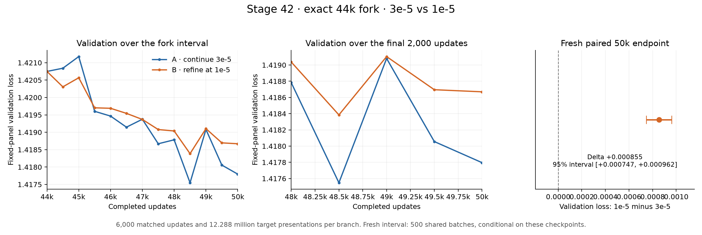
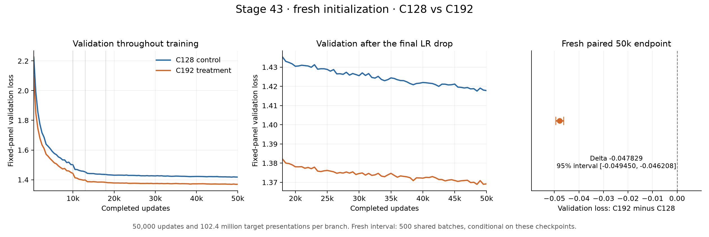
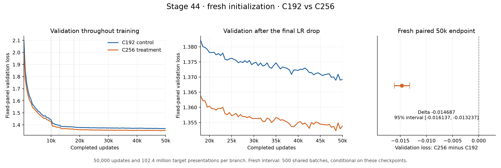

# Character language-model checkpoints

The token-local embedding model remains intact as **Stage 1**. **Stage 2**
adds fixed causal averaging so tokens can communicate, without adding any
trainable parameters.

## Showcase

- [Per-stage results table](docs/stage_results.csv): one row per stage with its best validation loss, whether the change was kept, and a one-line note.
- [Progress chart](figures/showcase_progress.png), generated from that table by `experiments/showcase_progress_plot.py`.
- [What I learned](docs/showcase_lessons.md): five lessons from the 59 stages, in plain English.
- [Text samples](docs/showcase_samples.md): what an untrained model, Stage 10, Stage 26 and the final champion write after the same prompt.
- Caveat: Stages 1-36 use TinyShakespeare and Stage 37 onward use Complete Shakespeare, and evaluation protocols changed over time, so losses are only comparable within a corpus and protocol (see the `metric` column).

## Stage 1: embeddings

This stage separates character lookup from next-character prediction:

```text
(B, T) token IDs
    -> token embeddings + position embeddings
(B, T, C) internal representations
    -> linear language-model head
(B, T, V) logits
```

The code is split by responsibility:

- `data_utils.py` owns the vocabulary, encoding/decoding, data split, and batches.
- `model.py` defines `EmbeddingLanguageModel` and cropped generation.
- `training.py` owns seeding, evaluation, and optimization.
- `train.py` runs the checkpoint and prints its reports.
- `inspect_data.py` only inspects the corpus; importing it no longer trains.
- `test_stage1.py` verifies shapes, parameters, gradients, cropping, and the
  architectural ceiling.

All data paths are resolved relative to these scripts, so commands work from
the repository root.

## Run the checkpoint

Train the token + position model with the Stage 1 defaults:

```powershell
python .\my-gpt\train.py
```

Train the requested A/B experiment with matched token/head initialization and
the same sampled-batch stream. Every reported evaluation also reuses the same
fixed set of sampled blocks, making initial/final losses directly comparable:

```powershell
python .\my-gpt\train.py --compare-positions
```

Run a quick CPU smoke check:

```powershell
python .\my-gpt\train.py --device cpu --max-iters 10 --eval-iters 2 --sample-length 40
```

Run the tests without third-party test tooling:

```powershell
python -m unittest discover -s .\my-gpt -p "test_*.py" -v
```

## What the ceiling check proves

`train.py` constructs two contexts whose final token is identical but whose
earlier tokens are all different. Their final-position logits remain exactly
the same. Each position is still processed independently, so a context window
of eight tokens is only an input-size limit—not eight-token understanding.

There is an additional subtlety in this particular model. Because the head is
linear,

```text
W(token_embedding + position_embedding) + bias
```

is just a token-dependent term plus a position-dependent term. Position does
not create token-to-token communication (or even a token-by-position
interaction). Attention is the next ingredient that will let information move
between positions.

## Stage 2: fixed causal averaging

`causal_average_model.py` defines `CausalAverageLanguageModel`. After adding
token and position embeddings, it applies this fixed lower-triangular
operation:

```text
position 0 <- position 0
position 1 <- average(positions 0, 1)
position 2 <- average(positions 0, 1, 2)
...
```

The `tril` connectivity matrix is a registered buffer, not a parameter. With
the default vocabulary, context, and embedding sizes, both Stage 1 and Stage 2
therefore have exactly 4,481 trainable parameters.

Run the new checkpoint:

```powershell
python .\my-gpt\03_causal_average.py
```

Run a matched comparison against the retained Stage 1 model. Both models use
identical learned-parameter initialization, training batches, and evaluation
batches:

```powershell
python .\my-gpt\03_causal_average.py --compare-embedding
```

Quick CPU smoke comparison:

```powershell
python .\my-gpt\03_causal_average.py --compare-embedding `
    --device cpu --max-iters 10 --eval-iters 2 --sample-length 40
```

The Stage 1 prefix test remains exactly zero. With the default multi-token
context, the Stage 2 prefix test is non-zero because changing an earlier token
now changes the averaged final representation. The weights are still uniform
and fixed; learned Q/K/V self-attention is the intended next checkpoint.

## Stage 3: one causal self-attention head

`04_single_head_attention.py` replaces the fixed average with one learned
query/key/value head. It prints the full Stage 3 diagnostic set: parameter and
shape reports, normalization and causal-mask checks, prefix sensitivity,
initial/final losses, generated text, and the learned attention matrix for an
eight-character input.

Run the full FP32/eager checkpoint (5,000 steps at a `1e-3` learning rate):

```powershell
python .\my-gpt\04_single_head_attention.py
```

Run a quick CPU smoke check:

```powershell
python .\my-gpt\04_single_head_attention.py --device cpu `
    --max-iters 10 --eval-iters 2 --sample-length 40
```

The default attention probe is `"To be or"`. Use `--attention-text` to inspect
another non-empty string no longer than `block_size` whose characters occur in
the training corpus.

## Stage 4: four causal self-attention heads

`05_multi_head_attention.py` splits the 32 representation channels across four
independent heads. Each head produces eight channels and its own causal
attention matrix; concatenating the four outputs restores `(B,T,32)`. There is
still no output projection, residual connection, feed-forward network, or
LayerNorm, so the experiment isolates multi-head routing while retaining the
same 7,553 trainable parameters as Stage 3.

Run the full checkpoint with the Stage 3 training conditions:

```powershell
python .\my-gpt\05_multi_head_attention.py
```

Run a quick CPU smoke check:

```powershell
python .\my-gpt\05_multi_head_attention.py --device cpu `
    --max-iters 10 --eval-iters 2 --sample-length 40
```

The report includes per-head Q/K/V shapes, combined attention weights with
shape `(B,H,T,T)`, row-sum and causal-mask checks, train/validation loss,
generated text, all four learned attention matrices, and each head's routing
distribution for the final character of `"To be or"`.

## Stage 5: position-wise feed-forward network

`05_feed_forward.py` keeps the four causal attention heads and adds a ReLU
feed-forward network after them:

```text
(B,T,32) -> Linear(32,128) -> ReLU -> Linear(128,32) -> (B,T,32)
```

The FFN is applied independently at every position. This stage intentionally
still has no residual connection, LayerNorm, dropout, attention output
projection, or GELU. With the default dimensions, the FFN contributes 8,352
parameters and the complete model has 15,905 trainable parameters.

Run the full 5,000-step checkpoint:

```powershell
python .\my-gpt\05_feed_forward.py
```

Run a quick CPU smoke check:

```powershell
python .\my-gpt\05_feed_forward.py --device cpu `
    --max-iters 10 --eval-iters 2 --sample-length 40
```

The report prints the `(B,T,4C)` hidden shape, verifies attention remains
normalized and causal, and performs a direct FFN locality experiment: changing
only position 0 must leave the FFN outputs at positions 1 through 7 exactly
unchanged.

## Stage 6: residual connections

`06_residual_connections.py` preserves the Stage 5 attention and FFN modules
and changes only how their outputs update the representation:

```python
x = x + self.sa(x)
x = x + self.ffwd(x)
```

Both additions preserve `(B,T,C)`, add no trainable parameters, and leave the
complete model at exactly 15,905 parameters. The checkpoint reports `x0`, both
sublayer updates, both post-residual representations, and their norms. It also
retains the causal-attention and position-wise FFN checks from Stage 5.

Run the full 5,000-step checkpoint with the same controlled settings as Stage
5:

```powershell
python .\my-gpt\06_residual_connections.py
```

Run a quick CPU smoke check:

```powershell
python .\my-gpt\06_residual_connections.py --device cpu `
    --max-iters 10 --eval-iters 2 --sample-length 40
```

`test_residual_connections.py` additionally proves the exact two-addition
dataflow, the zero-update identity behavior, the direct residual gradient
route, unchanged parameter count, and causal masking.

## Stage 7: pre-norm LayerNorm and GELU

`07_layer_norm.py` adds two learned LayerNorms around the Stage 6 residual
branches and switches the feed-forward activation from ReLU to GELU:

```python
x = x + self.sa(self.ln1(x))
x = x + self.ffwd(self.ln2(x))
```

This is a pre-norm arrangement: each complicated sublayer receives a
normalized `(B,T,C)` view, while the residual stream itself keeps a direct
identity path. LayerNorm acts independently on the `C` features of every
token and contributes a learned scale and bias of shape `(C,)`. With two
LayerNorms and the default `C=32`, Stage 7 adds 128 trainable parameters, for
16,033 total. GELU changes the activation behavior but adds no parameters.

Run the full 5,000-step checkpoint with the same controlled settings as Stage
6:

```powershell
python .\my-gpt\07_layer_norm.py
```

Run a quick CPU smoke check:

```powershell
python .\my-gpt\07_layer_norm.py --device cpu `
    --max-iters 10 --eval-iters 2 --sample-length 40
```

The report includes a standalone LayerNorm experiment, all pre-norm and
residual shapes, one token's mean and population variance before and after
`ln1`, initial LayerNorm affine parameters, residual magnitudes, train and
validation loss, and generated text. `test_layer_norm.py` verifies the exact
pre-norm dataflow, feature-axis normalization without token or batch mixing,
GELU, causal masking, residual identity path, gradients, and the 16,033
parameter count.

## Stage 8: stacked Transformer blocks

`08_transformer_block.py` packages the Stage 7 pre-norm attention and FFN
branches into a reusable `Block`, gives multi-head attention its learned
output projection, and stacks four independent blocks:

```text
token + position embeddings
    -> Block 0 -> Block 1 -> Block 2 -> Block 3
    -> final LayerNorm
    -> language-model head
```

Each block retains the two residual updates:

```python
x = x + self.sa(self.ln1(x))
x = x + self.ffwd(self.ln2(x))
```

The attention output projection mixes the concatenated head slices before
they re-enter the residual stream. At the default `C=32`, one block has
12,608 parameters: 3,072 Q/K/V weights, 1,056 output-projection parameters,
8,352 FFN parameters, and 128 LayerNorm parameters. With four blocks, the
actual 65-character vocabulary, final LayerNorm, embeddings, and LM head, the
complete model has exactly 54,977 trainable parameters.

Run the full 5,000-step checkpoint on the automatically selected accelerator:

```powershell
python .\my-gpt\08_transformer_block.py
```

Run a quick CPU smoke check:

```powershell
python .\my-gpt\08_transformer_block.py --device cpu `
    --max-iters 10 --eval-iters 2 --sample-length 40
```

The report records the embedding and every block's `(B,T,C)` shape and
residual-stream norm, the final LayerNorm norm, causal attention checks, and
one first-head query gradient from every block before training. With the
default `(32,8,32)` diagnostic batch, the initial final-LayerNorm norm should
be close to `sqrt(8192) = 90.51`.

`test_transformer_block.py` verifies the projected multi-head path, exact
pre-norm block flow, residual identity behavior, independent block instances,
the final normalization, end-to-end causality, gradient propagation through
all four blocks, context cropping, validation errors, and both exact parameter
budgets.

## Stage 9: scale context from 8 to 64

`09_context_length.py` reuses the exact Stage 8 model and changes the default
context length only:

```text
B=32, T=64, C=32, H=4, D=8, L=4
```

The position embedding grows from `(8,32)` to `(64,32)`, and each head's
causal mask grows from `(8,8)` to `(64,64)`. The model therefore has 56,769
trainable parameters--only 1,792 more than Stage 8--while each full attention
matrix contains 64 times as many relationships.

Run the full FP32/eager XPU experiment:

```powershell
python .\my-gpt\09_context_length.py --device xpu
```

Run a quick CPU smoke check while keeping the benchmark inside the shortened
training budget:

```powershell
python .\my-gpt\09_context_length.py --device cpu `
    --max-iters 10 --eval-iters 2 --sample-length 40 `
    --benchmark-warmup 2 --benchmark-steps 5
```

The benchmark warms up on 20 optimizer steps and times the following 100 real
training steps by default. Those steps are part of `max_iters`; benchmarking
does not add updates, consume extra training batches, or reset AdamW state.
The timer covers batch construction and transfer, forward pass, loss,
backward pass, and optimizer update. Accelerator synchronization brackets the
timed window. On XPU, the report also records peak PyTorch allocated and
reserved memory. Pass `--benchmark-steps 0` to disable it.

The first full run on the Intel Arc 140T with PyTorch 2.13.0+xpu produced:

| Run | T | C | H | L | Params | train loss | val loss | bench seconds | iter/s | tokens/s | allocated MB | reserved MB |
| --- | -: | -: | -: | -: | -----: | ---------: | -------: | ------------: | -----: | -------: | -----------: | ----------: |
| Stage 8 | 8 | 32 | 4 | 4 | 54,977 | 1.9500 | 2.0425 | ... | ... | ... | ... | ... |
| Stage 9 | 64 | 32 | 4 | 4 | 56,769 | 1.7684 | 1.9225 | 2.739 | 36.514 | 74,780.672 | 27.698 | 50.000 |

Both runs used 5,000 optimizer steps, but they did not use the same token
budget: Stage 8 trained on 1.28 million token positions and Stage 9 trained on
10.24 million. The lower Stage 9 validation loss therefore reflects the
combined experiment of longer context and eight times as many token
predictions, not a context-only causal estimate.

The seeded 500-character Stage 9 sample was:

```text
siclan where make in more stonvant hirs
Than what therk thengts.
Buth soon ome, he mors Enguman cong
With tracters art a lequingly ever armlian
His is himselff, no?


DUKE VOLINGBY:

Hidjour you twaph'd! be coite Laray vurrour?
So mun mark he master, away of this I, he's
Wknamings I havan: dithtly and bloody me
not umzemand, if joil aurved come,
Engel have crothinngour, sir, by reast we
Bustsizers, dor mornighore do binss!
And park thy father vachile, and whose,
But all the no dobldest!

ISABET:
```

## Stage 10: scale width from 32 to 64

`10_scale_width.py` retains the Stage 9 token budget and context, then doubles
only the residual-stream width:

```text
B=32, T=64, C=64, H=4, D=16, FF=256, L=4
```

The attention maps remain `(32,4,64,64)`, because their final two dimensions
depend on context length. The token representations become `(32,64,64)`, each
head's Q/K/V projection becomes `(32,64,16)`, and the FFN grows from
`32 -> 128 -> 32` to `64 -> 256 -> 64`.

Each block has 49,792 parameters and the complete 65-character model has
exactly 211,777:

```text
token embedding       4,160
position embedding    4,096
four blocks          199,168
final LayerNorm         128
LM head               4,225
                     -------
total                211,777
```

Run the full FP32/eager XPU experiment:

```powershell
python .\my-gpt\10_scale_width.py --device xpu
```

Run a quick CPU smoke check:

```powershell
python .\my-gpt\10_scale_width.py --device cpu `
    --batch-size 2 --max-iters 2 --eval-interval 1 --eval-iters 1 `
    --sample-length 40 --benchmark-warmup 1 --benchmark-steps 2 `
    --checkpoint-path .\my-gpt\checkpoints\stage_10_smoke.pt
```

Stage 10 benchmarks a separately initialized, disposable model and optimizer.
Its warmup and timed updates therefore cannot change the model used for the
5,000-step experiment. The actual model is reseeded before construction so
benchmark RNG consumption cannot alter its initialization either.

Every periodic validation result is compared using a strict improvement rule.
The separate final evaluation at step 5,000 is also considered, and the best
weights are written to `my-gpt/checkpoints/stage_10_best_model.pt`. Checkpoint
artifacts are ignored by Git. The final report records the full architecture,
parameter count, final train/validation losses, generalization gap, best
validation loss and step, throughput, allocator peaks, and generated sample.

The first full Stage 10 run on the Intel Arc 140T produced:

| Run | T | C | H | L | Params | train loss | val loss | gap | best val / step | iter/s | tokens/s | allocated MB | reserved MB |
| --- | -: | -: | -: | -: | -----: | ---------: | -------: | --: | --------------: | -----: | -------: | -----------: | ----------: |
| Stage 10 | 64 | 64 | 4 | 4 | 211,777 | 1.4930 | 1.6800 | 0.1870 | 1.6800 / 5,000 | 15.487 | 31,717.613 | 46.270 | 54.000 |

The Stage 9 row above used its legacy in-training timing window, whereas Stage
10 benchmarks a disposable model before the experiment. Both time the same
optimizer-step work after 20 warmups, but their surrounding harness placement
differs, so the exact throughput ratio is informative rather than a perfectly
matched A/B measurement. Future stages use the independent Stage 10 method.

The seeded 500-character sample from the best checkpoint was:

```text
Me lack, thou have beard a good exture.

TANIrch:
Bredk thoughts, in a ofuld right.
Thou wounder, thou would at thurn arms But of here,

JUlie aloner:
A bloody, sir, go weeet alonion
In pour you telposienteds,
That bay very wine me: nor here horself,
But usir I will he sayk; my respect!

Second ELAUREL:
With meaning may arrow to like.

FRIAR go:
To be had into thy hough smord your stood
Thousime of dartion, good to things,
And part thy fathor vain's angelio,
And distancer them I come, Darls: bur
```

## Stage 11: train the same model longer

`11_train_longer.py` keeps the complete Stage 10 setup unchanged and increases
only the training duration from 5,000 to 10,000 optimizer steps:

```text
B=32, T=64, C=64, H=4, D=16, FF=256, L=4, learning_rate=1e-3
```

The existing `stage_10_best_model.pt` contains only a raw model state dict. It
does not contain AdamW's moving averages, a training step, or the prior best
validation loss. Loading it with a new optimizer would therefore be a warm
start, not an exact continuation. To preserve the one-variable experiment,
the default Stage 11 command performs a fresh seeded run through all 10,000
steps. Its measurements at steps 4,000, 4,500, and 5,000 exactly reproduced
the Stage 10 values.

Run the clean FP32/eager XPU experiment:

```powershell
python .\my-gpt\11_train_longer.py --device xpu
```

Stage 11 checkpoints are fully resumable. Resume one to a higher absolute
target step with:

```powershell
python .\my-gpt\11_train_longer.py --device xpu `
    --max-iters 15000 `
    --resume-from .\my-gpt\checkpoints\stage_11_best_checkpoint.pt
```

The saved payload contains the model and optimizer states, absolute step, best
loss and step, training-batch generator state, CPU and accelerator RNG states,
architecture and training metadata, a corpus fingerprint, and optimizer-lineage
provenance. Loading validates the metadata and restores AdamW's state tensors
to the model's device.

On XPU, the saver synchronizes the device and copies an owned snapshot of every
model and optimizer tensor to CPU before calling `torch.save`. This prevents
asynchronous device storage from producing a checkpoint whose scalar metadata
is newer than its tensor contents. The test suite covers repeated XPU saves and
reloads, including non-empty AdamW state and RNG restoration.

A weights-only checkpoint is rejected by default. The explicitly confounded
alternative remains available under an opt-in flag and writes to a separate
path:

```powershell
python .\my-gpt\11_train_longer.py --device xpu `
    --resume-from .\my-gpt\checkpoints\stage_10_best_model.pt `
    --allow-optimizer-restart --legacy-step 5000 `
    --checkpoint-path `
        .\my-gpt\checkpoints\stage_11_restarted_adamw_best_checkpoint.pt
```

That mode is reported as `Stage-10 weights + restarted AdamW state`, and the
restart provenance remains in subsequent full checkpoints.

The clean Stage 11 run produced this fixed-batch evaluation curve:

| Step | Train loss | Validation loss | Gap | Best validation / step |
| ---: | ---: | ---: | ---: | ---: |
| 0 | 4.3394 | 4.3465 | 0.0071 | 4.3465 / 0 |
| 500 | 2.2155 | 2.2332 | 0.0177 | 2.2332 / 500 |
| 1,000 | 1.9576 | 2.0240 | 0.0664 | 2.0240 / 1,000 |
| 1,500 | 1.7871 | 1.9079 | 0.1208 | 1.9079 / 1,500 |
| 2,000 | 1.6989 | 1.8478 | 0.1489 | 1.8478 / 2,000 |
| 2,500 | 1.6294 | 1.7787 | 0.1493 | 1.7787 / 2,500 |
| 3,000 | 1.5853 | 1.7522 | 0.1668 | 1.7522 / 3,000 |
| 3,500 | 1.5585 | 1.7272 | 0.1687 | 1.7272 / 3,500 |
| 4,000 | 1.5287 | 1.7100 | 0.1813 | 1.7100 / 4,000 |
| 4,500 | 1.5121 | 1.6919 | 0.1798 | 1.6919 / 4,500 |
| 5,000 | 1.4930 | 1.6800 | 0.1870 | 1.6800 / 5,000 |
| 5,500 | 1.4877 | 1.6827 | 0.1950 | 1.6800 / 5,000 |
| 6,000 | 1.4698 | 1.6603 | 0.1905 | 1.6603 / 6,000 |
| 6,500 | 1.4564 | 1.6542 | 0.1977 | 1.6542 / 6,500 |
| 7,000 | 1.4486 | 1.6520 | 0.2034 | 1.6520 / 7,000 |
| 7,500 | 1.4414 | 1.6486 | 0.2073 | 1.6486 / 7,500 |
| 8,000 | 1.4300 | 1.6401 | 0.2101 | 1.6401 / 8,000 |
| 8,500 | 1.4270 | 1.6314 | 0.2044 | 1.6314 / 8,500 |
| 9,000 | 1.4177 | 1.6361 | 0.2184 | 1.6314 / 8,500 |
| 9,500 | 1.4134 | 1.6257 | 0.2123 | 1.6257 / 9,500 |
| 10,000 | 1.4100 | 1.6167 | 0.2068 | 1.6167 / 10,000 |

Validation improved by `0.0633` from step 5,000 to step 10,000, and the final
measurement was a fresh best. The gap grew from `0.1870` to `0.2068`, but the
validation curve did not show a sustained reversal: the isolated increases at
5,500 and 9,000 were followed by lower losses. Stage 10 was undertrained, and
this run does not provide evidence for adding dropout next.

The constant learning rate also has not produced a settled plateau. Before
another capacity change, the most informative Stage 12 would be a controlled
learning-rate experiment: fork the exact step-10,000 checkpoint into a constant
`1e-3` continuation and a decayed-learning-rate continuation, with matching
batch and evaluation streams.

The independent XPU benchmark measured 22.360 iterations/s, 45,792.771
tokens/s, 46.270 MB peak allocated memory, and 54.000 MB peak reserved memory.
The best checkpoint is `my-gpt/checkpoints/stage_11_best_checkpoint.pt`; the
complete console record is `my-gpt/checkpoints/stage_11_training.log`.

The seeded 500-character sample from the step-10,000 checkpoint was:

```text
Me lanchery come, to morney.
That therefold troubly, dared not suding for any
To you, I and my envented on rough murre and Butoor't;
Such mlaint in itset love, you?

KING RICHARD II:
I can die more!

CATESBY:
I can band with thee held make he made heeds?

GLOUCESTER:
Not tk this so were, for thy countinusing me
Bagy man a powery like.

VOLUMNIA:
To the wretched is hour, sir, by this? I do buried
on drawn's world to the wretchers all brother?

FRIAR LAURENCE:
Set you all the news about are smet m
```

## Stage 12: controlled learning-rate drop

`12_learning_rate_drop.py` turns the proposed learning-rate test into one
paired experiment. It loads the exact Stage 11 step-10,000 checkpoint twice
and advances each independent branch to the same absolute target step:

```text
                              Stage 11 source
                       step 10,000, lr = 1e-3
                                  |
                   +--------------+--------------+
                   |                             |
             control branch                LR-drop branch
               lr = 1e-3                     lr = 3e-4
                   |                             |
             step 15,000                   step 15,000
```

The architecture and other training defaults remain unchanged:

```text
B=32, T=64, C=64, H=4, D=16, FF=256, L=4
source_step=10000, max_iters=15000, eval_interval=500, eval_iters=100
```

Because `max_iters` is an absolute target, each branch performs exactly 5,000
additional optimizer updates, numbered 10,001 through 15,000. Run the default
FP32/eager XPU experiment with:

```powershell
python .\my-gpt\12_learning_rate_drop.py --device xpu
```

The default checkpoint paths are:

```text
source:   my-gpt/checkpoints/stage_11_best_checkpoint.pt
control:  my-gpt/checkpoints/stage_12_control_best_checkpoint.pt
LR drop:  my-gpt/checkpoints/stage_12_lr_drop_best_checkpoint.pt
```

They can be changed with `--source-checkpoint`,
`--control-checkpoint-path`, and `--lr-drop-checkpoint-path`. The fork and
learning-rate defaults can likewise be changed with `--source-step`,
`--max-iters`, `--source-learning-rate`, `--control-learning-rate`, and
`--reduced-learning-rate`. The control rate must equal the source rate, and
the reduced rate must be lower than the control rate.

### Exact branch restoration

Each branch is constructed and restored independently from the source file.
The loader first validates the Stage 11 architecture, training metadata, and
corpus fingerprint, then restores the model weights, AdamW state, explicit
training-batch generator, and saved RNG state. Only after
`optimizer.load_state_dict(...)` has restored AdamW's parameter groups and
moment estimates does Stage 12 set every parameter group's learning rate:

```python
optimizer.load_state_dict(checkpoint["optimizer_state_dict"])

for param_group in optimizer.param_groups:
    param_group["lr"] = branch_learning_rate
```

The order matters because loading the optimizer state also restores its saved
`1e-3` learning rate. Applying the override first would silently undo the
intended LR drop when the checkpoint was loaded. The control branch writes
`1e-3` back, while the LR-drop branch writes `3e-4`; the AdamW first- and
second-moment estimates and step counters remain restored in both cases.

Both branches begin with the same model, optimizer history, training-batch
generator state, and global RNG state. They therefore consume matching
training batches after the fork. The learning rate is the only intentional
training difference.

### Fixed evaluation panel

Stage 11 and Stage 12 do not draw a fresh validation panel at every reported
step. `evaluate_on_fixed_batches` recreates the evaluation generator from the
same seed for every measurement, so all measurements and both branches use the
same 100 sampled training batches and the same 100 sampled validation batches
by default.

This corrects an easy misreading of the Stage 11 curve: its isolated increases
at steps 5,500 and 9,000 are not draw-to-draw noise from newly sampled
evaluation batches. They are changes in model loss on a fixed, finite panel.
That panel is still an estimate rather than the full corpus, but holding it
fixed makes the Stage 12 branch comparison more direct.

### Checkpoint safety and provenance

Before training, Stage 12 requires a full checkpoint at the requested source
step whose `best_step` equals its saved `step`. It also requires non-empty
AdamW moment state, a saved training-generator state, a CPU RNG state, known
optimizer provenance, and no recorded optimizer restart. A weights-only or
confounded warm-start checkpoint is rejected.

The source, control-output, and LR-drop-output paths must all resolve to
different files. Stage 12 hashes the source before training and verifies the
same hash after both branches, preventing either output from silently replacing
the common fork. Each branch output is materialized at step 10,000 under its
active learning rate before its first new update, so a valid resumable output
still exists if that branch never improves on the source validation loss.

Branch checkpoints retain the complete Stage 11 resumable payload and add:

```text
checkpoint_kind = "best"
experiment.stage
experiment.branch
experiment.source_checkpoint_sha256
experiment.source_step
experiment.source_learning_rate
experiment.branch_learning_rate
experiment.learning_rate_changed
```

The standard optimizer state and `training_config.learning_rate` also record
the branch's active rate. The generated samples use each branch's final
step-15,000 model with the same prompt, seed, and token count; the saved
checkpoint for each branch remains the best fixed-panel validation state seen
through that branch.

### Results

The full XPU experiment showed a clear advantage for lowering the learning
rate. At the equal-budget step-15,000 endpoint, the `3e-4` branch had a
validation loss `0.0201` below the `1e-3` control. It also had the lower train
loss, so the result is not a regularization trade in which the reduced rate
merely accepts a worse training fit.

| Metric | Control (`1e-3`) | LR drop (`3e-4`) | Drop - control |
| --- | ---: | ---: | ---: |
| Final train loss at step 15,000 | 1.3743 | **1.3470** | -0.0273 |
| Final validation loss at step 15,000 | 1.6029 | **1.5829** | -0.0201 |
| Final generalization gap | 0.2286 | 0.2358 | +0.0072 |
| Best validation loss / step | 1.5989 / 13,500 | **1.5791 / 13,000** | -0.0198 |

The complete paired fixed-panel curve was:

| Step | Control train | Control val | LR-drop train | LR-drop val |
| ---: | ---: | ---: | ---: | ---: |
| 10,000 | 1.4100 | 1.6167 | 1.4100 | 1.6167 |
| 10,500 | 1.4031 | 1.6134 | 1.3699 | 1.5845 |
| 11,000 | 1.4024 | 1.6083 | 1.3641 | 1.5812 |
| 11,500 | 1.3965 | 1.6160 | 1.3606 | 1.5864 |
| 12,000 | 1.3908 | 1.6097 | 1.3572 | 1.5819 |
| 12,500 | 1.3897 | 1.6132 | 1.3556 | 1.5846 |
| 13,000 | 1.3811 | 1.6061 | 1.3512 | **1.5791** |
| 13,500 | 1.3803 | **1.5989** | 1.3501 | 1.5815 |
| 14,000 | 1.3785 | 1.6068 | 1.3474 | 1.5815 |
| 14,500 | 1.3766 | 1.6061 | 1.3466 | 1.5843 |
| 15,000 | 1.3743 | 1.6029 | 1.3470 | 1.5829 |

The control still improved on the Stage 11 source, from `1.6167` to `1.6029`
at the final step, so `1e-3` had not stopped making progress. The stronger
result is that the restored AdamW optimizer made substantially finer progress
immediately after its global step size was reduced: by step 10,500 the
LR-drop branch was already at `1.5845`. This is direct evidence that `1e-3`
had become too large for efficient late-stage refinement, while `3e-4` was
not so small that useful learning stopped.

```text
control checkpoint: my-gpt/checkpoints/stage_12_control_best_checkpoint.pt
LR-drop checkpoint: my-gpt/checkpoints/stage_12_lr_drop_best_checkpoint.pt
complete console record: my-gpt/checkpoints/stage_12_training.log
```

## Stage 13: second controlled learning-rate drop

`13_second_learning_rate_drop.py` repeats the paired fork after Stage 12. It
loads the exact `3e-4` branch winner at step 13,000 twice and advances both
independent continuations to the same absolute target:

```text
                         Stage 12 LR-drop winner
                          step 13,000, lr = 3e-4
                                    |
                     +--------------+--------------+
                     |                             |
               control branch              second-drop branch
                 lr = 3e-4                      lr = 1e-4
                     |                             |
               step 18,000                   step 18,000
```

The architecture and all other defaults remain fixed:

```text
B=32, T=64, C=64, H=4, D=16, FF=256, L=4
source_step=13000, max_iters=18000, eval_interval=500, eval_iters=100
```

Run the full FP32/eager XPU experiment with:

```powershell
python .\my-gpt\13_second_learning_rate_drop.py --device xpu
```

The default artifacts are:

```text
source:       my-gpt/checkpoints/stage_12_lr_drop_best_checkpoint.pt
control:      my-gpt/checkpoints/stage_13_control_best_checkpoint.pt
second drop:  my-gpt/checkpoints/stage_13_lr_drop_best_checkpoint.pt
console log:  my-gpt/checkpoints/stage_13_training.log
```

Stage 13 adds a stricter source gate to the Stage 12 safeguards. The source
must be a full best checkpoint with `step == best_step == 13000`, uninterrupted
AdamW provenance, non-empty moment state, the saved batch-generator and RNG
states, an active `3e-4` LR in both its training metadata and every optimizer
parameter group, and explicit provenance identifying it as Stage 12's
`lr_drop` branch. An XPU or CUDA run also requires the matching saved device
RNG state.

Each branch independently restores that source before its LR is overwritten.
The source is hashed before and after validation, around each branch load, and
after training. Stage 13 checkpoints use new paths and record
`experiment.stage = 13` plus the Stage 12 source hash, source branch, source
step, source LR, and active branch LR. The source SHA-256 remained:

```text
46eb29ebb24e4ed18d1271f80447e873e99f822cefc969a876a420383238b88f
```

### Results

The second reduction won on both training and validation loss. At the equal
step-18,000 endpoint, `1e-4` was `0.0057` lower on train loss and `0.0093`
lower on validation loss. Both branches selected step 17,000 as their best
fixed-panel checkpoint, where the second drop led by `0.0082` validation-loss
units.

| Metric | Control (`3e-4`) | Second drop (`1e-4`) | Drop - control |
| --- | ---: | ---: | ---: |
| Final train loss at step 18,000 | 1.3358 | **1.3301** | -0.0057 |
| Final validation loss at step 18,000 | 1.5803 | **1.5710** | -0.0093 |
| Final generalization gap | 0.2445 | **0.2410** | -0.0035 |
| Best validation loss / step | 1.5770 / 17,000 | **1.5688 / 17,000** | -0.0082 |

The complete paired fixed-panel curve was:

| Step | Control train | Control val | Second-drop train | Second-drop val |
| ---: | ---: | ---: | ---: | ---: |
| 13,000 | 1.3512 | 1.5791 | 1.3512 | 1.5791 |
| 13,500 | 1.3501 | 1.5815 | 1.3390 | 1.5718 |
| 14,000 | 1.3474 | 1.5815 | 1.3376 | 1.5715 |
| 14,500 | 1.3466 | 1.5843 | 1.3358 | 1.5715 |
| 15,000 | 1.3470 | 1.5829 | 1.3356 | 1.5729 |
| 15,500 | 1.3436 | 1.5799 | 1.3338 | 1.5694 |
| 16,000 | 1.3419 | 1.5815 | 1.3330 | 1.5707 |
| 16,500 | 1.3397 | 1.5803 | 1.3323 | 1.5715 |
| 17,000 | 1.3384 | **1.5770** | 1.3316 | **1.5688** |
| 17,500 | 1.3373 | 1.5774 | 1.3310 | 1.5708 |
| 18,000 | 1.3358 | 1.5803 | 1.3301 | 1.5710 |

The control's measurements through step 15,000 exactly reproduce the prior
Stage 12 `3e-4` branch to four decimals. This provides an end-to-end check that
the model, optimizer, and training-batch stream resumed from the intended
step-13,000 state.

Like the first reduction, `1e-4` did not improve validation by accepting a
worse training fit: it found lower-loss parameters on both datasets. The
second decay therefore still addressed an optimization limitation. Its return
was smaller, however. Most of the validation gain appeared in the first 500
steps, and the best `1e-4` result was only `0.0030` below its step-13,500
measurement after another 3,500 updates. Training loss continued downward
after the best step while validation rose slightly at 17,500 and 18,000.

That is stronger evidence of diminishing optimization returns and a developing
generalization plateau, although two post-best measurements are not enough to
declare definitive overfitting. Generated text remains a qualitative sample;
both branches use the same newline prompt, seed, sampling procedure, and token
count, while the loss curves remain the comparison metric.

## Stage 14: controlled residual-path dropout

`14_dropout.py` tests whether regularization helps after the Stage 13
optimization gains have flattened. It loads the exact Stage 13 `1e-4` winner
at step 17,000 twice and advances both branches to step 22,000:

```text
                         Stage 13 LR-drop winner
                          step 17,000, lr = 1e-4
                                    |
                     +--------------+--------------+
                     |                             |
               control branch                dropout branch
                    p = 0.0                       p = 0.1
                     |                             |
               step 22,000                   step 22,000
```

Dropout is applied only after the attention output projection and after the
FFN's final `C`-dimensional projection, immediately before each residual
addition:

```text
attention heads -> output projection -> dropout -> residual addition
FFN hidden GELU -> final projection   -> dropout -> residual addition
```

There are two `nn.Dropout` modules per block and eight in the four-block
model. They contain no parameters or persistent buffers, so the Stage 13 model
state loads strictly without renaming any tensor, AdamW's parameter order is
unchanged, and both branches still have exactly 211,777 trainable parameters.
The probability and placement are written explicitly into Stage 14 checkpoint
metadata because they cannot be recovered from the state dict itself.

Run the complete FP32/eager XPU experiment with:

```powershell
python .\my-gpt\14_dropout.py --device xpu
```

The default run first evaluates the Stage 12 winner and both Stage 13 winners
on 500 newly sampled validation batches. It then performs the paired Stage 14
fork. Pass `--precise-eval-iters 0` to skip the preflight. A short CPU plumbing
check can use an absolute target just above the fork:

```powershell
python .\my-gpt\14_dropout.py --device cpu `
    --max-iters 17001 --precise-eval-iters 2 --sample-length 0 `
    --control-checkpoint-path .\my-gpt\checkpoints\stage_14_control_smoke.pt `
    --dropout-checkpoint-path .\my-gpt\checkpoints\stage_14_dropout_smoke.pt
```

### Precise validation preflight

The fixed 100-batch panel remains the checkpoint-selection and training-curve
metric. Because those samples have been reused across several stages, Stage 14
also uses a separate validation-only panel of 500 batches with seed 1,340. All
three checkpoints see the same new batches, enabling paired loss differences.
This reduces sampling uncertainty but is still a new sample from the existing
validation split, not a third held-out dataset.

| Checkpoint | Step | Fixed-panel loss | Fresh 500-batch loss | SE |
| --- | ---: | ---: | ---: | ---: |
| Stage 12 `3e-4` winner | 13,000 | 1.5791 | 1.579669 | 0.002627 |
| Stage 13 `3e-4` control | 17,000 | 1.5770 | 1.576908 | 0.002684 |
| Stage 13 `1e-4` winner | 17,000 | 1.5688 | **1.569129** | 0.002672 |

The paired deltas were more precise than the standalone standard errors:

| Paired comparison | Mean delta | Paired SE | 95% CI |
| --- | ---: | ---: | ---: |
| Stage 13 control - Stage 12 winner | -0.002761 | 0.000353 | [-0.003452, -0.002069] |
| Stage 13 `1e-4` - Stage 13 control | **-0.007779** | 0.000178 | **[-0.008128, -0.007430]** |

The fresh panel therefore confirms rather than reverses the Stage 13 result.
The second learning-rate drop retains a clear advantage over its paired
control, and both Stage 13 branches improve on the Stage 12 source in this
larger measurement.

### Exact fork and train/eval behavior

Each branch independently restores the same model tensors, all 94 non-empty
AdamW state entries, the explicit training-batch generator, and the saved CPU
and XPU RNG states. Both branches receive the same post-fork training batches.
The `p=0.1` branch then consumes global XPU RNG for masks; that divergence is
the intended treatment rather than a loss of pairing.

Every reported train and validation measurement calls `model.eval()` and then
restores the previous mode. Dropout is therefore off for the complete table
below. Training calls `model.train()` explicitly, so dropout is active only
during optimizer updates. The source checkpoint remained unchanged at SHA-256:

```text
650eb2399a29bced5fa5398dc129228e15e2f4a68fb09db9c44a5400b1f739f1
```

### Results

The control made a small further improvement. Residual dropout introduced at
step 17,000 caused a large loss increase and did not recover within 5,000
updates:

| Step | Control train | Control val | Dropout train | Dropout val |
| ---: | ---: | ---: | ---: | ---: |
| 17,000 | 1.3316 | 1.5688 | 1.3316 | 1.5688 |
| 17,500 | 1.3310 | 1.5708 | 1.4535 | 1.6283 |
| 18,000 | 1.3301 | 1.5710 | 1.4491 | 1.6279 |
| 18,500 | 1.3300 | 1.5713 | 1.4479 | 1.6285 |
| 19,000 | 1.3283 | 1.5700 | 1.4476 | 1.6284 |
| 19,500 | 1.3270 | 1.5693 | 1.4449 | 1.6260 |
| 20,000 | 1.3268 | 1.5683 | 1.4438 | **1.6250** |
| 20,500 | 1.3265 | 1.5706 | 1.4433 | 1.6271 |
| 21,000 | 1.3249 | **1.5682** | 1.4419 | 1.6252 |
| 21,500 | 1.3239 | 1.5709 | 1.4416 | 1.6294 |
| 22,000 | 1.3237 | 1.5686 | 1.4403 | 1.6266 |

| Metric | Control (`p=0.0`) | Dropout (`p=0.1`) | Dropout - control |
| --- | ---: | ---: | ---: |
| Final train loss at step 22,000 | **1.3237** | 1.4403 | +0.1166 |
| Final validation loss at step 22,000 | **1.5686** | 1.6266 | +0.0581 |
| Final generalization gap | 0.2449 | **0.1864** | -0.0585 |
| Best validation loss / step | **1.5682 / 21,000** | 1.5688 / 17,000 | +0.0007 |

The smaller dropout-branch gap is not evidence of better generalization here.
Its measured train loss worsened roughly twice as much as its validation loss,
and both losses are substantially above the control. No post-fork dropout
checkpoint beat the common source, so the saved dropout "best" remains the
step-17,000 source weights with explicit `p=0.1` runtime metadata.

A post-run evaluation of the two saved best checkpoints on the same fresh
500-batch panel also favors the control:

| Best checkpoint | Fresh loss | SE |
| --- | ---: | ---: |
| Stage 14 control, step 21,000 | **1.566965** | 0.002689 |
| Stage 14 dropout, step 17,000 | 1.569129 | 0.002672 |

The paired `dropout - control` delta is `+0.002164 +/- 0.000202 SE`, with a
95% interval of `[+0.001767, +0.002561]`.

Stage 14 therefore rejects adding `p=0.1` residual-path dropout during
late-stage refinement of this already-trained model. It does not establish
that dropout would hurt if present from step zero, and it does not test a
smaller probability or a different placement. Those require separate
experiments rather than reinterpretation of this fork.

```text
control checkpoint: my-gpt/checkpoints/stage_14_control_best_checkpoint.pt
dropout checkpoint: my-gpt/checkpoints/stage_14_dropout_best_checkpoint.pt
complete console record: my-gpt/checkpoints/stage_14_training.log
post-run precise record: my-gpt/checkpoints/stage_14_posthoc_precise.log
```

## Stage 15: residual dropout from initialization

`15_dropout_from_initialization.py` tests the question left open by Stage 14:
does `p=0.1` residual-path dropout help when it is present for the model's
entire training run? The script creates one seeded model state on CPU, clones
that exact state into both branches, and constructs a separate AdamW optimizer
for each:

```text
                     one cloned initialization
                               |
                    +----------+----------+
                    |                     |
              control, p=0.0        dropout, p=0.1
                    |                     |
                    +--- same batches ---+
```

The architecture remains `B=32, T=64, C=64, H=4, D=16, FF=256, L=4` by
default. Dropout remains in the two Stage 14 locations only: after the
attention output projection and after the FFN output projection, immediately
before their residual additions. Attention-weight dropout is not added.

Each branch owns an independent CPU batch generator initialized with the same
seed (`seed + 1` by default), so both consume the same training examples even
though the dropout branch also samples masks. After model construction and
state loading, the global CPU and accelerator RNGs are reset to the same
training seed (`seed + 3` by default) immediately before each branch begins
its optimizer updates.

Both branches use the discovered learning-rate schedule, indexed by the
zero-based optimizer update:

```text
[0, 10000)       lr = 1e-3
[10000, 13000)   lr = 3e-4
[13000, 18000)   lr = 1e-4
```

Thus the state reported as step 10,000 has completed 10,000 updates at
`1e-3`; update index 10,000 (the next update) uses `3e-4`.

Run the full experiment with:

```powershell
python .\my-gpt\15_dropout_from_initialization.py --device xpu
```

The default outputs are:

```text
control:  my-gpt/checkpoints/stage_15_control_best_checkpoint.pt
dropout:  my-gpt/checkpoints/stage_15_dropout_best_checkpoint.pt
```

A tiny CPU plumbing run can compress both decay boundaries and use separate
output paths:

```powershell
python .\my-gpt\15_dropout_from_initialization.py --device cpu `
    --first-decay-step 1 --second-decay-step 2 --max-iters 3 `
    --eval-interval 1 --eval-iters 2 --precise-eval-iters 2 `
    --sample-length 0 `
    --control-checkpoint-path .\my-gpt\checkpoints\stage_15_control_smoke.pt `
    --dropout-checkpoint-path .\my-gpt\checkpoints\stage_15_dropout_smoke.pt
```

Every reported training-curve measurement reuses the same fixed train and
validation panels and evaluates with dropout disabled. After both runs, the
script loads their best checkpoints and compares them on a fresh reproducible
validation panel shared by both models. The default uses 500 batches and
reports the paired dropout-minus-control difference, its standard error, and
a 95% confidence interval.

### Results

The completed default XPU run trained both 211,777-parameter branches for
18,000 updates. They used the same initial state, training-batch seed 1,338,
training RNG seed 1,340, and learning-rate schedule. Their shared initial
state SHA-256 was:

```text
88dae91952fe315e838766caa8df2e8624fdcd9dbf0c0ab870cfeeca5ea4bb88
```

Both branches began with identical fixed-panel losses. The selected curve
below includes the first comparison, points within each phase, both phase
boundaries, both post-decay responses, the best-checkpoint step, and the final
step. Above step zero, the LR shown is the rate used to reach that model state;
the step-zero row shows the initial scheduled rate.

| Step | LR | Control train | Control val | Control gap | Dropout train | Dropout val | Dropout gap |
| ---: | ---: | ---: | ---: | ---: | ---: | ---: | ---: |
| 0 | 1e-3 | 4.3394 | 4.3465 | 0.0071 | 4.3394 | 4.3465 | 0.0071 |
| 500 | 1e-3 | 2.2155 | 2.2332 | 0.0177 | 2.2392 | 2.2513 | 0.0121 |
| 1,000 | 1e-3 | 1.9576 | 2.0240 | 0.0664 | 2.0092 | 2.0615 | 0.0523 |
| 2,500 | 1e-3 | 1.6294 | 1.7787 | 0.1493 | 1.6948 | 1.8364 | 0.1416 |
| 5,000 | 1e-3 | 1.4930 | 1.6800 | 0.1870 | 1.5489 | 1.7132 | 0.1643 |
| 7,500 | 1e-3 | 1.4414 | 1.6486 | 0.2073 | 1.4870 | 1.6620 | 0.1750 |
| 9,500 | 1e-3 | 1.4134 | 1.6257 | 0.2123 | 1.4613 | 1.6461 | 0.1848 |
| 10,000 | 1e-3 | 1.4100 | 1.6167 | 0.2068 | 1.4533 | 1.6290 | 0.1758 |
| 10,500 | 3e-4 | 1.3699 | 1.5845 | 0.2146 | 1.4271 | 1.6063 | 0.1792 |
| 13,000 | 3e-4 | 1.3512 | 1.5791 | 0.2279 | 1.4122 | 1.5996 | 0.1875 |
| 13,500 | 1e-4 | 1.3390 | 1.5718 | 0.2328 | 1.4045 | 1.5909 | 0.1864 |
| 15,000 | 1e-4 | 1.3356 | 1.5729 | 0.2374 | 1.4013 | 1.5893 | 0.1880 |
| 17,000 | 1e-4 | 1.3316 | **1.5688** | 0.2373 | 1.3973 | **1.5843** | 0.1870 |
| 18,000 | 1e-4 | 1.3301 | 1.5710 | 0.2410 | 1.3957 | 1.5847 | 0.1890 |

The final and best fixed-panel comparisons were:

| Metric | Control (`p=0.0`) | Dropout (`p=0.1`) | Dropout - control |
| --- | ---: | ---: | ---: |
| Final train loss at step 18,000 | **1.3301** | 1.3957 | +0.0656 |
| Final validation loss at step 18,000 | **1.5710** | 1.5847 | +0.0137 |
| Final train-validation gap | 0.2410 | 0.1890 | -0.0520 |
| Best checkpoint step | 17,000 | 17,000 | -- |
| Train loss at best checkpoint | **1.3316** | 1.3973 | +0.0657 |
| Best validation loss | **1.5688** | 1.5843 | +0.0155 |
| Gap at best checkpoint | 0.2373 | 0.1870 | -0.0503 |

The smaller dropout gap is not a validation win. Dropout raised both losses;
its training loss rose much more, which compressed the gap while leaving its
validation loss above the control.

The control's step-17,000 train, validation, and gap values (`1.3316`,
`1.5688`, and `0.2373`) reproduce the Stage 13 `1e-4` branch to four decimal
places. That match provides an end-to-end check of the from-initialization
control path under the intended protocol. A post-run audit also found exact
equality between the Stage 15 control and Stage 13 model tensors, AdamW state,
and training-generator state at step 17,000.

The fresh paired post-run evaluation used 500 validation batches with shared
panel seed 1,341 and dropout disabled:

| Best checkpoint | Step | Fixed val | Fresh val | SE |
| --- | ---: | ---: | ---: | ---: |
| Control | 17,000 | 1.5688 | **1.575934** | 0.002738 |
| Dropout | 17,000 | 1.5843 | 1.590406 | 0.002382 |

The paired `dropout - control` delta was `+0.014472`, with paired SE
`0.000835` and a 95% confidence interval of `[+0.012834, +0.016109]`. The
interval is wholly positive, so the fresh panel confirms the fixed-panel
ordering. This interval measures validation-batch sampling uncertainty for
these trained weights; it does not measure variation across independent
training seeds.

For this initialization and training protocol, `p=0.1` residual-path dropout
loses even when present from the first update. Stage 14's late introduction
was therefore not the sole reason `p=0.1` failed. Stage 15 contains no late
switch and shows no comparable abrupt shock: the dropout branch learned
continuously from step zero, but remained behind the control instead of
reaching a better validation optimum.

If the dropout line continues, a from-initialization `p=0.05` comparison under
the same protocol is the next motivated test. Stage 15 suggests that `p=0.1`
may be too strong for this model and data; it does not establish that `p=0.05`
will help.

```text
control checkpoint: my-gpt/checkpoints/stage_15_control_best_checkpoint.pt
dropout checkpoint: my-gpt/checkpoints/stage_15_dropout_best_checkpoint.pt
complete console record: my-gpt/checkpoints/stage_15_training.log

control checkpoint SHA-256:
01a903e5c5e298b2992bb8170f4b0869e0059d3ee4e7f2fa4888e553992bce63

dropout checkpoint SHA-256:
83fc233705ae4b575a280043f9ea9afe9ecf6a4142947ee492405050122d70ac
```

## Stage 16: residual-dropout strength

`16_dropout_strength.py` performs the final motivated dropout-strength test:
does halving residual-path dropout from `p=0.10` to `p=0.05` recover enough
fit to beat the Stage 15 `p=0` control? It trains only the new treatment and
reuses both saved Stage 15 checkpoints as read-only references:

```text
                 same verified initialization
                            |
          +-----------------+-----------------+
          |                 |                 |
       p=0.00            p=0.05            p=0.10
       Stage 15          Stage 16           Stage 15
       reused             trained            reused
```

The default command pins the exact Stage 15 checkpoint hashes before doing
any expensive work. It regenerates the original CPU initialization from seed
1,337, requires SHA-256
`88dae91952fe315e838766caa8df2e8624fdcd9dbf0c0ab870cfeeca5ea4bb88`,
strictly loads it into the `p=0.05` model, and resets the training RNG to
1,340 immediately before updates. Its independent batch generator uses seed
1,338, the same architecture and 18,000-update LR schedule are retained, and
every curve measurement uses the same fixed panels as Stage 15.

At the Stage 15 reference step 17,000, the running treatment's batch-generator
state must exactly equal both saved Stage 15 generator states. At the end of
training it is also checked against a separately advanced 18,000-update
generator. Both Stage 15 files are hashed again after training and after fresh
evaluation, so the run fails if either supposedly read-only input changes.

Run the experiment after the two Stage 15 checkpoints exist:

```powershell
python .\my-gpt\16_dropout_strength.py --device xpu
```

The new treatment checkpoint and complete console record are:

```text
my-gpt/checkpoints/stage_16_dropout_best_checkpoint.pt
my-gpt/checkpoints/stage_16_training.log
```

Stage 16 has its own checkpoint contract because its treatment and baseline
come from different stages. The treatment checkpoint records the complete
schedule, initialization and RNG seeds, dropout probability and placement,
and hashes of both reused Stage 15 references. A mixed-stage evaluator first
validates each checkpoint under its own contract, then measures all three on
one paired validation panel with dropout disabled.

### Results

The canonical XPU run trained one 211,777-parameter `p=0.05` model for 18,000
updates. Its selected fixed-panel curve is shown alongside the already saved
Stage 15 curves:

| Step | LR | `p=0` val | `p=0.05` val | `p=0.10` val |
| ---: | ---: | ---: | ---: | ---: |
| 0 | 1e-3 | 4.3465 | 4.3465 | 4.3465 |
| 2,500 | 1e-3 | **1.7787** | 1.8109 | 1.8364 |
| 7,500 | 1e-3 | **1.6486** | 1.6531 | 1.6620 |
| 10,000 | 1e-3 | **1.6167** | 1.6237 | 1.6290 |
| 10,500 | 3e-4 | **1.5845** | 1.5991 | 1.6063 |
| 13,500 | 1e-4 | **1.5718** | 1.5832 | 1.5909 |
| 15,500 | 1e-4 | **1.5694** | 1.5779 | 1.5847 |
| 17,000 | 1e-4 | **1.5688** | 1.5787 | 1.5843 |
| 18,000 | 1e-4 | **1.5710** | 1.5799 | 1.5847 |

The best fixed-panel checkpoints and final-step diagnostics were:

| Metric | `p=0` | `p=0.05` | `p=0.10` |
| --- | ---: | ---: | ---: |
| Best checkpoint step | 17,000 | 15,500 | 17,000 |
| Train loss at best checkpoint | **1.3316** | 1.3787 | 1.3973 |
| Best fixed validation loss | **1.5688** | 1.5779 | 1.5843 |
| Gap at best checkpoint | 0.2373 | 0.1992 | 0.1870 |
| Final train loss | **1.3301** | 1.3751 | 1.3957 |
| Final validation loss | **1.5710** | 1.5799 | 1.5847 |
| Final gap | 0.2410 | 0.2048 | 0.1890 |

Halving dropout reduced the damage but did not reverse it. Relative to the
reused control, `p=0.05` was `+0.0091` worse at its best fixed checkpoint;
`p=0.10` was `+0.0155` worse. The generalization gap again moved in the
opposite direction from validation quality because dropout raised training
loss much more than it helped validation.

The post-run evaluator used 500 newly sampled validation batches with shared
seed 1,343. This seed is distinct from the fixed panel (1,339), the Stage 15
fresh panel (1,341), and generation (1,342):

| Best checkpoint | Step | Fixed val | Fresh val | SE |
| --- | ---: | ---: | ---: | ---: |
| `p=0` | 17,000 | **1.5688** | **1.572696** | 0.002754 |
| `p=0.05` | 15,500 | 1.5779 | 1.580936 | 0.002517 |
| `p=0.10` | 17,000 | 1.5843 | 1.588543 | 0.002431 |

Because every model saw the same batches, paired differences are substantially
more precise than comparing the three marginal standard errors:

| Paired fresh delta | Mean | Paired SE | 95% CI |
| --- | ---: | ---: | ---: |
| `p=0.05 - p=0` | +0.008240 | 0.000750 | [+0.006771, +0.009710] |
| `p=0.10 - p=0` | +0.015847 | 0.000858 | [+0.014164, +0.017529] |
| `p=0.10 - p=0.05` | +0.007606 | 0.000648 | [+0.006336, +0.008876] |

All three intervals are wholly positive. Validation loss therefore increases
cleanly with dropout strength for these trained weights:

```text
p=0.00  <  p=0.05  <  p=0.10
 better                  worse
```

Stage 16 closes the current dropout line. `p=0.05` is not an ambiguous tie;
it is reliably worse than no residual-path dropout, while `p=0.10` is worse
again. The model should retain `p=0`, and further searches such as `0.04`,
`0.03`, or `0.02` are not justified by this dose response. As in Stage 15,
the confidence intervals quantify validation-batch sampling uncertainty for
these particular trained weights, not variation across independent training
seeds.

The next useful experiment should return to architecture or data use. Context
scaling from `T=64` to `T=128` is a natural candidate, but it needs a protocol
that separates the benefit of longer context from the doubled token targets
per batch and the quadratic attention cost.

```text
reused p=0 checkpoint: my-gpt/checkpoints/stage_15_control_best_checkpoint.pt
new p=.05 checkpoint:  my-gpt/checkpoints/stage_16_dropout_best_checkpoint.pt
reused p=.10 checkpoint: my-gpt/checkpoints/stage_15_dropout_best_checkpoint.pt
complete console record: my-gpt/checkpoints/stage_16_training.log

p=.05 checkpoint SHA-256:
2c3faf67cdd051e1c015ab31a465b7a51876b80c26765085163d7fb513e2ff75

console record SHA-256:
e68ef8da30e7f2efc343f8a34ed1e3d3e50ef24a9f5322f6215586638355d424
```

## Stage 17: controlled context scaling

`17_context_length.py` tests whether extending context from 64 to 128
characters improves held-out next-character prediction enough to justify the
additional attention cost. Both branches retain the Stage 16 winner:
residual dropout is zero.

| Branch | Batch | Context | Targets/update | Parameters |
| --- | ---: | ---: | ---: | ---: |
| `T=64` control | 32 | 64 | 2,048 | 211,777 |
| `T=128` treatment | 16 | 128 | 2,048 | 215,873 |

Both use `C=64, H=4, D=16, FF=256, L=4`, with residual dropout fixed at
zero.

Both branches train from initialization for 18,000 updates under the
established schedule:

```text
[0, 10000)       lr = 1e-3
[10000, 13000)   lr = 3e-4
[13000, 18000)   lr = 1e-4
```

The experiment does not reuse the saved Stage 15 control. That run sampled 32
independent 64-character windows per update, which is a different training
stream. Stage 17 instead samples 16 starting positions. For each sampled
128-character input and its 128 next-character targets, the control receives
the two adjacent 64-character windows:

```text
long treatment:  [ s ....................................... s+127 ]
short control A: [ s ............... s+63 ]
short control B:                     [ s+64 ........... s+127 ]
```

The short windows are interleaved by sampled segment and built by reshaping
the long CPU tensor. This makes the flattened target tensors exactly equal at
every update. Only the selected branch's view is transferred to the
accelerator, so the memory comparison does not retain both representations.
Over 18,000 updates, each branch therefore trains on 36,864,000 target
characters.

### Matched initialization

Changing the positional-table size changes constructor RNG consumption, so
constructing both models with the same seed would not by itself initialize
their later layers equally. Stage 17 constructs the canonical seeded `T=64`
state, then draws rows 64 through 127 from the continuation of that seeded RNG
stream. It copies every shared parameter and positional rows 0 through 63 into
`T=128`; the newly drawn rows are the treatment's only additional learned
parameters. The correctly sized causal-mask buffers remain branch-specific.

The script records separate full-state hashes and a hash of the common
`T=64` projection, plus a hash of the additional positional rows. On one
seeded validation audit batch, it also checks before training that the two
models produce matching logits on the first 64 positions of the same long
segments. The checkpoint metadata calls this an overlap-matched
initialization; the full states are not identical because their positional
tables and causal masks have different shapes.

### Context and systems diagnostics

Every fixed-panel evaluation reports overall train and validation loss plus
first- and second-half validation loss. Best checkpoints are selected
strictly by overall validation loss. The second-half comparison is the
central context diagnostic: both models predict the same characters, while
`T=128` can attend to the preceding half that the second `T=64` window cannot
see.

The residual activation budget is unchanged:

```text
32 * 64 * 64  = 131,072
16 * 128 * 64 = 131,072
```

The attention-weight tensor shapes are checked directly:

```text
T=64:  (32, 4, 64, 64)   =   524,288 elements per block
T=128: (16, 4, 128, 128) = 1,048,576 elements per block
```

The driver benchmarks disposable initialized clones in the counterbalanced
order `T=64, T=128, T=128, T=64`. Each run measures 100 updates after 20
warmup updates by default. The four runs are adjacent in time, and none of
their updates touch the models, optimizers, or batch generators used for the
quality experiment. The timed region includes paired CPU batch construction,
transfer, forward loss, backward, and the optimizer update. The two runs for
each context are aggregated before reporting iterations/second, target
characters/second, and the maximum peak allocated and reserved accelerator
memory.

After training, the driver reloads both overall-best checkpoints on a fresh
paired validation panel (seed 1,344 by default) and reports
treatment-minus-control deltas, standard errors, and 95% confidence intervals
for overall, first-half, and second-half loss. Those intervals measure
validation-panel sampling uncertainty for the two trained models, not
variation across independent training seeds. It also prints final-step text
from each branch using the same generation seed (`seed + 5`); those samples
are not generated from the reloaded best checkpoints.

Run the full experiment with:

```powershell
python .\my-gpt\17_context_length.py --device xpu 2>&1 | Tee-Object -FilePath .\my-gpt\checkpoints\stage_17_training.log
```

A small CPU plumbing run can compress the schedule and use disposable
checkpoint paths:

```powershell
python .\my-gpt\17_context_length.py --device cpu `
    --first-decay-step 1 --second-decay-step 2 --max-iters 3 `
    --eval-interval 1 --eval-iters 1 --precise-eval-iters 2 `
    --benchmark-warmup 1 --benchmark-steps 2 --sample-length 0 `
    --control-checkpoint-path .\my-gpt\checkpoints\stage_17_t64_smoke.pt `
    --treatment-checkpoint-path .\my-gpt\checkpoints\stage_17_t128_smoke.pt
```

The default best-checkpoint outputs are:

```text
my-gpt/checkpoints/stage_17_control_best_checkpoint.pt
my-gpt/checkpoints/stage_17_context_128_best_checkpoint.pt
```

As in the preceding stages, capture the complete canonical console record
externally as `my-gpt/checkpoints/stage_17_training.log`; the driver does not
create the log itself.

### Results

The canonical XPU run completed all 18,000 updates on an Intel Arc 140T. Exact
target pairing and overlap-matched initialization both passed: the common
`T=64` projection had SHA-256
`88dae91952fe315e838766caa8df2e8624fdcd9dbf0c0ab870cfeeca5ea4bb88`,
the 64 additional positional rows had SHA-256
`ea3c74d982c0643b34a7c8951033e24949efe7c9545ae7b14794dabc36db73d1`,
and the initial first-half logits matched with a maximum difference of
`0.000e+00`.

The counterbalanced training benchmark found a modest end-to-end cost even
though the attention-score tensor doubled:

| Metric | `T=64` control | `T=128` treatment | Treatment change |
| --- | ---: | ---: | ---: |
| Parameters | 211,777 | 215,873 | +1.9% |
| Attention elements/block | 524,288 | 1,048,576 | +100.0% |
| Iterations/second | **46.542** | 44.447 | -4.5% |
| Target characters/second | **95,318.928** | 91,027.556 | -4.5% |
| Peak allocated memory | **46.003 MiB** | 54.988 MiB | +19.5% |
| Peak reserved memory | **52.000 MiB** | 62.000 MiB | +19.2% |

At this model size on this accelerator, the measurements suggest that
attention was not the dominant end-to-end cost: doubling its score elements
reduced throughput by about 4.5% and raised measured peak accelerator memory
by about 19%.

The control had lower overall validation loss at every reported fixed-panel
evaluation. Its selected checkpoint and final-step measurements were also
better:

| Branch | Best step | Best fixed val | Final train | Final val | Final gap |
| --- | ---: | ---: | ---: | ---: | ---: |
| `T=64` control | 14,500 | **1.5639** | **1.3282** | **1.5673** | 0.2391 |
| `T=128` treatment | 16,500 | 1.5820 | 1.3454 | 1.5857 | 0.2403 |

The best fixed-panel delta was `+0.0181`, and the final-step delta was
`+0.0184`, where positive `T=128 - T=64` values favor the control. The higher
training loss and nearly equal final train/validation gaps do not resemble an
overfitting penalty; they are more consistent with a harder optimization or
capacity-allocation problem, although this run does not identify the cause.

Fresh evaluation used 500 paired validation batches with seed 1,344:

| Best checkpoint | Step | Overall | First half/window | Second half/window |
| --- | ---: | ---: | ---: | ---: |
| `T=64` control | 14,500 | **1.574628** | **1.571067** | 1.578189 |
| `T=128` treatment | 16,500 | 1.593972 | 1.613175 | **1.574769** |

The paired differences separate the overall result into two opposing pieces:

| Paired delta, `T=128 - T=64` | Mean | Paired SE | 95% CI |
| --- | ---: | ---: | ---: |
| Overall | +0.019344 | 0.000844 | [+0.017689, +0.020999] |
| First half/window | +0.042107 | 0.001103 | [+0.039945, +0.044269] |
| Second half/window | -0.003419 | 0.001211 | [-0.005793, -0.001046] |

Because the two halves contain the same number of targets, their paired
deltas reproduce the overall difference exactly:

```text
(+0.042107 - 0.003419) / 2 = +0.019344
```

The `T=128` checkpoint was slightly better on the second-window targets, where
it could condition on the preceding 64 characters. That result is consistent
with useful predictive signal beyond a 64-character window. It is not, by
itself, a context-only causal estimate: the comparison uses separately
trained weights, and the treatment also learns positional rows 64 through
127. A same-checkpoint evaluation that blocks cross-half attention would test
the treatment's actual use of the earlier half more directly.

The much larger first-window penalty is decisive for the standard objective.
Those predictions receive no additional history, and their logits were
identical across branches before training, so the penalty developed during
optimization rather than coming from an overlap-initialization mismatch.
Learned absolute positions add another relevant difference: every control
position row serves both short windows, whereas the 128-row table distributes
the same target budget across two sets of absolute positions. This is an
inherent part of the tested longer-context model, but it means Stage 17 cannot
attribute the first-half divergence to context length alone.

Stage 17 therefore rejects `T=128` as a drop-in replacement under the tested
equal-target budget and established learning-rate schedule:

```text
retain T=64
```

The fresh overall loss was `+0.019344` worse, with its entire 95% confidence
interval above zero. The fixed-panel best and final results agree with that
ordering. As in earlier stages, these intervals measure validation-batch
sampling uncertainty for these two trained checkpoints, not variation across
independent training seeds. The generated samples are not used to override
the quantitative result.

```text
control checkpoint:
my-gpt/checkpoints/stage_17_control_best_checkpoint.pt

control checkpoint SHA-256:
cdb1e76c24a290257ee27b670630b016ca10f6416fe8b639aeb01ebd9cd0e00f

treatment checkpoint:
my-gpt/checkpoints/stage_17_context_128_best_checkpoint.pt

treatment checkpoint SHA-256:
3488d073f7a67b3f59c268e103176c2833eac4c0b1c61bf9c6bb0b7c0b16f7b8

canonical console transcript:
my-gpt/checkpoints/stage_17_training.log

console transcript SHA-256:
5bc50ce7bd84562c5753c6f71260afbc89c3f60172945d4bb4842fa3d5b0ab09
```

`stage_17_training.log` was reconstructed verbatim from the complete console
output returned after the run. It was not captured directly from the process
with `Tee-Object`, so its hash authenticates the persisted transcript rather
than the original terminal byte stream. The numerical record and line order
are preserved.

## Stage 18: isolated direct attention span

`18_attention_span.py` follows up the opposing Stage 17 results without
changing batch geometry or absolute-position usage. Both branches use the
same model and training configuration:

| Setting | Local control | Full treatment |
| --- | ---: | ---: |
| Batch size | 16 | 16 |
| Sequence length | 128 | 128 |
| Targets/update | 2,048 | 2,048 |
| Learned position rows | 128 | 128 |
| Parameters | 215,873 | 215,873 |
| Attention tensor/block | `(16, 4, 128, 128)` | `(16, 4, 128, 128)` |
| Direct attention span | latest 64 positions | full causal prefix |

Both retain `C=64, H=4, D=16, FF=256, L=4`, zero residual dropout, and the
18,000-update three-phase learning-rate schedule established in Stage 15.
Every learned tensor, including all 128 absolute positional embeddings, is
initialized identically. Independent batch generators start from the same
seed and consume the same sequence of `B=16,T=128` batches. The only initial
state differences are the persistent attention-mask buffers.

The local mask implements the requested rolling window:

```python
positions = torch.arange(block_size)
query_pos = positions[:, None]
key_pos = positions[None, :]

causal = key_pos <= query_pos
within_window = key_pos >= query_pos - max_context + 1
mask = causal & within_window
```

With `block_size=128` and `max_context=64`, query 100 directly attends to
keys 37 through 100. The full branch directly attends to keys 0 through 100.
Rows 0 through 63 are identical across masks; row 64 is the first to differ.
An initialization audit checks that first-half logits match to within `1e-6`,
and the test suite also verifies identical first-half parameter gradients
when loss is restricted to those positions.

### Scope of the intervention

The local setting limits each attention operation to 64 positions. It is not
a hard 64-character end-to-end receptive-field limit in a multilayer model.
Information can relay through intermediate positions across blocks. With four
blocks, the theoretical receptive-field width is capped by the sequence length
but otherwise grows as:

```text
1 + 4 * (64 - 1) = 253 positions
```

Stage 18 therefore asks whether direct attention edges longer than 63
positions improve prediction when every other tested condition is held fixed.
It does not compare literal access versus no access to all characters more
than 63 positions back. A stricter information-access experiment would use a
block-diagonal causal mask with separate 64-position segments, preventing
cross-half information from relaying at any layer.

### Evaluation and safeguards

Fixed-panel evaluations report overall, first-half, second-half, and four
equal position bands:

```text
[0, 32)   [32, 64)   [64, 96)   [96, 128)
```

Best checkpoints are selected by overall validation loss. The fresh
best-checkpoint comparison uses the same independently sampled validation
batches for both branches and computes paired `full - local` differences
before the standard error and two-sided Student-t 95% interval. At least two
paired batches are required. The second-half delta is the primary context
diagnostic. The four band intervals are exploratory, pointwise diagnostics;
they are not multiplicity-adjusted evidence for separate significance claims.
These intervals quantify validation-panel sampling uncertainty for the two
trained checkpoints, not training-seed variability.

Each branch's fresh result uses its independently selected overall-best
checkpoint, so the comparison includes the common early-stopping rule and the
checkpoints may represent different update counts. The fixed-panel final-step
losses are also reported as the matched-update comparison.

Checkpoint validation records and checks the shared learned-initialization
hash, branch mask-policy hashes, batch and RNG seeds, position bands, schedule,
data fingerprint, optimizer learning rate, and exact training-generator state.
Because local and full mask buffers have identical shapes, strict state-dict
loading alone could silently accept the wrong mask. Stage 18 explicitly checks
every saved mask against the branch policy after loading.

The optional benchmark uses disposable initialized clones in the
counterbalanced order `local, full, full, local`. Both paths still construct
dense attention scores, so it measures mask-policy overhead under identical
tensor shapes; it is not a benchmark of a sparse local-attention kernel.

Run the canonical experiment with:

```powershell
python .\my-gpt\18_attention_span.py --device xpu 2>&1 | Tee-Object -FilePath .\my-gpt\checkpoints\stage_18_training.log
```

A small CPU plumbing run can compress the schedule and use disposable
checkpoint paths:

```powershell
python .\my-gpt\18_attention_span.py --device cpu `
    --batch-size 2 --block-size 8 --local-context 4 `
    --n-embd 8 --n-head 2 --n-layer 1 `
    --first-decay-step 1 --second-decay-step 2 --max-iters 3 `
    --eval-interval 1 --eval-iters 1 --precise-eval-iters 2 `
    --benchmark-warmup 1 --benchmark-steps 2 --sample-length 0 `
    --local-checkpoint-path .\my-gpt\checkpoints\stage_18_local_smoke.pt `
    --full-checkpoint-path .\my-gpt\checkpoints\stage_18_full_smoke.pt
```

The default best-checkpoint outputs are:

```text
my-gpt/checkpoints/stage_18_local_64_best_checkpoint.pt
my-gpt/checkpoints/stage_18_full_128_best_checkpoint.pt
```

### Results

The canonical XPU run completed all 18,000 updates on an Intel Arc 140T. The
controlled protocol passed its initialization audit. Benchmark, training
history, final-step, and generated-text values below come from the supplied
console output. Best-checkpoint metadata and the fresh 500-batch evaluation
were independently reproduced from the saved checkpoints.

```text
shared learned-parameter SHA-256:
bfccda39e33b36457f947fa1a41c9f230e860b96f25531cb61e3cf965ffcf02c

local mask-policy SHA-256:
756634e0909fbbd2bb7d7fc5cebc20666e435aca6fe6b37257f1ae6cde79a4d6

full mask-policy SHA-256:
91fc1df848a40db0decca26c27935e4ae74bc4ec8a09f3bf8ee6dda243dceabd

initial first-half maximum logit difference: 0.000e+00
```

The dense local and full implementations had indistinguishable systems
requirements:

| Metric | Local-64 | Full-128 | Full change |
| --- | ---: | ---: | ---: |
| Iterations/second | 41.819 | 42.228 | +1.0% |
| Target characters/second | 85,645.851 | 86,482.053 | +1.0% |
| Peak allocated memory | 54.988 MiB | 54.988 MiB | 0 |
| Peak reserved memory | 62.000 MiB | 62.000 MiB | 0 |

The small throughput difference is within what this two-run-per-branch
benchmark can plausibly attribute to timing noise. Both policies materialize
the same dense attention tensors, so this experiment does not demonstrate a
computational benefit for local attention.

Full attention had lower fixed-panel loss at the final common update and at
its independently selected best checkpoint. It lagged through the first 1,500
updates and the ordering remained mixed through update 6,000; from update
6,500 onward, full attention had lower overall validation loss at every fixed
panel report.

| Branch | Best step | Best fixed val | Final train | Final val |
| --- | ---: | ---: | ---: | ---: |
| Local-64 | 17,000 | 1.5688 | 1.3375 | 1.5695 |
| Full-128 | 16,500 | **1.5628** | **1.3345** | **1.5649** |

The best fixed-panel difference was `-0.005977`, and the same-step final
difference was approximately `-0.0046`, where negative `full - local` values
favor full attention. The final fixed-panel band differences were `-0.0055`,
`-0.0074`, `-0.0051`, and `-0.0005` from the earliest to latest band. These
same-step measurements have no repeated-panel uncertainty interval.

Fresh evaluation reloaded the two overall-best checkpoints on 500 paired
validation batches with seed 1,344:

| Best checkpoint | Step | Overall | First half | Second half |
| --- | ---: | ---: | ---: | ---: |
| Local-64 | 17,000 | 1.579086 | 1.597815 | 1.560356 |
| Full-128 | 16,500 | **1.577779** | **1.595293** | **1.560265** |

The paired Student-t intervals separate the small overall difference into two
very different effects:

| Paired delta, `full - local` | Mean | Paired SE | 95% CI |
| --- | ---: | ---: | ---: |
| Overall | -0.001306 | 0.000690 | [-0.002661, +0.000049] |
| First half | -0.002522 | 0.001036 | [-0.004557, -0.000487] |
| Second half | -0.000090 | 0.001020 | [-0.002094, +0.001914] |
| Positions 0-31 | -0.002841 | 0.001385 | [-0.005562, -0.000120] |
| Positions 32-63 | -0.002204 | 0.001545 | [-0.005238, +0.000831] |
| Positions 64-95 | -0.002937 | 0.001497 | [-0.005878, +0.000005] |
| Positions 96-127 | +0.002756 | 0.001485 | [-0.000161, +0.005673] |

The second half was the predeclared context-sensitive diagnostic. It was
effectively tied: the point estimate was `-0.000090`, and its interval spans
both practically small benefits and costs. Stage 18 therefore does not show a
measurable predictive benefit from direct attention edges longer than 63
positions.

The apparent overall gap also shrank from `-0.005977` on the repeatedly used
checkpoint-selection panel to `-0.001306` on the fresh panel. That contraction
is consistent with selection-panel optimism and is another reason not to treat
the fixed best gap as the context effect.

The small overall advantage is instead concentrated in the first half, where
the branch masks are identical for every layer. Half of that first-half delta
contributes `-0.001261` to the overall mean, versus only `-0.000045` from the
second-half delta. Approximately 96.5% of the apparent overall improvement is
therefore an indirect consequence of training different shared weights. The
fresh overall interval narrowly crosses zero.

The exploratory bands do not show the hypothesized advantage increasing with
position. The final band trends toward local attention, and none of the four
pointwise band results supports a separate claim after accounting for the
four exploratory comparisons. The first-half result and differing best steps
also mean that the best-checkpoint comparison includes training dynamics and
the shared early-stopping rule, not just inference-time mask access.

This substantially narrows the Stage 17 interpretation. Its large first-half
penalty disappears and reverses when batch geometry, all 128 position rows,
initial learned tensors, and tensor shapes are matched. That is consistent
with the Stage 17 first-half loss arising from its positional and optimization
changes rather than from longer attention itself. The Stage 17 second-half
benefit does not reappear here as a benefit from direct long-range edges.

The result does not establish that information beyond 64 characters is
useless. With four local-64 blocks, information can relay across the entire
128-position sequence. The supported conclusion is narrower:

```text
full causal attention produced no detectable second-half improvement over
four-layer local-64 attention, while costing essentially the same in this
dense implementation
```

Under the predefined overall-checkpoint rule, Full-128 is the nominal Stage 18
winner: its fixed best and final losses were lower, and it carried no measured
systems penalty. It should not be recorded as a demonstrated context-length
win: the fresh overall result is borderline, the primary second-half result is
null, and the experiment contains only one paired training seed.

```text
local checkpoint:
my-gpt/checkpoints/stage_18_local_64_best_checkpoint.pt

local checkpoint SHA-256:
8c76a8aa0dbca383c10da3a5199c91ef2836cc2021889492fb02a51b413ce8f0

full checkpoint:
my-gpt/checkpoints/stage_18_full_128_best_checkpoint.pt

full checkpoint SHA-256:
03ba54b044b54207182f98b88804c9e8127b367f41a35e88b551c47317b2acd8
```

The complete canonical console output supplied after the run is archived in
`my-gpt/checkpoints/stage_18_training.log`. This is a post-run transcript of
the supplied output, not the original live `Tee-Object` capture. The checkpoint
metadata, hashes, and fresh 500-batch evaluation above were independently
revalidated from the saved artifacts.

## Stage 19: bounded theoretical receptive field

`19_receptive_field.py` follows the null Stage 18 context diagnostic with a
local branch whose stacked receptive field no longer covers the full sequence.
Stage 18 used a 64-position window in each of four blocks, giving an uncapped
theoretical receptive-field width of `253`, larger than `T=128`. Stage 19 uses
the smallest integer window whose four-block receptive field reaches roughly
half of the sequence:

```text
W = 17
R = 1 + L(W - 1)
  = 1 + 4(17 - 1)
  = 65
```

The controlled configuration remains:

| Setting | Local control | Full treatment |
| --- | ---: | ---: |
| Batch size | 16 | 16 |
| Sequence length | 128 | 128 |
| Targets/update | 2,048 | 2,048 |
| Learned position rows | 128 | 128 |
| Parameters | 215,873 | 215,873 |
| Attention tensor/block | `(16, 4, 128, 128)` | `(16, 4, 128, 128)` |
| Per-layer attention span | latest 17 positions | full causal prefix |
| Maximum theoretical RF | 65 positions | 128 positions |

Both branches retain `C=64, H=4, D=16, FF=256, L=4`, zero residual dropout,
the same 18,000-update learning-rate schedule, identical learned
initialization, identical `B=16,T=128` training batches, and identical absolute
positional embeddings. Only the per-layer causal mask policy changes.

Before training, the program prints the local receptive-field calculation for
every block:

```text
after block 1: max receptive field = 17
after block 2: max receptive field = 33
after block 3: max receptive field = 49
after block 4: max receptive field = 65
```

For query position `q` after block `l`, the position-dependent width is:

```text
R_l(q) = min(q + 1, 1 + l(W - 1))
```

At query 127, Local-17 can theoretically depend on inputs 63 through 127;
Full-128 can depend on inputs 0 through 127. Query 64 still has its complete
65-position causal prefix available locally. Position 65 is the first query
for which the full branch has a reachable input origin that the four-block
local branch cannot reach, making zero-based positions `[65,128)` the cleanest
extra-history region.

### Safeguards and interpretation

The masks are identical only for query positions 0 through 16; row 17 is the
first to differ. Stage 19 therefore replaces Stage 18's initial first-half
equivalence check with an exact shared-prefix logit audit over positions
`[0,17)`. It retains the identical-parameter, mask-buffer, training-batch,
checkpoint-provenance, dense-shape, and fresh paired-validation safeguards.
Overall, half, and four-band losses are unchanged for comparability with Stage
18. The second-half aggregate `[64,128)` is an approximate extra-history proxy
that includes the single boundary query 64, where both branches can still
reach the complete prefix.

The value 65 is a maximum theoretical dependency width, not a guarantee that
the trained model preserves or uses information from every reachable
position. This is also not equivalent to an ordinary `T=64` model. Distant
information in Local-17 must travel through intermediate representations,
whereas Full-128 can reach its complete causal prefix directly in every block.
The intervention therefore bundles maximum reachable history, information
path length, and the training effects of a different mask policy.

Both implementations still form dense `128 x 128` attention score tensors and
mask unwanted local entries afterward. As in Stage 18, the benchmark measures
dense mask-policy overhead, not the potential speed or memory benefit of a
specialized sparse local-attention kernel.

Run the canonical experiment with:

```powershell
python .\my-gpt\19_receptive_field.py --device xpu 2>&1 | Tee-Object -FilePath .\my-gpt\checkpoints\stage_19_training.log
```

A small CPU plumbing run uses `T=8,W=3,L=2`, whose local receptive field is 5:

```powershell
python .\my-gpt\19_receptive_field.py --device cpu `
    --batch-size 2 --block-size 8 --local-window 3 `
    --n-embd 8 --n-head 2 --n-layer 2 `
    --first-decay-step 1 --second-decay-step 2 --max-iters 3 `
    --eval-interval 1 --eval-iters 1 --precise-eval-iters 2 `
    --benchmark-warmup 1 --benchmark-steps 2 --sample-length 0 `
    --local-checkpoint-path .\my-gpt\checkpoints\stage_19_local_smoke.pt `
    --full-checkpoint-path .\my-gpt\checkpoints\stage_19_full_smoke.pt
```

The default best-checkpoint outputs are:

```text
my-gpt/checkpoints/stage_19_local_17_best_checkpoint.pt
my-gpt/checkpoints/stage_19_full_128_best_checkpoint.pt
```

### Results

The canonical XPU run completed all 18,000 updates on an Intel Arc 140T. The
saved checkpoints independently passed the complete Stage 19 contract: data,
architecture, all 16 attention-mask buffers, learned initialization, seeds,
schedule, optimizer provenance, and batch-generator replay. Re-evaluating the
fixed 100-batch panels and the fresh 500 paired batches reproduced every saved
or displayed loss, standard error, and confidence interval exactly.

```text
shared learned-parameter SHA-256:
bfccda39e33b36457f947fa1a41c9f230e860b96f25531cb61e3cf965ffcf02c

local mask-policy SHA-256:
fc25dd44948a4f2e3be00e5f305b4412c62e4c3b3d05cf70ae007a3c693e20ad

full mask-policy SHA-256:
91fc1df848a40db0decca26c27935e4ae74bc4ec8a09f3bf8ee6dda243dceabd

initial shared-prefix maximum logit difference: 0.000e+00
```

The dense implementations again had the same measured memory requirements.
Local-17 was about 1.6% faster in this short counterbalanced benchmark, a
small difference that does not establish a systems advantage:

| Metric | Local-17 | Full-128 | Full change |
| --- | ---: | ---: | ---: |
| Iterations/second | 41.283 | 40.632 | -1.6% |
| Target characters/second | 84,547.187 | 83,214.077 | -1.6% |
| Peak allocated memory | 54.988 MiB | 54.988 MiB | 0 |
| Peak reserved memory | 62.000 MiB | 62.000 MiB | 0 |

Local-17 learned faster through most of training on the repeatedly evaluated
fixed panel. Full-128 first moved ahead at step 13,000 and remained lower
thereafter. It had the lower final fixed-panel validation loss and the lower
independently selected fixed-panel best loss:

| Branch | Best step | Best fixed val | Final train | Final val |
| --- | ---: | ---: | ---: | ---: |
| Local-17 | 17,000 | 1.5684 | **1.3060** | 1.5715 |
| Full-128 | 16,500 | **1.5628** | 1.3345 | **1.5649** |

The best fixed-panel difference was `-0.005562`, and the same-step final
difference was approximately `-0.0066`, where negative `full - local` values
favor Full-128. The final band differences were `+0.0016`, `-0.0121`,
`-0.0125`, and `-0.0034` from earliest to latest. These are measurements on
the reused selection panel and have no repeated-panel uncertainty interval.

Fresh evaluation reloaded the two overall-best checkpoints on 500 paired
validation batches with seed 1,344:

| Best checkpoint | Step | Overall | First half | Second half |
| --- | ---: | ---: | ---: | ---: |
| Local-17 | 17,000 | 1.577164 | 1.594120 | 1.560208 |
| Full-128 | 16,500 | 1.577779 | 1.595293 | 1.560265 |

The fresh point estimates slightly favor Local-17, but all three aggregate
intervals include zero:

| Paired delta, `full - local` | Mean | Paired SE | 95% CI |
| --- | ---: | ---: | ---: |
| Overall | +0.000615 | 0.000792 | [-0.000940, +0.002171] |
| First half | +0.001173 | 0.001121 | [-0.001030, +0.003376] |
| Second half | +0.000058 | 0.001089 | [-0.002081, +0.002196] |
| Positions 0-31 | +0.004495 | 0.001504 | [+0.001540, +0.007450] |
| Positions 32-63 | -0.002148 | 0.001580 | [-0.005252, +0.000955] |
| Positions 64-95 | -0.003296 | 0.001640 | [-0.006518, -0.000073] |
| Positions 96-127 | +0.003411 | 0.001562 | [+0.000342, +0.006480] |

The fixed-panel advantage therefore did not survive the fresh comparison: it
reversed from `-0.005562` to `+0.000615`. The second half is the closest
reported proxy for positions where Full-128 has additional reachable input
origins, and its difference is effectively zero. Stage 19 provides no
convincing overall or second-half advantage for Full-128 over a four-layer
Local-17 model with a maximum theoretical receptive field of 65 positions.

The exploratory bands are mixed rather than distance-monotonic. Positions
64-95 favor Full-128 pointwise, while both the earliest and latest bands favor
Local-17 pointwise. These four intervals are not multiplicity-adjusted, so
they do not support separate positional-effect claims. In particular, the
latest band does not show the increasing full-context benefit predicted by a
simple history-length account.

The Full-128 model state, optimizer state, selected step, saved losses, and
training-generator state are tensor-for-tensor identical to the Stage 18
Full-128 branch. Only the experiment and initialization-policy metadata differ,
as expected. This reproduces the full branch while isolating the new Local-17
control.

Under the predefined fixed-panel checkpoint-selection rule, Full-128 is the
nominal Stage 19 winner. It should not be recorded as a demonstrated
context-length win: the more trustworthy fresh aggregate and second-half
results are ties, the experiment uses one paired training seed, and its
confidence intervals measure validation-batch sampling uncertainty rather
than training-seed variability. The supported conclusion is narrower:

```text
full causal attention produced no detectable fresh-validation improvement
over four-layer local-17 attention with a theoretical 65-position receptive
field in this model and training run
```

```text
local checkpoint:
my-gpt/checkpoints/stage_19_local_17_best_checkpoint.pt

local checkpoint SHA-256:
deae96ed1c62525f7c6ccc6847f65cb489f3bda619e41862c16b7f9a6836c09c

full checkpoint:
my-gpt/checkpoints/stage_19_full_128_best_checkpoint.pt

full checkpoint SHA-256:
24585bc937b0f956d1f757eb199873782fc8e6b9fc0bf8b45044c2c358a89960

canonical console transcript:
my-gpt/checkpoints/stage_19_training.log

console transcript SHA-256:
2c4bba31081230feb2f0806cba6a6d70aa69d7d960023f71b9c7ac6fb3c46d7e
```

`stage_19_training.log` is the post-run console transcript supplied after the
canonical run, not the original live `Tee-Object` byte stream. Its hash
authenticates the persisted transcript. Checkpoint metadata and both
validation panels were independently revalidated from the saved artifacts;
benchmark timings, final-step metrics, and generated samples rely on the
supplied transcript.

## Stage 20: controlled width scaling from 64 to 128

`20_scale_width.py` closes the Stage 17-19 context-length investigation and
returns to representation capacity. The fresh Stage 19 panel found no
measurable overall benefit from full 128-character attention over Local-17's
theoretical 65-character receptive field, so both Stage 20 branches use the
smaller `B=32,T=64` geometry. The only architectural treatment is width:

| Setting | C=64 control | C=128 treatment |
| --- | ---: | ---: |
| Batch size | 32 | 32 |
| Sequence length | 64 | 64 |
| Targets/update | 2,048 | 2,048 |
| Residual width | 64 | 128 |
| Attention heads | 4 | 4 |
| Channels/head | 16 | 32 |
| FFN hidden width | 256 | 512 |
| Blocks | 4 | 4 |
| Residual dropout | 0 | 0 |
| Parameters | 211,777 | 816,705 |

For this repository's architecture, one block contains
`12C^2 + 10C` parameters. With the 65-character vocabulary and 64 learned
position rows, the treatment count is:

```text
token embedding          8,320
position embedding       8,192

per block:
Q/K/V                    49,152
attention projection    16,512
FFN                     131,712
two LayerNorms              512
                        -------
per block               197,888

four blocks             791,552
final LayerNorm             256
LM head                   8,385
                        -------
total                    816,705
```

The resulting parameter ratio is approximately `3.86x`, as expected when the
block-dominant terms scale quadratically with width.

### Controlled training and checkpoint protocol

Both branches train from step zero for 18,000 updates with fresh AdamW
optimizers and the established schedule:

```text
update indices 0-9,999:       1e-3
update indices 10,000-12,999: 3e-4
update indices 13,000-17,999: 1e-4
```

A dedicated batch generator is recreated from seed 1,338 for each branch, so
every optimizer update sees byte-identical inputs and targets. Fixed-panel
train and validation measurements recreate seed 1,339 at every report. The
program verifies that both training generators finish in the same exact
state.

The two widths cannot have identical learned initial tensors: their shapes
and correct fan-in-dependent initialization ranges differ. Stage 20 therefore
resets the same initialization seed before constructing each architecture and
records two separate state hashes. It deliberately does not copy or slice the
wide tensors into the narrow model, and checkpoint metadata explicitly marks
the states as non-identical. Consequently, a one-seed width comparison still
contains width-specific initialization variation even though its batches are
paired.

Each strict overall-validation improvement atomically writes a full best
checkpoint containing model and optimizer state, batch-generator and
global/device RNG state, the branch-specific initialization hash, exact
architecture and parameter count, schedule, data fingerprint, seeds, fixed
position bands, and experiment contract. The validator replays the expected
training generator through the selected step and strictly loads the saved
state into the requested width, preventing swapped-width checkpoints from
passing silently.

Generated samples are also produced from each branch's reloaded overall-best
checkpoint, and the console labels the selected step explicitly.

After training, the two independently selected overall-best checkpoints are
reloaded on 500 fresh paired validation batches from seed 1,344. Loss is
reported overall, by half, and in four 16-position bands. The program first
forms each per-batch `C=128 - C=64` difference, then reports its mean, paired
standard error, and two-sided Student-t 95% interval. Negative deltas favor
the wider model. Overall is the primary width result; the half and position
band intervals are exploratory and are not adjusted for multiple comparisons.
These intervals measure fresh-panel sampling uncertainty conditional on the
two selected checkpoints, not variation across training seeds. The repeatedly
used fixed panel remains the checkpoint-selection panel; the fresh panel is
the primary guard against selection-panel optimism.

### Counterbalanced hardware benchmark

Before quality training, disposable clones run in the counterbalanced order
`C64, C128, C128, C64`. Each trial uses the appropriate native initial state,
the same batch and model RNG seeds, 20 warmup updates, and 100 timed updates.
The two trials per width are aggregated by total timed updates divided by
total elapsed time. Reports include iterations/second, target
characters/second, and peak allocated and reserved MiB. The benchmark models,
optimizers, and updates are discarded before either experimental branch
trains.

Run the canonical XPU experiment with:

```powershell
python .\my-gpt\20_scale_width.py --device xpu 2>&1 | Tee-Object -FilePath .\my-gpt\checkpoints\stage_20_training.log
```

A small CPU plumbing run compresses the model and schedule while preserving
the complete paired workflow:

```powershell
python .\my-gpt\20_scale_width.py --device cpu `
    --batch-size 2 --block-size 8 `
    --control-width 8 --treatment-width 16 `
    --n-head 2 --n-layer 1 `
    --first-decay-step 1 --second-decay-step 2 --max-iters 3 `
    --eval-interval 1 --eval-iters 1 --precise-eval-iters 2 `
    --benchmark-warmup 1 --benchmark-steps 2 --sample-length 0 `
    --control-checkpoint-path .\my-gpt\checkpoints\stage_20_c8_smoke.pt `
    --treatment-checkpoint-path .\my-gpt\checkpoints\stage_20_c16_smoke.pt
```

The default best-checkpoint outputs are:

```text
my-gpt/checkpoints/stage_20_width_64_best_checkpoint.pt
my-gpt/checkpoints/stage_20_width_128_best_checkpoint.pt
```

### Results

The canonical Arc 140T run completed all 18,000 updates for both branches. The
supplied transcript reports the following counterbalanced benchmark:

| Metric | C=64 | C=128 |
| --- | ---: | ---: |
| Iterations/second | 31.373 | 26.379 |
| Target characters/second | 64,251.521 | 54,024.683 |
| Peak allocated memory | 46.003 MiB | 87.609 MiB |
| Peak reserved memory | 52.000 MiB | 100.000 MiB |

Despite having `3.856x` as many parameters, C=128 retained `84.08%` of C=64's
measured training throughput. Its peak allocated and reserved memory were
`1.904x` and `1.923x` the control values.

The repeatedly evaluated fixed panel selected different best steps:

| Branch | Best step | Best fixed val | Final train | Final val |
| --- | ---: | ---: | ---: | ---: |
| C=64 | 17,000 | 1.5688 | 1.3301 | 1.5710 |
| C=128 | 10,500 | **1.5462** | **1.0789** | 1.6230 |

These are checkpoint-selection results, not a final-step win for C=128. From
its selected step to step 18,000, the wider model's training loss fell from
`1.1695` to `1.0789` while its fixed-panel validation loss rose from `1.5462`
to `1.6230`. The final-step validation delta was `+0.051942`, favoring C=64,
whereas the independently selected best-checkpoint point estimates differed by
`-0.022660`, favoring C=128.

The fresh panel did not select new checkpoints. It reloaded the two already
selected models and evaluated them on 500 paired validation batches:

| Best checkpoint | Overall | First half | Second half |
| --- | ---: | ---: | ---: |
| C=64 at step 17,000 | 1.561340 | 1.601042 | 1.521639 |
| C=128 at step 10,500 | **1.535457** | **1.572447** | **1.498467** |

Paired `C=128 - C=64` inference gave:

| Scope | Mean delta | Paired SE | 95% CI |
| --- | ---: | ---: | ---: |
| Overall | -0.025883 | 0.000946 | [-0.027742, -0.024024] |
| First half | -0.028595 | 0.001178 | [-0.030910, -0.026280] |
| Second half | -0.023172 | 0.001380 | [-0.025884, -0.020460] |
| Positions 0-15 | -0.028183 | 0.001640 | [-0.031404, -0.024961] |
| Positions 16-31 | -0.029007 | 0.001793 | [-0.032530, -0.025483] |
| Positions 32-47 | -0.022989 | 0.001895 | [-0.026713, -0.019265] |
| Positions 48-63 | -0.023354 | 0.001933 | [-0.027152, -0.019556] |

The primary overall interval excludes zero. For this paired training seed and
these selected checkpoints, doubling width produced a clear fresh-validation
improvement. Every exploratory band also favors C=128, so the observed gain is
broad across the sequence rather than confined to later positions. The band
intervals are not multiplicity-adjusted and do not establish separate
position-specific effects.

The run also shows substantially stronger overfitting pressure at C=128: its
best checkpoint arrives 7,500 updates before the end, and continued training
improves training loss while degrading validation loss. This does not by
itself identify data scarcity as the cause; schedule length, regularization,
and other width-dependent optimization choices remain possible contributors.

This remains a one-training-seed result. The paired interval measures
fresh-validation batch uncertainty conditional on the two selected models. It
does not measure training-seed or width-specific initialization variability,
and the two architecture-native initial states are not identical.

```text
C=64 checkpoint:
my-gpt/checkpoints/stage_20_width_64_best_checkpoint.pt

C=64 checkpoint SHA-256:
c8927671ef7fbdb479fa0f87faaa072bd7b4755f06a5286a9b71e68ee475a162

C=128 checkpoint:
my-gpt/checkpoints/stage_20_width_128_best_checkpoint.pt

C=128 checkpoint SHA-256:
645f7dc1971bd7e790b6583564731acd7f8501e26ecea457d21f8f7cec8c03f2

canonical console transcript:
my-gpt/checkpoints/stage_20_training.log

console transcript SHA-256:
dc832c09980208869ab33c71dff03839d5519db1d2177252486475f6765833e0
```

`stage_20_training.log` is the post-run console transcript supplied after the
canonical run, not the original live `Tee-Object` byte stream. Its hash
authenticates the persisted transcript. Both checkpoints passed the strict
Stage 20 validator, and the complete 500-batch fresh panel was independently
replayed from them with an exact six-decimal match. Benchmark timings,
training-trajectory rows, final-step metrics, and generated samples rely on
the supplied transcript.

## Stage 21: residual dropout revisited at width 128

`21_dropout.py` tests whether the residual dropout that over-regularized the
`C=64` model becomes useful after Stage 20 exposed strong overfitting at
`C=128`. It trains only one new treatment and keeps the existing Stage 20
width-128 best checkpoint as a read-only `p=0` control:

| Setting | Reused control | New treatment |
| --- | ---: | ---: |
| Batch size | 32 | 32 |
| Sequence length | 64 | 64 |
| Residual width | 128 | 128 |
| Attention heads / channels per head | 4 / 32 | 4 / 32 |
| FFN width / blocks | 512 / 4 | 512 / 4 |
| Residual dropout | 0 | 0.05 |
| Parameters | 816,705 | 816,705 |
| Updates | 18,000 | 18,000 |

Dropout remains restricted to the two established residual paths in every
block: after the attention output projection and after the FFN output
projection, immediately before their residual additions. There is no
embedding dropout or attention-weight dropout. The eight `Dropout` modules
add no parameters or buffers, so the `p=0` and `p=0.05` models have
byte-identical state dictionaries at initialization.

The treatment recreates Stage 20's native C=128 initialization from seed
1,337, strictly loads that state into a `p=0.05` model, creates a fresh AdamW
optimizer with the same defaults (including weight decay `0.01`), and resets
the model/dropout RNG to seed 1,340 immediately before update zero. Training
batches use the same independent seed 1,338 generator. The fixed panel is
recreated from seed 1,339 at every report, and the update schedule is unchanged:

```text
update indices 0-9,999:       1e-3
update indices 10,000-12,999: 3e-4
update indices 13,000-17,999: 1e-4
```

The Stage 20 source is pinned by SHA-256 and expected best step. The program
verifies the treatment's batch-generator state against that source at step
10,500, independently replays the expected generator through all 18,000
updates, and hashes the source before and after training and evaluation.
Treatment checkpoints atomically store full model and optimizer state, RNG
state, both train and validation losses at the selected step, exact dropout
placement, initialization and source hashes, seeds, schedule, data fingerprint,
position bands, and optimizer settings. The validator checks optimizer steps
and shapes, the exact causal-mask contents, and all protocol metadata. The
selected treatment weights are reloaded and replayed on the fixed panel to tie
the stored best metrics to the saved tensors.

The source checkpoint contains Stage 20's best `p=0` weights at step 10,500,
not its final step-18,000 weights. Stage 21 can therefore make an artifact-based
best-checkpoint comparison, including a replayed train loss and generalization
gap, but it does not claim to reload or remeasure the `p=0` final state. That
branch's final curve remains transcript evidence from Stage 20.

Run the canonical treatment-only XPU experiment with:

```powershell
python .\my-gpt\21_dropout.py --device xpu 2>&1 |
    Tee-Object -FilePath .\my-gpt\checkpoints\stage_21_training.log
```

Run the focused CPU workflow and provenance tests with:

```powershell
python -m unittest discover -s .\my-gpt `
    -p "test_width_128_dropout.py" -v
```

### Results

Dropout changed the conclusion decisively. Selected points from the paired
fixed-panel trajectories are:

| Step | `p=0` train | `p=0` val | `p=0.05` train | `p=0.05` val |
| ---: | ---: | ---: | ---: | ---: |
| 8,500 | 1.2559 | 1.5683 | 1.2830 | **1.5451** |
| 10,000 | 1.2268 | 1.5559 | 1.2605 | **1.5311** |
| 10,500 | 1.1695 | 1.5461 | 1.2207 | **1.5095** |
| 13,000 | 1.1254 | 1.5836 | 1.1911 | **1.5141** |
| 13,500 | 1.1076 | 1.5800 | 1.1790 | **1.5056** |
| 15,000 | 1.0952 | 1.5981 | 1.1718 | **1.5076** |
| 18,000 | 1.0788 | 1.6232 | 1.1611 | **1.5133** |

The best-checkpoint and final treatment diagnostics were:

| Metric | Reused `p=0` | New `p=0.05` |
| --- | ---: | ---: |
| Best checkpoint step | 10,500 | 13,500 |
| Train loss at best | 1.1695 | 1.1790 |
| Best fixed validation loss | 1.5461 | **1.5056** |
| Gap at best | 0.3766 | **0.3266** |
| Final train loss | 1.0788 | 1.1611 |
| Final validation loss | 1.6232 | **1.5133** |
| Final gap | 0.5443 | **0.3521** |

The new optimum arrives 3,000 updates later and improves the fixed selection
panel by `-0.040541`. Dropout does not eliminate overfitting: after step
13,500, training loss continues down while validation eventually rises. It
does make the late deterioration far shallower. The treatment worsens only
from `1.5056` to `1.5133` by step 18,000, while the Stage 20 control worsened
from `1.5461` to `1.6232` over its post-best interval.

After checkpoint selection, both best models were reloaded and evaluated on
the same 500 fresh validation batches from Stage 20's seed 1,344:

| Best checkpoint | Overall | First half | Second half |
| --- | ---: | ---: | ---: |
| `p=0` at step 10,500 | 1.535398 | 1.572350 | 1.498446 |
| `p=0.05` at step 13,500 | **1.496772** | **1.540253** | **1.453291** |

Paired `p=0.05 - p=0` inference gave:

| Scope | Mean delta | Paired SE | 95% CI |
| --- | ---: | ---: | ---: |
| Overall | -0.038625 | 0.000752 | [-0.040104, -0.037147] |
| First half | -0.032096 | 0.000993 | [-0.034047, -0.030145] |
| Second half | -0.045154 | 0.001139 | [-0.047392, -0.042917] |
| Positions 0-15 | -0.029112 | 0.001257 | [-0.031582, -0.026641] |
| Positions 16-31 | -0.035081 | 0.001604 | [-0.038234, -0.031929] |
| Positions 32-47 | -0.042350 | 0.001588 | [-0.045471, -0.039229] |
| Positions 48-63 | -0.047959 | 0.001644 | [-0.051188, -0.044729] |

The primary interval is wholly below zero, and every exploratory positional
band favors dropout. The benefit grows later in the context rather than being
confined to the earliest, easiest positions. The band intervals are not
multiplicity-adjusted.

This is outcome A with an additional element of outcome C: `p=0.05` improves
the optimum substantially and delays overfitting. It also demonstrates the
capacity interaction motivating the experiment. At `C=64`, the Stage 16 fresh
paired delta for the same dose was `+0.008240`, reliably worse than no dropout;
at `C=128`, it is `-0.038625`, reliably better under this protocol. Regularizer
strength is not an intrinsic dataset setting independent of model capacity.

The result remains conditional on one initialization/training seed and one
dropout-mask stream. The paired intervals quantify fresh-validation batch
uncertainty for the selected checkpoints; they do not measure training-seed
or mask-seed uncertainty. A replicated training-seed comparison would be
needed to estimate that broader uncertainty.

The canonical artifacts are:

```text
reused p=0 checkpoint:
my-gpt/checkpoints/stage_20_width_128_best_checkpoint.pt

new p=0.05 checkpoint:
my-gpt/checkpoints/stage_21_dropout_005_best_checkpoint.pt

p=0.05 checkpoint SHA-256:
8d4f3d3bce5bcaca346c421f7a344175cebf3603f49d47b66fdd71cf743c111f

canonical console transcript:
my-gpt/checkpoints/stage_21_training.log

console transcript SHA-256:
afe9792676c56637bf0a13ab6d29cbe65e71525f9d288e376cfc0121f165447f
```

The checkpoint passed the current strict validator, including exact causal
masks and optimizer state.

## Stage 22: increase residual dropout from 0.05 to 0.10

`22_dropout_strength.py` asks whether the wider model continues to benefit
from stronger regularization or whether dropout begins interfering with
useful learning. It trains only a new `p=0.10` branch and keeps the Stage 21
best checkpoint as a read-only `p=0.05` control:

| Setting | Reused control | New treatment |
| --- | ---: | ---: |
| Batch size | 32 | 32 |
| Sequence length | 64 | 64 |
| Residual width | 128 | 128 |
| Attention heads / channels per head | 4 / 32 | 4 / 32 |
| FFN width / blocks | 512 / 4 | 512 / 4 |
| Residual dropout | 0.05 | 0.10 |
| Parameters | 816,705 | 816,705 |
| Updates | 18,000 | 18,000 |

The only intended treatment variable is the probability at the same eight
residual-path dropout sites used by Stage 21. There is still no embedding or
attention-weight dropout. Because dropout modules have no state, both models
share the exact learned initialization with SHA-256:

```text
7c3ef103b2b6ae2d6cc0fb0e1c065743c0e692f32ae3ff32940bbaee88b73568
```

The treatment starts from that recreated state with a fresh AdamW optimizer.
It uses the same training-batch seed 1,338, model/dropout RNG seed 1,340,
fixed-panel seed 1,339, fresh-validation seed 1,344, learning-rate schedule,
18,000-update budget, and 500-step evaluation cadence as Stages 20 and 21.
The run is deliberately not stopped early if its early validation is worse;
the complete curve distinguishes slower learning from harmful regularization.

The Stage 21 source is pinned to best step 13,500 and checkpoint SHA-256
`8d4f3d3bce5bcaca346c421f7a344175cebf3603f49d47b66fdd71cf743c111f`.
Stage 22 validates all Stage 21 provenance, checks the treatment batch-generator
state against the source at step 13,500, and hashes the source before and after
training and evaluation. Its own checkpoint records Stage 22, `p=0.05` as the
Stage 21 control, `p=0.10` as the treatment, and the shared initialization
lineage. The strict validator also checks optimizer state, exact causal masks,
loss metadata, seeds, schedule, data fingerprint, and dropout placement.

Run the canonical treatment-only XPU experiment with:

```powershell
python .\my-gpt\22_dropout_strength.py --device xpu 2>&1 |
    Tee-Object -FilePath .\my-gpt\checkpoints\stage_22_training.log
```

Run the focused CPU workflow and provenance tests with:

```powershell
python -m unittest discover -s .\my-gpt `
    -p "test_dropout_strength_128.py" -v
```

### Results

Stronger dropout improved generalization while deliberately worsening the
training fit. Selected points from the matched fixed-panel trajectories are:

| Step | `p=0.05` train | `p=0.05` val | `p=0.10` train | `p=0.10` val |
| ---: | ---: | ---: | ---: | ---: |
| 5,000 | **1.3452** | **1.5664** | 1.3621 | 1.5766 |
| 8,500 | **1.2830** | **1.5451** | 1.3022 | 1.5399 |
| 10,000 | **1.2605** | 1.5311 | 1.2844 | **1.5339** |
| 10,500 | **1.2207** | 1.5095 | 1.2491 | **1.5143** |
| 11,000 | **1.2107** | 1.5070 | 1.2421 | **1.5099** |
| 13,000 | **1.1911** | 1.5141 | 1.2247 | **1.5112** |
| 13,500 | **1.1790** | 1.5056 | 1.2150 | **1.5031** |
| 15,000 | **1.1718** | 1.5076 | 1.2087 | **1.5017** |
| 18,000 | **1.1611** | 1.5133 | 1.1999 | **1.5030** |

The best-checkpoint and final diagnostics were:

| Metric | Reused `p=0.05` | New `p=0.10` |
| --- | ---: | ---: |
| Best checkpoint step | 13,500 | 15,500 |
| Train loss at best | **1.1790** | 1.2072 |
| Best fixed validation loss | 1.5056 | **1.4999** |
| Gap at best | 0.3266 | **0.2927** |
| Final train loss | **1.1611** | 1.1999 |
| Final validation loss | 1.5133 | **1.5030** |
| Final gap | 0.3521 | **0.3030** |

The fixed selection panel improves by `-0.005675`. At the shared optimum,
`p=0.10` raises training loss but lowers validation loss, which is the clean
regularization outcome this stage was designed to test. The `p=0.10` branch
selects 2,000 updates later than `p=0.05`, so the hypothesis that stronger
dropout might move the optimum later is supported here. Stronger dropout also
makes the late deterioration shallower: its validation loss rises only from
`1.4999` to `1.5030` by step 18,000, compared with `1.5056` to `1.5133` for
`p=0.05`.

After checkpoint selection, both best models were reloaded and evaluated on
the same 500 fresh validation batches from seed 1,344:

| Best checkpoint | Overall | First half | Second half |
| --- | ---: | ---: | ---: |
| `p=0.05` at step 13,500 | 1.496772 | 1.540253 | 1.453291 |
| `p=0.10` at step 15,500 | **1.489799** | **1.534534** | **1.445064** |

Paired `p=0.10 - p=0.05` inference gave:

| Scope | Mean delta | Paired SE | 95% CI |
| --- | ---: | ---: | ---: |
| Overall | -0.006973 | 0.000594 | [-0.008140, -0.005806] |
| First half | -0.005719 | 0.000846 | [-0.007380, -0.004057] |
| Second half | -0.008227 | 0.000865 | [-0.009927, -0.006528] |
| Positions 0-15 | -0.001752 | 0.001152 | [-0.004015, +0.000510] |
| Positions 16-31 | -0.009685 | 0.001314 | [-0.012266, -0.007104] |
| Positions 32-47 | -0.009286 | 0.001278 | [-0.011797, -0.006775] |
| Positions 48-63 | -0.007169 | 0.001319 | [-0.009761, -0.004577] |

The primary interval is wholly below zero. Six of the seven positional bands
favor `p=0.10`, but the earliest band's interval crosses zero, so the benefit
is not uniform across positions. The largest improvements occur in the two
middle bands rather than growing monotonically with position. As before, the
band intervals are exploratory and not multiplicity-adjusted.

This is the first outcome posed for Stage 22: the `C=128` model continues to
benefit from stronger residual regularization at `p=0.10`. The improvement is
smaller than the Stage 21 gain from `p=0` to `p=0.05`, suggesting diminishing
returns, but this experiment has not yet located the point where additional
dropout becomes harmful. The conclusion remains conditional on this one
initialization, training-batch stream, and dropout-mask RNG stream. The paired
interval measures validation-batch sampling uncertainty for these selected
checkpoints, not uncertainty across training seeds.

The canonical artifacts are:

```text
reused p=0.05 checkpoint:
my-gpt/checkpoints/stage_21_dropout_005_best_checkpoint.pt

new p=0.10 checkpoint:
my-gpt/checkpoints/stage_22_dropout_010_best_checkpoint.pt

p=0.10 checkpoint SHA-256:
8811ba1c355c69b880c6df26b2be0b6daf205f95466a2604860ce53b56b20284

canonical console transcript:
my-gpt/checkpoints/stage_22_training.log

console transcript SHA-256:
91e1d2465885b4348f5754603d86741dae970ae0fadea985ea0edae2174996ce
```

The checkpoint passed the strict Stage 22 validator, its selected fixed-panel
losses were replayed from the saved tensors, and the fresh 500-batch panel was
run on identically sampled validation batches for both checkpoints.

One measurement detail is now explicit: the fixed-panel `train` values in
Stages 20-22 were already produced by `model.eval()` under `torch.no_grad()`.
Dropout was therefore disabled for both the fixed training and validation
panels. In particular, Stage 22's `1.2072` training-panel loss measures the
fit of the learned weights with dropout off; it is not mechanically inflated
by active dropout noise. What is not reported by those curves is the noisy
single-batch loss seen by an individual optimizer update.

## Stage 23: increase residual dropout from 0.10 to 0.15

`23_dropout_strength.py` continues the controlled regularization sweep with
the next local increment. It trains only a new `p=0.15` branch and keeps the
Stage 22 best checkpoint as a read-only `p=0.10` control:

| Setting | Reused control | New treatment |
| --- | ---: | ---: |
| Batch size | 32 | 32 |
| Sequence length | 64 | 64 |
| Residual width | 128 | 128 |
| Attention heads / channels per head | 4 / 32 | 4 / 32 |
| FFN width / blocks | 512 / 4 | 512 / 4 |
| Residual dropout | 0.10 | 0.15 |
| Parameters | 816,705 | 816,705 |
| Updates | 18,000 | 18,000 |

The Stage 22 control is pinned to best step 13,500 and SHA-256
`8811ba1c355c69b880c6df26b2be0b6daf205f95466a2604860ce53b56b20284`.
Stage 23 validates its full provenance and hashes it before and after training,
checkpoint replay, and fresh validation. The treatment starts from the same
byte-identical initialization, uses a fresh AdamW optimizer, and preserves the
training batches, RNG seeds, fixed panels, LR schedule, evaluation cadence,
18,000-update budget, architecture, and parameter count.

A non-default Stage 22 control path must be accompanied by both
`--control-checkpoint-sha256` and `--control-checkpoint-step`; Stage 23 never
infers a custom control's expected identity from that checkpoint's own
metadata. The selected Stage 23 treatment hash is also carried in the
in-memory experiment report, so replacing that file between training and
fresh validation is rejected.

At every evaluation checkpoint, the console now labels the three comparable
diagnostics explicitly:

```text
eval-train   fixed training panel, model.eval(), dropout off
eval-val     fixed validation panel, model.eval(), dropout off
eval-gap     eval-val - eval-train
```

This is a clarification of the existing evaluator rather than an extra model
pass or a protocol change. The Stage 23 checkpoint records and strictly
validates the fixed-panel seed, eval mode, disabled gradients/dropout, split
order, and batch count, along with `identical_fixed_training_batches=True`.

Run the canonical treatment-only XPU experiment with:

```powershell
python .\my-gpt\23_dropout_strength.py --device xpu 2>&1 |
    Tee-Object -FilePath .\my-gpt\checkpoints\stage_23_training.log
```

Run the focused CPU workflow, provenance, and measurement-mode tests with:

```powershell
python -m unittest discover -s .\my-gpt `
    -p "test_dropout_strength_015.py" -v
```

The canonical run will write the selected treatment checkpoint to:

```text
my-gpt/checkpoints/stage_23_dropout_015_best_checkpoint.pt
```

The primary Stage 23 question is whether the smaller `0.05 -> 0.10` gain
continues at `p=0.15` or turns around. Fresh paired validation compares the
Stage 22 and Stage 23 best checkpoints on the same 500 validation batches;
negative `p=0.15 - p=0.10` loss favors the new treatment.

### Stage 23 result

The canonical run found the turning point. The Stage 22 `p=0.10` checkpoint
remains the champion:

| Metric | `p=0.10` | `p=0.15` | `p=.15 - p=.10` |
| --- | ---: | ---: | ---: |
| Best fixed validation | **1.4999** | 1.5003 | +0.0004 |
| Fresh validation | **1.489799** | 1.492145 | **+0.002346** |
| Eval-train at best | **1.2072** | 1.2335 | +0.0263 |
| Eval gap at best | 0.2927 | **0.2669** | -0.0258 |
| Best step | 15,500 | 17,000 | +1,500 |

The fresh paired delta was `+0.002346 +/- 0.000568 SE`, with a two-sided 95%
interval of `[+0.001230,+0.003462]`. Positive favors `p=0.10`, so the paired
panel resolves the small regression conditional on these checkpoints. The
fixed-panel point estimates differ by only `+0.0004` here, so the fresh paired
panel is what separates the two doses. The result also demonstrates why
validation loss, rather than the smallest train/validation gap, remains the
objective: `p=0.15` reduced the gap by weakening training fit but did not
improve validation.

The exploratory 16-position bands were `-0.000921`, `+0.004200`, `+0.002339`,
and `+0.003767` from earliest to latest. The earliest band's interval crosses
zero; the other three favor `p=0.10`, though the third band's interval only
just excludes zero at its upper edge.

The selected `p=0.15` checkpoint is pinned at step 17,000 with SHA-256:

```text
42eb0434ef2f88ce85a6b4f2a840338bec11971b352f40e1c0ab726673a6ac44
```

The full console record is `my-gpt/checkpoints/logs/23_23_dropout_strength.log`.

## Stage 24: controlled depth scaling from 4 to 6 layers

`24_scale_depth.py` locks the winning residual dropout at `p=0.10` and asks a
new architectural question: what do two additional rounds of attention and
nonlinear transformation buy at fixed representation width?

| Setting | Reused control | New treatment |
| --- | ---: | ---: |
| Batch size | 32 | 32 |
| Sequence length | 64 | 64 |
| Targets/update | 2,048 | 2,048 |
| Residual width | 128 | 128 |
| Attention heads / channels per head | 4 / 32 | 4 / 32 |
| FFN hidden width | 512 | 512 |
| Transformer blocks | 4 | 6 |
| Residual dropout | 0.10 | 0.10 |
| Parameters | 816,705 | 1,212,481 |
| Updates | 18,000 | 18,000 |

Each `C=128` block contains 197,888 parameters, so the two added blocks add
395,776 parameters, a 48.46% increase over the four-layer model. Attention
geometry within a layer remains `(B,H,T,T) = (32,4,64,64)`, while the number
of causal-mask buffers rises from 16 to 24 and the number of residual dropout
sites rises from 8 to 12.

### Native initialization and read-only control

The architectures cannot have byte-identical complete initial states. Stage
24 resets initialization seed 1,337 before constructing each native model and
records a separate state hash for each branch. It does not initialize `L=6`
by copying the trained `L=4` checkpoint or by grafting new layers onto it.

The `L=4` branch does not need another 18,000-update run: it is exactly the
Stage 22 `C=128,L=4,p=0.10` champion produced with the requested batch stream,
optimizer, schedule, update count, and initialization. Stage 24 therefore
pins that checkpoint at step 13,500 and SHA-256
`8811ba1c355c69b880c6df26b2be0b6daf205f95466a2604860ce53b56b20284`,
strictly validates its provenance, and keeps it read-only. A custom control
path requires both `--control-checkpoint-sha256` and
`--control-checkpoint-step`; expected identity is never inferred from a custom
checkpoint's own metadata.

The new `L=6` branch uses a fresh AdamW optimizer and the established schedule:

```text
update indices 0-9,999:       1e-3
update indices 10,000-12,999: 3e-4
update indices 13,000-17,999: 1e-4
```

Its explicit training-batch generator is recreated from seed 1,338, so its
inputs and targets match the Stage 22 stream exactly. Global model/dropout RNG
is reset to seed 1,340 before update zero. The RNG seed is shared, but the
models do not receive identical dropout masks: six layers consume more random
draws than four. Checkpoint selection again uses fixed eval-mode train and
validation panels from seed 1,339, with dropout and gradients disabled. This
keeps each best-step generalization gap apples-to-apples.

The Stage 24 checkpoint validator checks the treatment depth and parameter
count, 24 causal masks, 12 `p=0.10` dropout sites, optimizer state and step,
schedule, data fingerprint, explicit batch-generator replay, both native
initialization hashes, fixed-panel protocol, and pinned control identity. The
selected treatment hash is carried into fixed-panel replay and fresh
validation so replacing either checkpoint is rejected.

### Compute benchmark and paired validation

Disposable native-initialized models run before quality training in the
counterbalanced order `L4,L6,L6,L4`. Each trial uses 20 warmup and 100 timed
optimizer updates with the real dropout-active training path. The aggregated
report includes parameters, iterations/second, target characters/second, and
peak allocated and reserved accelerator memory. These models and optimizers
are discarded before the `L=6` treatment starts, and tests verify that enabling
the benchmark cannot change its quality trajectory.

After training, the independently selected Stage 22 and Stage 24 best
checkpoints run on 500 fresh paired validation batches from seed 1,344. The
primary statistic is the paired `L=6 - L=4` overall-loss delta; negative favors
the deeper model. First/second-half and four 16-position band intervals remain
exploratory and are not multiplicity-adjusted. As in prior stages, these
intervals quantify validation-batch sampling uncertainty conditional on the
selected checkpoints, not training-seed uncertainty.

Run the canonical XPU experiment with:

```powershell
python .\my-gpt\24_scale_depth.py --device xpu 2>&1 |
    Tee-Object -FilePath .\my-gpt\checkpoints\stage_24_training.log
```

The canonical comparison should use XPU, matching the numerical training path
that produced the reused Stage 22 checkpoint. CPU, CUDA, or MPS runs remain
useful for plumbing or separate replications, but device-dependent numerical
differences mean they are not the single-intervention canonical depth run.

Run the focused protocol and workflow tests with:

```powershell
python -m unittest discover -s .\my-gpt -p "test_depth_scaling.py" -v
```

The only new canonical checkpoint is:

```text
my-gpt/checkpoints/stage_24_depth_6_best_checkpoint.pt
```

### Stage 24 result

Depth produced a clear validation gain, and unlike the earlier width scaling
it did not cost a wider generalization gap:

| Metric | `L=4` | `L=6` | `L=6 - L=4` |
| --- | ---: | ---: | ---: |
| Parameters | 816,705 | 1,212,481 | +48.5% |
| Best fixed validation | 1.4999 | **1.4883** | -0.0116 |
| Paired-panel validation | 1.489799 | **1.478761** | **-0.011038** |
| Eval-train at best | 1.2072 | 1.2042 | -0.0030 |
| Gap at best | 0.2927 | **0.2841** | -0.0086 |
| Selected step | 15,500 | 10,500 | -5,000 |
| Training throughput | 397,525 chars/s | 276,762 chars/s | -30.4% |
| Peak allocated memory | 108.6 MiB | 150.4 MiB | +38.4% |

The paired `L=6 - L=4` estimate was `-0.011038 +/- 0.000647 SE`, with a
two-sided 95% interval of `[-0.012309,-0.009766]`. Every 16-position band
favored `L=6`; the band deltas ranged from `-0.008751` to `-0.014665`.
Conditional on these checkpoints, the deeper model therefore wins across the
sequence rather than only at late positions.

The generalization gap does not reverse that conclusion: validation loss
selects the model, while the gap diagnoses how it got there. At the selected
checkpoints the additional layers lowered both sides, reducing eval-train by
`0.0030` and fixed validation by `0.0116`, so six layers generalized better
rather than merely fitting harder. After the L=6 optimum, eval-train
continued from `1.2042` to `1.1411` while eval-val worsened from `1.4883` to
`1.4950`, so the added overfitting pressure does appear later in the run; it
simply had not yet arrived at the selected step. The L=6 optimum is reached
5,000 updates earlier than L=4's, immediately after the first learning-rate
reduction, which is the same early-saturation signature Stage 20 observed for
the wider model.

The deeper model's selected step is narrow rather than a broad plateau: step
11,000 already gives back `0.0009`, and by step 11,500 the loss has risen by
`0.0057`. The improvement costs about 30% more time per update and roughly
38% more allocated memory. Memory still remains small in absolute terms for
this experiment; throughput is the more immediate scaling constraint.

The selected Stage 24 checkpoint is pinned at step 10,500 with SHA-256:

```text
324abf49f39eddebf96f531bae4eb59bd3e0199a9dfbb541a04dff317d11878e
```

## Stage 25: dropout strength at six layers

`25_dropout_strength.py` tests whether the stronger overfitting pressure at
`L=6` shifts the useful residual-dropout dose upward. It holds the Stage 24
architecture fixed and changes only `p=0.10 -> p=0.15`:

| Setting | Reused control | New treatment |
| --- | ---: | ---: |
| Batch size | 32 | 32 |
| Sequence length | 64 | 64 |
| Residual width | 128 | 128 |
| Attention heads / channels per head | 4 / 32 | 4 / 32 |
| FFN hidden width | 512 | 512 |
| Transformer blocks | 6 | 6 |
| Residual dropout | 0.10 | 0.15 |
| Parameters | 1,212,481 | 1,212,481 |
| Updates | 18,000 | 18,000 |

The Stage 24 control is read-only and pinned to the hash and step above. The
new treatment recreates the byte-identical L=6 initialization with seed 1,337
and state SHA-256:

```text
b4bf85310a542f248a51a8eb8e290bbb9274adcce6a2d9898f89cf2e78665a71
```

Because dropout modules have no learned state, changing the probability does
not change initialization or parameter count. The treatment uses a fresh
AdamW optimizer, training-batch seed 1,338, model/dropout RNG seed 1,340, the
same 18,000-update learning-rate schedule, and the same fixed panels as Stage
24. The common RNG seed does not imply identical dropout masks: different
probabilities retain different elements even when the random stream is
matched.

The Stage 25 validator checks the complete L=6 state identity, 24 causal-mask
buffers, 12 `p=0.15` dropout sites, optimizer state and step, batch-generator
replay, schedule, data fingerprint, fixed eval-mode panels, and the pinned
Stage 24 source identity. It also records that depth and parameter count are
fixed while dropout masks are not identical. Both checkpoint files are
hashed around training, replay, and paired validation so the control stays
read-only and replacement of either selected artifact is rejected.

After selection, `p=0.10` and `p=0.15` run on the same 500 paired validation
batches from seed 1,344. The primary statistic is `p=0.15 - p=0.10`; a
negative value favors stronger regularization. The interval remains
conditional on the two selected checkpoints and measures validation-batch
sampling uncertainty, not variation across training seeds or dropout streams.

Run the canonical XPU experiment with:

```powershell
python .\my-gpt\25_dropout_strength.py --device xpu 2>&1 |
    Tee-Object -FilePath .\my-gpt\checkpoints\stage_25_training.log
```

Run the focused CPU workflow and provenance tests with:

```powershell
python -m unittest discover -s .\my-gpt `
    -p "test_dropout_strength_depth_6.py" -v
```

The selected treatment checkpoint was written to:

```text
my-gpt/checkpoints/stage_25_depth_6_dropout_015_best_checkpoint.pt
```

### Stage 25 result

Increasing residual dropout to `p=0.15` did not improve the six-layer model,
but in this run it did not measurably hurt it either:

| Metric | `p=0.10` | `p=0.15` | `p=.15 - p=.10` |
| --- | ---: | ---: | ---: |
| Best fixed validation | **1.4883** | 1.4894 | +0.0011 |
| Paired-panel validation | 1.478761 | **1.478707** | **-0.000055** |
| Eval-train at best | **1.2042** | 1.1881 | -0.0161 |
| Gap at best | **0.2841** | 0.3012 | +0.0171 |
| Selected step | 10,500 | 14,500 | +4,000 |

The paired `p=0.15 - p=0.10` estimate was `-0.000055 +/- 0.000687 SE`,
with a two-sided 95% interval of `[-0.001403,+0.001294]`. That interval
spans zero, so unlike Stage 22 and Stage 23 the fresh panel does not resolve
the two doses at six layers: `p=0.15` is statistically indistinguishable from
`p=0.10` conditional on these checkpoints. The fixed selection panel favors
`p=0.10`, but by only `+0.0011`.

The exploratory 16-position bands were `+0.001394`, `+0.000974`, `+0.001136`,
and `-0.003722` from earliest to latest. The first three intervals span zero;
the final band favors `p=0.15` with interval `[-0.006169,-0.001276]`. The
effect is not consistent in sign across the sequence, so these bands do not
support a directional claim.

The gap change does not make `p=0.15` the better model. Stronger dropout
lowered eval-train loss by `0.0161` while the fixed validation loss rose
slightly, so the gap widened rather than narrowed. The treatment still showed
mild late overfitting: from its selected step to step 18,000, eval-train
improved from `1.1767` to `1.1767` while eval-val worsened from `1.4894` to
`1.4912`. The late fixed-panel optimum is broad enough that step 14,500
should not be interpreted as proof that stronger dropout intrinsically
requires 4,000 more updates.

Both learning-rate reductions were followed by new best regions. The
treatment was at `1.5245` at step 10,000, improved to `1.4994` by step 11,000
after the first reduction, and reached `1.4894` at step 14,500 after the
second. This mirrors the earlier trajectories, although this run does not
provide a no-decay counterfactual that isolates the schedule's causal effect.

The cross-stage pattern no longer supports the motivating hypothesis, but it
also no longer clearly contradicts it. On the same 500 validation batches,
the `p=.15 - p=.10` delta was `+0.002346` at `L=4` and `-0.000055` at `L=6`.
The difference in those paired point estimates is:

```text
[L6(.15 - .10)] - [L4(.15 - .10)]
    = -0.000055 - 0.002346
    = -0.002401
```

That point-estimate difference is small, and both underlying intervals must
be considered: the `L=4` interval `[+0.001230,+0.003462]` lies wholly above
zero, while the `L=6` interval `[-0.001403,+0.001294]` spans zero. The
hypothesis that a six-layer model needs stronger regularization is therefore
neither confirmed nor refuted here; the six-layer panel is simply unable to
separate the two doses at this sample size. This is a weaker verdict than a
significant reversal, and it does not establish `p=0.10` as globally optimal
or rule out an intermediate probability.

The corresponding `L=6 - L=4` depth gain at `p=0.15` was not re-measured in
this reproduction, so no claim is made here about how much of the depth gain
the stronger dose preserves.

The selected `p=0.15` checkpoint is pinned at step 14,500 with SHA-256:

```text
18f957ccee378198391dd9cd85925b6d56db6298d9195f62e5ce561c1115bd98
```

The checkpoint passed the strict validator, and its fixed panel and complete
500-batch paired panel were independently replayed without changing either
artifact. The full console record is preserved in
`my-gpt/checkpoints/logs/25_25_dropout_strength.log`.

## Stage 26: controlled context scaling from 64 to 128 characters

`26_context_length.py` locks the Stage 25 verdict at the winning
`C=128,H=4,L=6,p=0.10` architecture and tests whether predictions benefit
from another 64 characters of available history:

| Setting | New control | New treatment |
| --- | ---: | ---: |
| Batch size | 32 | 16 |
| Sequence length | 64 | 128 |
| Targets/update | 2,048 | 2,048 |
| Residual width | 128 | 128 |
| Attention heads / channels per head | 4 / 32 | 4 / 32 |
| FFN hidden width | 512 | 512 |
| Transformer blocks | 6 | 6 |
| Residual dropout | 0.10 | 0.10 |
| Parameters | 1,212,481 | 1,220,673 |
| Updates | 18,000 | 18,000 |

Both branches must be trained again from step zero. The saved Stage 24 model
is the right architecture and initialization source, but it is not a valid
trained control for this experiment: it saw 32 independently sampled
64-character windows per update. Stage 26 instead samples 16 long segments
and derives both branches from each segment:

```text
T=128: 16 x [---------------- 128 ----------------]
T=64:  16 x [------ 64 ------][------ 64 ------]
        = 32 short windows
```

The reshape preserves flattened input and target order exactly. Consequently,
each optimizer update in both branches contains the same 2,048 corresponding
target characters, and both branches consume 36,864,000 targets over the
canonical run. Batch size and sequence geometry differ, but target identity,
update count, learning-rate schedule, dropout probability, initialization
seed, model/dropout RNG seed, and optimizer configuration are held fixed.
The metadata conservatively does not claim identical dropout masks across
the different tensor geometries.

### Overlap-matched initialization

The `T=64` control reproduces the exact Stage 24 six-layer initialization.
Every shared trainable parameter and positional row 0-63 is copied
byte-for-byte into the `T=128` treatment. Only positional rows 64-127 are new,
and they are drawn with the embedding layer's native normal initializer from
an isolated continuation of the control initialization stream. Constructing
the larger positional table therefore cannot shift the initialization of any
later Transformer parameter.

The canonical provenance pins are:

```text
corpus fingerprint:
fa03e609cfc0769eb1fa73fb4e81239fee0c6e9ab0608c549b0a742a25535493

T=64 complete initial state (also the Stage 24 L=6 hash):
b4bf85310a542f248a51a8eb8e290bbb9274adcce6a2d9898f89cf2e78665a71

shared trainable parameters:
c2b003d749cdf15f35377ed2278ddddc6423a8c0d97edf5f1f6683391f9c9db5

new positional rows 64-127:
fd4ecc1a7362e3eaa5971c12dcf2a6f8567a8ab4544f9710da5b98e2a90d0870

T=128 complete initial state:
4223e34a42abf674aee39ab130228c5cd8007860f0466906a4d5143cd64f3726
```

The 8,192-parameter difference is exactly `64 x 128` additional positional
embedding values, or about 0.676% of the control. An initialization audit also
requires the two models' first-half logits to agree within `1e-6` with
dropout disabled before training begins.

### Paired panel interpretation

Fixed and fresh panels report overall loss plus two diagnostics:

```text
panel positions 000-063
panel positions 064-127
```

For the treatment, these are model positions 0-63 and 64-127. For the
control, the second panel half is the second derived short window, so its
model positions reset to 0-63. The first panel half has no more than 63 prior
within-sequence characters in either branch; the second is where `T=128` can
use up to 127. A useful-context result should therefore preferentially improve
the second half, although the halves are diagnostics and overall validation
loss remains the checkpoint-selection objective.

The first half is not a pure post-training internal control. The branches are
optimized separately, may select different steps, and the control reuses
absolute positions 0-63 for both windows while the treatment learns positions
0-127. Likewise, a second-half gain is consistent with useful longer context
but remains conditional on the complete training treatment.

After selection, both best checkpoints run on the same fresh paired batches
from seed 1,344. Stage 26 forms per-batch `T=128 - T=64` differences and uses
an unbiased paired SE with a two-sided Student-t 95% interval. Negative favors
longer context. At least two batches are required, and the fresh seed may not
equal fixed-panel seed 1,339. These intervals measure validation-panel
sampling uncertainty conditional on the selected checkpoints, not variation
across training seeds or checkpoint selection.

Run the canonical XPU experiment with:

```powershell
python .\my-gpt\26_context_length.py --device xpu 2>&1 |
    Tee-Object -FilePath .\my-gpt\checkpoints\stage_26_training.log
```

Run the focused pairing, initialization, workflow, RNG-isolation, checkpoint,
and paired-statistics tests with:

```powershell
python -m unittest discover -s .\my-gpt `
    -p "test_context_length_scaling_depth_6.py" -v
```

The canonical run writes two newly trained selected checkpoints:

```text
my-gpt/checkpoints/stage_26_context_64_best_checkpoint.pt
my-gpt/checkpoints/stage_26_context_128_best_checkpoint.pt
```

### Stage 26 result: longer context wins through the second half

Stage 26 gives a decisive answer for the current `C=128,H=4,L=6,p=0.10`
model: use `T=128`. On 500 fresh paired validation batches, the selected
`T=128` checkpoint lowered overall loss by `0.021850 +/- 0.000753 SE`; its
two-sided 95% Student-t interval is `[-0.023329,-0.020371]`. The entire
interval favors the longer context.

The selected-checkpoint measurements are:

| Metric | `T=64` control | `T=128` treatment | `T=128 - T=64` |
| --- | ---: | ---: | ---: |
| Parameters | 1,212,481 | 1,220,673 | +8,192 (+0.676%) |
| Best step | 14,000 | 13,500 | -500 |
| Best fixed val | 1.4951 | **1.4728** | **-0.0223** |
| Eval-train at best step | 1.1660 | **1.1527** | -0.0133 |
| Eval gap at best step | 0.3292 | 0.3201 | -0.0091 |

The larger validation gain than eval-train gain slightly narrows the
selected-checkpoint gap. The longer-context branch learned a better fit
without paying an additional validation penalty relative to that fit.

Fresh evaluation used seed 1,344 and the predeclared 500 paired batches:

| Best checkpoint | Overall | First half/window | Second half/window |
| --- | ---: | ---: | ---: |
| `T=64` control | 1.507015 | 1.502509 | 1.511521 |
| `T=128` treatment | **1.485165** | 1.506140 | **1.464190** |

| Paired delta, `T=128 - T=64` | Mean | Paired SE | 95% CI |
| --- | ---: | ---: | ---: |
| Overall | **-0.021850** | 0.000753 | [-0.023329, -0.020371] |
| First half/window | +0.003631 | 0.000993 | [+0.001681, +0.005581] |
| Second half/window | **-0.047331** | 0.001151 | [-0.049592, -0.045069] |

The position result is more informative than the overall number alone. The
two equal-sized halves reproduce the overall effect exactly:

```text
(+0.003631 - 0.047331) / 2 = -0.021850
```

The first half became significantly worse even though the branches' initial
first-half logits were identical. The second half improved by more than
thirteen times the magnitude of that penalty, far more than compensating for
it. This is the specific pattern predicted when positions 64-127 can exploit
useful history from positions 0-63. It is strong evidence that the current
model is partly context-limited at 64 characters.

It is not a context-only causal estimate. The branches are trained separately;
the treatment also halves batch size, adds positional rows 64-127, distributes
the target budget across twice as many absolute positions, and selects a
checkpoint 500 updates earlier. The small parameter increase is entirely the
new position rows, and the localization of the gain to the context-sensitive
half makes a generic parameter-count explanation unlikely, but this comparison
does not eliminate the other training-treatment differences.

### Audit against the incumbent Stage 24 champion

**Provenance note.** The three-way audit below was performed as a separate
read-only analysis in the earlier canonical `Intel(R) Arc(TM) 140T GPU (16GB)`
run and was not re-measured in the CUDA reproduction that produced the
artifact hashes and result tables above. Its Stage 26 rows therefore show that
run's values, which differ from the reproduced values by the usual
device-dependent third-decimal amount. The qualitative conclusion — that
`T=128` beats the actual incumbent and that the gain is localized to the
second half — is unchanged. Treat the specific deltas in this subsection as
carried over from the earlier run rather than as reproduced measurements.

The Stage 26 pair answers the controlled treatment question, but its newly
trained `T=64` branch is not the incumbent model. A read-only three-way audit
therefore evaluated the Stage 24 `L=6,p=0.10,T=64` champion and both Stage 26
checkpoints on the exact same 500 long panels from seed 1,344. Each `T=64`
model saw the two reset 64-character halves in the same target order used by
the Stage 26 evaluator.

| Checkpoint on Stage 26 panels | Overall | First half/window | Second half/window |
| --- | ---: | ---: | ---: |
| Stage 24 `T=64` champion | 1.492336 | **1.488982** | 1.495690 |
| Stage 26 `T=64` control | 1.500019 | 1.497060 | 1.502977 |
| Stage 26 `T=128` treatment | **1.485961** | 1.506290 | **1.465631** |

| Paired delta against Stage 24 | Mean | Paired SE | 95% CI |
| --- | ---: | ---: | ---: |
| Stage 26 `T=64 -` Stage 24 `T=64` | +0.007683 | 0.000801 | [+0.006108, +0.009257] |
| Stage 26 `T=128 -` Stage 24 `T=64` | **-0.006375** | 0.000783 | [-0.007913, -0.004837] |

This establishes `T=128` as the new project champion, not merely the winner
against a specially retrained control. It also tightens the effect-size story.
The Stage 26 `T=64` retraining is `0.007683` worse than Stage 24, accounting
descriptively for about 54.65% of the within-stage `0.014058` difference. The
net improvement over the actual incumbent is `0.006375`, or the remaining
45.35%:

```text
+0.007683 - 0.014058 = -0.006375
```

This decomposition does not identify why the `T=64` retraining regressed; its
training stream and trajectory differ from Stage 24. It prevents that
regression from being misreported as part of the operational context gain.
Against the incumbent, `T=128` is worse by `+0.017308` on the first half but
better by `-0.030059` on the second, so the champion result remains localized
to positions with access to the preceding half.

The outcome also reverses Stage 17 at the smaller
`C=64,H=4,L=4,p=0.00` configuration:

| Fresh paired delta, `T=128 - T=64` | Stage 17 | Stage 26 |
| --- | ---: | ---: |
| Overall | +0.019344 | **-0.021850** |
| First half/window | +0.042107 | +0.003631 |
| Second half/window | -0.003419 | **-0.047331** |

The larger current model has a much smaller first-half penalty and a much
larger context-sensitive gain. Because width, depth, dropout, initialization,
and training trajectories differ between stages, this cross-stage reversal
does not identify which change enabled the gain. It does show that the Stage 17
rejection of `T=128` was conditional on that earlier model rather than a corpus-
wide verdict about 64-character history.

The counterbalanced benchmark records the systems cost:

| Metric | `T=64` control | `T=128` treatment | Treatment change |
| --- | ---: | ---: | ---: |
| Attention elements/block | 524,288 | 1,048,576 | +100.0% |
| Iterations/second | **133.771** | 131.481 | -1.7% |
| Target characters/second | **273,963.869** | 269,272.342 | -1.7% |
| Peak allocated memory | **150.357 MiB** | 163.858 MiB | +9.0% |
| Peak reserved memory | **164.000 MiB** | 178.000 MiB | +8.5% |

Thus the longer window doubles each block's attention-score elements but costs
only about 1.7% measured training throughput and 13.5 MiB of peak allocated
accelerator memory in this benchmark. Given both the controlled Stage 26 win
and the direct incumbent-checkpoint win, `T=128` is the new default for this
architecture.

The selected artifacts are pinned as:

```text
Stage 24 incumbent T=64 checkpoint SHA-256:
324abf49f39eddebf96f531bae4eb59bd3e0199a9dfbb541a04dff317d11878e

T=64 checkpoint SHA-256:
d9bd0cc62e7ef07d5a6a173497523e5a46a5e469f81059b85563eee2f63ac9e5

T=128 checkpoint SHA-256:
dba7ff0f35563eaef4c4dfc54764177ae58351af39129ba18770c80e4c2b4e2e
```

Both Stage 26 checkpoints passed strict validation, and each checkpoint's
fixed panel and fresh paired panel were replayed from the saved tensors
before the run completed. The earlier canonical run's independent XPU replay
reproduced its reported fresh means, SEs, paired deltas, and confidence
intervals at the displayed precision, and its three-way champion audit left
all three artifact hashes unchanged. The full console record of the CUDA
reproduction is `my-gpt/checkpoints/logs/26_26_context_length.log`; the
earlier transcript-only observations noted above remain documented from that
transcript.

## Stage 27: hard cross-half context isolation at T=128

`27_context_isolation.py` tests whether Stage 26 improved because predictions
at positions 64-127 can use information from positions 0-63. Both branches
have the Stage 26 treatment geometry:

| Setting | Blocked control | Full-context reference |
| --- | ---: | ---: |
| Batch size | 16 | 16 |
| Sequence length | 128 | 128 |
| Targets/update | 2,048 | 2,048 |
| Residual width | 128 | 128 |
| Attention heads / channels per head | 4 / 32 | 4 / 32 |
| FFN hidden width | 512 | 512 |
| Transformer blocks | 6 | 6 |
| Residual dropout | 0.10 | 0.10 |
| Parameters | 1,220,673 | 1,220,673 |

The full branch uses ordinary causal attention. The blocked branch uses a
hard block-diagonal causal mask in every head of every layer:

```text
allowed(q, k) = (k <= q) and (q // 64 == k // 64)
```

Each 128-character sequence is therefore two independent causal islands.
Queries 64-127 cannot attend to keys 0-63 directly, and the same boundary in
all six layers prevents information from relaying across it indirectly. This
is deliberately different from a rolling 64-character attention window,
which could propagate older information through intermediate representations
as layers accumulate.

The full mask has 8,256 allowed query-key edges per head. The blocked mask has
4,160 and removes exactly `64 x 64 = 4,096` cross-half edges. Tensor geometry,
parameter count, positional embeddings, targets per update, optimizer,
schedule, and dropout probability remain unchanged.

### Reused reference and matched anchor

Stage 27 does not retrain the full-context branch. It validates and reuses the
selected Stage 26 `T=128` checkpoint at step 13,500, pinned by SHA-256:

```text
dba7ff0f35563eaef4c4dfc54764177ae58351af39129ba18770c80e4c2b4e2e
```

Only the blocked branch is trained from step zero. Its learned parameters are
initialized byte-for-byte from the Stage 26 `T=128` initialization; the 24
attention-mask buffers are the only differing state entries. The canonical
initialization pins are:

```text
learned parameters:
c22ae640e5d1e70a0b789a30bb5b9f9be833dfc090147151a8a303409e41c53e

full initial state:
4223e34a42abf674aee39ab130228c5cd8007860f0466906a4d5143cd64f3726

blocked initial state:
f9cff7fd6f770a1339f989ec41fd6203feb569359fcf12710814751e060b1e0e
```

The blocked run uses the same training-batch seed and model RNG seed as the
Stage 26 treatment. It saves both its independently selected overall-best
checkpoint and an unconditional step-13,500 anchor. The anchor validator
requires its batch-generator and CPU/XPU RNG states to equal the Stage 26
reference states exactly. This verifies matching stream consumption at the
comparison endpoint; it does not expand the confidence interval to cover
training-seed or backend variability.

The primary trained-model comparison is therefore:

```text
full-context Stage 26 checkpoint @ 13,500
minus
blocked Stage 27 anchor @ 13,500
```

Comparing the two independently selected best checkpoints is secondary,
because their selected steps may differ.

### Four-condition mechanistic evaluation

The fresh evaluator loads two persisted weight checkpoints and applies both
masks to each without saving either crossed condition:

| Weights | Inference mask | Role |
| --- | --- | --- |
| Full-trained | Full | Natural Stage 26 model |
| Full-trained | Blocked | Same-weight removal of cross-half access |
| Block-trained | Blocked | Natural Stage 27 control |
| Block-trained | Full | Exploratory same-weight opening of access |

Within either same-weight pair, positions 0-63 are mathematically unaffected
by the mask change, so their first-half logits and batchwise losses must be
exactly equal. First-half values need not match between independently trained
weight sets.

The canonical fresh panel uses 500 validation batches from seed 1,345 and
reports overall loss, both halves, and six contiguous position bands:

```text
000-031  032-063  064-079  080-095  096-111  112-127
```

The reported paired deltas are:

```text
natural:           full/full - blocked/blocked
full-weight mask:  full/full - full/blocked
block-weight mask: block/full - blocked/blocked
```

Negative values favor cross-half information access. The natural matched-step
delta is the primary training-treatment endpoint, with second-half loss as the
primary mechanistic diagnostic. Blocking the full-trained model measures its
same-weight reliance on earlier-half information. Opening the block-trained
model is exploratory because those weights were never optimized with the new
connections. Student-t intervals quantify validation-panel sampling only,
conditional on the persisted checkpoints. The matched-step natural overall
endpoint and its predeclared second-half diagnostic carry primary evidential
weight. Selected-best, crossed-mask, and position-band intervals are
exploratory, pointwise, and unadjusted for multiplicity.

The canonical CLI runs on any PyTorch accelerator backend selected by
`--device` (`cuda`, `xpu`, or `mps`), or on `auto`. The recorded artifacts and
console transcript were produced by this repository's local `NVIDIA GeForce
RTX 3090` CUDA run, so the newly trained branch matched the accelerator of its
reused reference. The pinned reference values themselves originated on
`Intel(R) Arc(TM) 140T GPU (16GB)` and agree to the displayed precision:

```powershell
python .\my-gpt\27_context_isolation.py --device xpu 2>&1 |
    Tee-Object -FilePath .\my-gpt\checkpoints\stage_27_training.log
```

It writes two new artifacts and verifies that the Stage 26 reference hash is
unchanged before returning:

```text
my-gpt/checkpoints/stage_27_block_64_at_128_best_checkpoint.pt
my-gpt/checkpoints/stage_27_block_64_at_128_step_13500_checkpoint.pt
```

Run the focused mask, initialization, checkpoint, matched-stream, and
four-condition workflow tests with:

```powershell
python -m unittest discover -s .\my-gpt `
    -p "test_long_range_information.py" -v
```

### Stage 27 result: cross-half access wins at the matched endpoint

The canonical run completed all 18,000 blocked-branch updates and left the
pinned Stage 26 Full-128 checkpoint unchanged. The blocked branch's selected
fixed-panel best occurred at step 15,000 with validation loss `1.4932`; its
unconditional step-13,500 anchor had validation loss `1.4957`. At the matched
anchor, the reused full branch had validation loss `1.4728`, a fixed-panel
`full - block` difference of about `-0.0241`. The corresponding first- and
second-half differences were approximately `+0.0002` and `-0.0484`. These
fixed-panel values describe the repeatedly evaluated selection panel and do
not carry repeated-panel confidence intervals.

The primary result comes from the new 500-batch panel at seed 1,345. Both
natural conditions use the attention policy under which their weights were
trained, and both are evaluated at the predeclared step-13,500 endpoint:

| Natural matched condition | Overall | First half | Second half |
| --- | ---: | ---: | ---: |
| Full-trained / full mask | **1.484572** | 1.508242 | **1.460902** |
| Block-trained / block mask | 1.506512 | **1.506559** | 1.506464 |

| Paired delta, `full/full - block/block` | Mean | Paired SE | 95% CI |
| --- | ---: | ---: | ---: |
| Overall | **-0.021940** | 0.000766 | [-0.023444, -0.020436] |
| First half | +0.001683 | 0.000965 | [-0.000213, +0.003579] |
| Second half | **-0.045563** | 0.001138 | [-0.047799, -0.043327] |

The overall and second-half intervals are wholly below zero, while the
first-half interval includes zero. In this matched training run, changing the
cross-half attention policy therefore caused a clear natural performance
difference, localized almost entirely to positions where the two policies
provide different source information. This sharply strengthens the Stage 26
interpretation: its second-half gain was not merely correlated with absolute
position, tensor geometry, batch size, parameter count, or the extra learned
position rows. Stage 27 holds those factors fixed and changes the mask.

The natural position bands show that the effect is not distributed uniformly
through the second half:

| Position band | Natural `full - block` | Paired SE | 95% CI |
| --- | ---: | ---: | ---: |
| 000-031 | +0.004518 | 0.001346 | [+0.001874, +0.007162] |
| 032-063 | -0.001152 | 0.001368 | [-0.003840, +0.001536] |
| 064-079 | **-0.164849** | 0.003048 | [-0.170837, -0.158861] |
| 080-095 | **-0.012697** | 0.002068 | [-0.016759, -0.008635] |
| 096-111 | -0.002114 | 0.002103 | [-0.006246, +0.002018] |
| 112-127 | -0.002591 | 0.002035 | [-0.006590, +0.001408] |

The dominant loss is a context cold start immediately after the hard
boundary. At query 64 the blocked model has no preceding characters inside
its new island; it then rebuilds a local prefix one character at a time. The
natural Full-128 advantage is enormous over positions 64-79, much smaller over
80-95, and not detected in either later 16-position band. The bands are
exploratory and their intervals are pointwise and unadjusted, so they do not
identify an exact recovery position. They do establish the broader shape:
the matched aggregate advantage is driven mainly by avoiding the reset, not by
a benefit that grows monotonically with distance into the sequence.

That distinction narrows what Stage 27 proves. It provides strong evidence
that cross-boundary continuity is useful, but it does not by itself show that
source characters substantially older than 64 positions are needed. By the
end of the second island the blocked model has rebuilt nearly a full
64-character local prefix, and the natural difference has largely
disappeared. A continuous bounded-receptive-field control is needed to remove
old source information without periodically resetting the available prefix.

The independently selected blocked checkpoint gives the same qualitative
answer, but it is secondary because the branch steps are unmatched:

| Natural selected-best condition | Step | Overall | First half | Second half |
| --- | ---: | ---: | ---: | ---: |
| Full-trained / full mask | 13,500 | **1.484572** | 1.508242 | **1.460902** |
| Block-trained / block mask | 15,000 | 1.503148 | **1.503290** | 1.503006 |

| Selected-best `full - block` | Mean | Paired SE | 95% CI |
| --- | ---: | ---: | ---: |
| Overall | -0.018576 | 0.000791 | [-0.020130, -0.017022] |
| First half | +0.004952 | 0.000971 | [+0.003044, +0.006860] |
| Second half | -0.042104 | 0.001174 | [-0.044411, -0.039798] |

### Crossed masks measure reliance, not the natural architecture effect

The same-weight crossed-mask comparisons answer different questions from the
natural trained-model comparison. Removing cross-half edges from the
Full-trained weights at inference produced:

| Full-trained mask effect, `full mask - block mask` | Mean | Paired SE | 95% CI |
| --- | ---: | ---: | ---: |
| Overall | -0.117546 | 0.000774 | [-0.119066, -0.116025] |
| First half | +0.000000 | 0.000000 | [+0.000000, +0.000000] |
| Second half | **-0.235092** | 0.001548 | [-0.238133, -0.232050] |

The exact first-half equality is a strong mask-implementation audit: changing
the second island's incoming edges cannot affect first-half logits. The large
second-half change shows that the trained Full-128 weights actively rely on
cross-half access. It is not an estimate that cross-half context is naturally
worth `0.287954` loss, because deleting expected connections at inference is
a distribution shift. The natural matched training-treatment estimate is
`-0.045563` in the second half; the blocked model adapted to its restriction
during training and therefore performs much better than the crossed
Full-trained model.

Opening the previously absent connections for Block-trained weights is even
more distribution-shifted:

| Block-trained mask effect, `full mask - block mask` | Mean | Paired SE | 95% CI |
| --- | ---: | ---: | ---: |
| Overall | +1.011653 | 0.002675 | [+1.006398, +1.016908] |
| First half | +0.000000 | 0.000000 | [+0.000000, +0.000000] |
| Second half | +2.023307 | 0.005349 | [+2.012796, +2.033817] |

Giving these weights more visible keys catastrophically redistributes their
attention over connections they were never optimized to use. In this model,
the exploratory result shows that simply making more inputs accessible does
not guarantee an improvement when the weights were trained under another
connectivity policy; it does not show that the earlier-half text is harmful.
The natural and crossed magnitudes must therefore remain separate.

All of these statistical intervals condition on two persisted checkpoints
from one matched initialization, batch stream, and training RNG seed. They
measure sampling uncertainty across the 500 validation panels, not variation
across training seeds, initialization draws, devices, or backends. The
matched-step natural overall result and its predeclared second-half diagnostic
carry the primary evidential weight. Selected-best, crossed-mask, and band
results remain exploratory.

### Dense-mask systems result and artifacts

The blocked mask removes 4,096 of the full mask's 8,256 allowed edges per head,
or about 49.6%, but both implementations still materialize and multiply dense
`128 x 128` attention tensors:

| Training benchmark | Block 64+64 | Full-128 |
| --- | ---: | ---: |
| Iterations/second | 133.165 | 133.073 |
| Target characters/second | 272,722.107 | 272,533.067 |
| Peak allocated memory | 163.858 MiB | 163.858 MiB |
| Peak reserved memory | 178.000 MiB | 178.000 MiB |

The short counterbalanced benchmark found practically identical memory use
and only a small throughput difference. Logical sparsity alone therefore
provides no dense-kernel compute or memory saving; a specialized sparse or
block-sparse implementation would be required to exploit the removed edges.

The persisted Stage 27 artifacts are pinned as:

```text
blocked selected-best checkpoint SHA-256:
51a1ede886ee5bb638bf20abe733458e20df372ac4c746bc532f74d4b25a5fbb

blocked step-13,500 anchor SHA-256:
0d9d70f886b507f5340beab5f38247156db03acd8afa0f3ef36fa5e8b7b582c8

reused Full-128 checkpoint SHA-256:
dba7ff0f35563eaef4c4dfc54764177ae58351af39129ba18770c80e4c2b4e2e

canonical console transcript SHA-256:
d14a9258d26b71d1ccddf7de611743afeb25d79690ec8c6272331e1d6abd1000
```

The checkpoint validator confirmed the learned initialization, mask buffers,
metadata, schedule, optimizer provenance, and matched step-13,500 batch and
RNG states. The complete training curve, benchmark, generated samples, and
four-condition panel are recorded in
`my-gpt/checkpoints/stage_27_training.log`.

## Stage 28: continuous bounded receptive field at T=128

`28_context_continuity.py` tests the hypothesis refined by Stage 27: does the
current model benefit from source information older than approximately 64
characters when its context is never reset? It compares the pinned Full-128
reference with a continuous bounded branch whose six-layer maximum theoretical
receptive field is 67 positions.

This is not a literal per-layer sliding window of 64. In a multilayer
Transformer, contextualized representations can relay older source
information across layers. With a uniform direct-attention window `W` and
`L` blocks, the maximum theoretical source receptive-field width is:

```text
R = 1 + L(W - 1)
```

A six-layer `W=64` model would have an uncapped theoretical width of 379 and
would cover the complete 128-position sequence. Such a mask tests whether
direct long edges matter, not whether source history older than 64 positions
matters. Stage 28 instead uses `W=12` in every layer:

```text
direct mask:  allowed(q, k) = (k <= q) and (k >= q - 11)
stacked RF:   1 + 6(12 - 1) = 67
```

For query `q` after block `l`, the theoretical reachable-source width is:

```text
R_l(q) = min(q + 1, 1 + l(12 - 1))
```

At query 66, the bounded branch can still theoretically receive information
from the complete source prefix 0-66. Query 67 is the first position where
Full-128 has an additional reachable origin: the bounded branch can reach
sources 1-67, while Full-128 can also reach source 0. At query 127, the
bounded branch can theoretically reach sources 61-127. These are reachability
bounds, not guarantees that training preserves or uses every source.

The window rolls one position at every query and has no island boundary. For
example, direct keys at queries 63, 64, and 65 are respectively 52-63, 53-64,
and 54-65. Unlike Stage 27, no query abruptly falls from a populated prefix to
zero preceding characters.

### Stage 18 and Stage 19 precedent

Stage 18 compared Full-128 with a per-layer local window whose stacked
receptive field still covered the whole sequence. It was primarily a test of
direct attention span. Stage 19 then used `W=17,L=4`, giving a maximum
theoretical receptive field of 65, to bound end-to-end source history without
a reset. Stage 28 repeats the Stage 19 logic at the current
`C=128,L=6,p=0.10` architecture, choosing `W=12` because six layers yield a
closely matched 67-position bound.

| Mask policy at `T=128` | Hard reset | Direct span/layer | Maximum theoretical RF |
| --- | --- | ---: | ---: |
| Stage 27 Block 64+64 | Yes, at 64 | Up to 64 within each island | Up to 64 within each island |
| Stage 28 bounded | No | 12 | 67 |
| Full causal reference | No | Complete causal prefix | 128 |

### Controlled training protocol

Both Stage 28 conditions retain the current champion geometry:

| Setting | Bounded `W=12` branch | Full-128 reference |
| --- | ---: | ---: |
| Batch size | 16 | 16 |
| Sequence length | 128 | 128 |
| Targets/update | 2,048 | 2,048 |
| Residual width | 128 | 128 |
| Attention heads / channels per head | 4 / 32 | 4 / 32 |
| FFN hidden width | 512 | 512 |
| Transformer blocks | 6 | 6 |
| Residual dropout | 0.10 | 0.10 |
| Parameters | 1,220,673 | 1,220,673 |
| Dense attention shape/block | `(16, 4, 128, 128)` | `(16, 4, 128, 128)` |

Only the bounded branch is newly trained. The full branch is the read-only
Stage 26 checkpoint selected at step 13,500, pinned by SHA-256:

```text
dba7ff0f35563eaef4c4dfc54764177ae58351af39129ba18770c80e4c2b4e2e
```

The bounded branch starts from the exact Stage 26 `T=128` learned
initialization; only its 24 per-head attention-mask buffers differ. The
canonical seeds remain initialization 1,337, training batches 1,338, fixed
panel 1,339, training RNG 1,340, sample generation 1,342, and initial audit
1,343. It uses the same 18,000-update schedule: `1e-3` over updates
`[0,10000)`, `3e-4` over `[10000,13000)`, and `1e-4` over `[13000,18000)`.
It saves an unconditional step-13,500 anchor as well as its independently
selected overall-best checkpoint. At the anchor, strict validation requires
the bounded branch's training-batch generator and CPU/XPU RNG states to match
the pinned full reference. Rows 0-11 of the two direct masks are identical, so
their initial logits over `[0,12)` must also match exactly.

The canonical initialization and mask fingerprints are predeclared as:

```text
learned parameters:
c22ae640e5d1e70a0b789a30bb5b9f9be833dfc090147151a8a303409e41c53e

full initial state:
4223e34a42abf674aee39ab130228c5cd8007860f0466906a4d5143cd64f3726

bounded initial state:
b661b835caec8703bc1d5147ad329feaffdef3e58e6fafde0732184f87740bad

bounded Boolean mask:
7ec1b36fc194b2f73d2d1ff723fbb8f523cab5160f7e03ebe100a7255ffdd1d4

bounded float mask buffer:
0509f55a67587266e0d8670daec81e1b22b923160f6a89590e46934c04ba87a8
```

The primary natural comparison is:

```text
full-context Stage 26 checkpoint @ 13,500
minus
bounded-W12 Stage 28 anchor @ 13,500
```

The selected-best comparison is secondary because the independently selected
bounded checkpoint may come from another update. Stage 28 does not use crossed
inference masks: Stage 27 already showed how severely a connectivity policy
can shift a model that was trained under another policy.

Fresh paired evaluation uses 500 validation panels from the new seed 1,346,
distinct from the fixed panel and the Stage 26 and Stage 27 fresh panels. It
reports overall and half losses plus the following predeclared position
aggregates:

```text
[0,12)   exact direct-mask prefix
[12,32)  topology differs, complete source prefix remains theoretically reachable
[32,64)  topology differs, complete source prefix remains theoretically reachable
[64,67)  last queries with a complete source prefix theoretically reachable
[67,128) Full has additional reachable source origins
```

The matched-step natural overall delta is primary. The `[67,128)` aggregate
is the predeclared extra-history diagnostic. Negative `full - bounded` values
favor Full-128. Student-t intervals quantify validation-panel sampling
uncertainty conditional on this one paired training seed; they do not measure
training-seed, initialization, device, or backend variability. Selected-best
and finer positional comparisons are secondary or exploratory, and an
interval that merely crosses zero is not proof of practical equivalence.

### Outcome interpretation is asymmetric

A clear Full-128 win concentrated in `[67,128)`, with little difference before
query 67, would be the strongest Stage 28 evidence that source information
older than about 67 positions is useful. Even then, the intervention also
changes path length and intermediate-representation bottlenecks, so it cannot
assign the entire magnitude to raw history length alone.

An aggregate Full-128 win that begins well before query 67 would establish a
mask-topology advantage, but not specifically an old-source-history benefit.
Before the receptive-field bound becomes active, both branches can reach the
same source origins theoretically, while Full-128 has shorter paths and wider
direct attention.

If the matched Full-128 and bounded results are close, the supported statement
is that Full-128 did not demonstrate an advantage over a continuous
67-position theoretical receptive field in this training run. Practical
equivalence requires the full confidence interval to fall inside a
predeclared equivalence margin; failure to reject zero alone is inconclusive.
Stage 28 does not currently declare such a margin, so a zero-crossing interval
must be reported as no detected difference rather than practical equivalence.
A bounded-branch win likewise would not prove that older history is
intrinsically harmful, only that full connectivity did not help under this
training protocol.

Both branches continue to compute dense `128 x 128` score tensors. The bounded
mask allows 1,470 of 8,256 causal query-key edges per head, but masking the
other entries does not remove dense matrix-multiplication work. The
counterbalanced benchmark therefore measures mask-policy overhead; it is not
a sparse-attention performance benchmark, and similar throughput and memory
are expected without a specialized kernel. Its canonical order is bounded,
full, full, bounded, with 20 warmup and 100 timed updates in each disposable
run.

Run the canonical Stage 28 experiment from the repository root with:

```powershell
python .\my-gpt\28_context_continuity.py --device xpu 2>&1 |
    Tee-Object -FilePath .\my-gpt\checkpoints\stage_28_training.log
```

Any accelerator backend (`cuda`, `xpu`, or `mps`) is accepted; the recorded
artifacts come from this repository's local `NVIDIA GeForce RTX 3090` CUDA run,
and the pinned full-reference trajectory originated on
`Intel(R) Arc(TM) 140T GPU (16GB)`.

It writes the newly trained bounded artifacts below and verifies that the
pinned Stage 26 reference remains unchanged:

```text
my-gpt/checkpoints/stage_28_window_12_at_128_best_checkpoint.pt
my-gpt/checkpoints/stage_28_window_12_at_128_step_13500_checkpoint.pt
my-gpt/checkpoints/stage_26_context_128_best_checkpoint.pt  (read-only reference)
```

Run the focused no-reset mask, six-layer reachability, initialization,
checkpoint, matched-stream, and paired-evaluator tests with:

```powershell
python -m unittest discover -s .\my-gpt `
    -p "test_context_continuity.py" -v
```

### Stage 28 result

The canonical run selected the bounded branch at step 10,500. At the matched
step 13,500, the fixed-panel train losses were 1.1527 for Full and 1.1719 for
W=12, while fixed-panel validation favored Full (1.4728 versus 1.4834). Thus
the local restriction fit the training corpus worse and generalized worse.

On 500 fresh paired validation panels, the primary matched-step result was:

| Metric | Full-128 | W=12 / RF=67 | Full - local |
| --- | ---: | ---: | ---: |
| Overall | 1.481257 | 1.494464 | -0.013207 |
| First half | 1.505562 | 1.515082 | -0.009520 |
| Second half | 1.456952 | 1.473846 | -0.016894 |

The overall estimate was `-0.013207 +/- 0.000761 SE`, with a 95% CI of
`[-0.014702,-0.011712]`. Both halves also favored Full, with second-half
`-0.016894 +/- 0.001099 SE`, interval `[-0.019054,-0.014734]`, and first-half
`-0.009520 +/- 0.001030 SE`, interval `[-0.011544,-0.007496]`. Stage 28 therefore rejects a reset-only
account and shows that theoretical reachability is not equivalent to equally
usable information. It does not separate source age beyond 67 from direct
fan-in, path length, or relay bottlenecks.

The selected-best endpoint agrees in direction but is weaker, consistent with
the unmatched steps (Full at 13,500, W=12 at 10,500): `full - local` was
`-0.006620 +/- 0.000776 SE`, with a 95% CI of `[-0.008145,-0.005096]`.

The audited Stage 28 artifacts are pinned by:

```text
selected best @ 10,500:
e501fcffb4e2080456e43db5662e0af28b00b6196c1ad098a31e04a8390939d5

matched anchor @ 13,500:
7b386c6b7c9e3f2f109a823b6c59b2b3e2d152c29052628e591d37aa442bff98

canonical console transcript:
234ad988e84f5acf8a535c40476606532a2f7b01e3da03448e81bce8ddf1b17b
```

## Stage 29: global receptive field through local routing

`29_global_receptive_field.py` tests whether a stacked local Transformer can
match Full-128 once its final-layer theoretical receptive field covers the
entire sequence. It uses the smallest uniform per-layer window that provides
global coverage at `T=128,L=6`:

```text
W_min = 1 + ceil((T - 1) / L)
      = 1 + ceil(127 / 6)
      = 23

W=22: 1 + 6(22 - 1) = 127  (short)
W=23: 1 + 6(23 - 1) = 133  (global at T=128)
```

The W=23 receptive-field progression is:

```text
layer 1:  23
layer 2:  45
layer 3:  67
layer 4:  89
layer 5: 111
layer 6: 133 uncapped, 128 effective
```

The final representation at every query can therefore reach its complete
causal source prefix. The intervention no longer changes which source origins
are theoretically reachable at the final layer. It still changes direct
fan-in, route length, intermediate relay demands, and the number of allowed
logical edges.

### Controlled protocol

Stage 29 preserves the Stage 28 geometry and training controls:

| Setting | W=23 global-RF local branch | Full-128 reference |
| --- | ---: | ---: |
| Batch size / sequence length | 16 / 128 | 16 / 128 |
| Targets per update | 2,048 | 2,048 |
| Width / heads / head size | 128 / 4 / 32 | 128 / 4 / 32 |
| FFN width / blocks | 512 / 6 | 512 / 6 |
| Residual dropout | 0.10 | 0.10 |
| Parameters | 1,220,673 | 1,220,673 |
| Dense attention shape/block | `(16,4,128,128)` | `(16,4,128,128)` |
| Direct attention | latest 23 positions | complete causal prefix |
| Final theoretical RF | 133, capped to 128 | 128 |

Only W=23 is newly trained. Full is the read-only Stage 26 checkpoint at step
13,500, SHA-256:

```text
dba7ff0f35563eaef4c4dfc54764177ae58351af39129ba18770c80e4c2b4e2e
```

The new branch starts from the same learned Stage 26 initialization. Exactly
24 per-head mask buffers differ; all learned tensors, position embeddings,
parameter counts, batch streams, training RNG seeds, dropout probability,
schedule, update count, and dense tensor geometry remain matched. The
18,000-update learning-rate schedule and unconditional step-13,500 anchor are
unchanged. Strict validation requires the anchor's training-batch generator
and CPU/XPU RNG states to equal the pinned Full trajectory.

Canonical W=23 fingerprints are predeclared as:

```text
learned parameters:
c22ae640e5d1e70a0b789a30bb5b9f9be833dfc090147151a8a303409e41c53e

full initial state:
4223e34a42abf674aee39ab130228c5cd8007860f0466906a4d5143cd64f3726

W=23 initial state:
4feb26dae434a6fad7a866895b3e53d7efcec79d3dc31f6af5a412fb758cd4c1

W=23 Boolean mask:
bab7c894395eb65e7ac2d5b7d2eaa0f8687e991914182ec2ad36858d0f16544b

W=23 float mask buffer:
d0ec90278c3d187be126d359bdb43d62e763eb478dc5c3d0fa07ca30f8603089
```

Rows `[0,23)` of the local and Full masks are identical, so their initial
logits over that prefix must match exactly. Query 23 is the first row where
Full has a shorter route to source 0: one direct attention edge versus at
least two local-attention layers.

### Hop-aligned evaluation

The position partition records a one-indexed local-routing bucket for the
oldest source in each query prefix; self-only query 0 is grouped with the
direct bucket:

```text
[0,23)    self/direct bucket (at most one local layer); exact initial-mask prefix
[23,45)   two local layers
[45,67)   three local layers
[67,89)   four local layers
[89,111)  five local layers
[111,128) six local layers
```

The matched step-13,500 natural overall delta remains primary. Stage 29 also
predeclares `[23,128)` as one mechanistic multi-hop aggregate, where Full has
wider direct fan-in and a shorter route to the oldest source. It is calculated
for each validation panel before the paired mean, standard error, and
Student-t CI are formed; it is not reconstructed by combining band standard
errors. The six individual hop bands are secondary or exploratory.

Held-out paired evaluation deliberately reuses Stage 28's 500 panels at seed
1,346, allowing the W=12 and W=23 deltas to be compared on the same examples.
They remain held out from training and checkpoint selection, but they are not
a newly unseen post-Stage-28 research panel. Both Stage 29 branches see each
panel in paired order. Negative `full - local` values favor Full-128.
Intervals remain conditional on one initialization, training stream, device,
and backend.

### Interpretation

If W=23 nearly matches Full and its interval falls inside a predeclared
equivalence margin, global direct attention is not necessary here: stacked
local routing is sufficient once its theoretical receptive field spans the
sequence. Stage 29 does not currently declare such a margin, so an interval
that merely crosses zero means no difference was detected, not that the two
branches are practically equivalent. If W=23 closes only part of the Stage 28
gap, both end-to-end coverage and routing ease matter. If it remains near
W=12, theoretical reachability by itself is insufficient, pointing toward
direct fan-in, shorter paths, or intermediate bottlenecks. Because both
branches have global final-layer reachability, Stage 29 must not describe any
band as an extra-history or unreachable-source diagnostic.

The W=23 mask allows 2,691 of 8,256 causal edges per head and removes 5,565
(67.4%). Both branches still compute dense `128 x 128` score tensors, so the
counterbalanced benchmark is a mask-overhead check rather than a sparse-speed
benchmark.

Run the canonical experiment from the repository root with:

```powershell
python .\my-gpt\29_global_receptive_field.py --device xpu 2>&1 |
    Tee-Object -FilePath .\my-gpt\checkpoints\stage_29_training.log
```

Any accelerator backend (`cuda`, `xpu`, or `mps`) is accepted; the recorded
trajectory comes from the local `NVIDIA GeForce RTX 3090` CUDA run, on the same
device as the Stage 26 reference it reuses.
It writes:

```text
my-gpt/checkpoints/stage_29_window_23_at_128_best_checkpoint.pt
my-gpt/checkpoints/stage_29_window_23_at_128_step_13500_checkpoint.pt
my-gpt/checkpoints/stage_26_context_128_best_checkpoint.pt  (read-only reference)
```

Run the focused mask, global reachability, hop-band, initialization,
checkpoint, matched-stream, and paired-evaluator tests with:

```powershell
python -m unittest discover -s .\my-gpt `
    -p "test_global_receptive_field.py" -v
```

### Canonical outcome
The canonical run completed and produced the artifacts above. On the 500
paired held-out panels at seed 1,346, the matched step-13,500 endpoint was:

| Metric | Full-128 | W=23 / RF=133 | Full - W=23 |
| --- | ---: | ---: | ---: |
| Overall | **1.481257** | 1.487401 | **-0.006144** |
| First half | **1.505562** | 1.511427 | -0.005865 |
| Second half | **1.456952** | 1.463375 | -0.006423 |

The paired 95% CI for the overall delta was
`[-0.007547, -0.004740]`. The predeclared `[23,128)` multi-hop delta was
`-0.005898`, with 95% CI `[-0.007459, -0.004337]`. Full therefore retained a
clear advantage even though W=23 had global final-layer theoretical
reachability. The selected-best endpoint selected the same step 13,500 for
both branches, so it reproduces the matched-step numbers exactly rather than
providing an independent comparison.

The W=23 fixed-panel checkpoint selected step 13,500 at fixed validation
`1.4803`, against the Full reference at `1.4728`, later than W=12's 10,500.
Its validation loss then worsened through step 18,000 while training loss
continued to improve, making early stopping important but insufficient to
match Full. These results motivate Stage 30's direct test of whether a single
global routing opportunity supplies most of the remaining benefit.

## Stage 30: one global routing layer

`30_sparse_global_shortcut.py` tests one Full-128 attention layer at depth 3
inside an otherwise W=23 local stack. Stage 30 is the reference for the
separated report layout: observed program output and human interpretation live
in different documents.

- [Verbatim script-output report](reports/stage_30.md)
- [Interpretation and next experiment](docs/interpretations/stage_30.md)
- [Stage script](30_sparse_global_shortcut.py)
- [Raw local execution log](checkpoints/logs/30_30_sparse_global_shortcut.log)
- Local checkpoints: `checkpoints/stage_30_hybrid_layer_3_at_128_best_checkpoint.pt` and `checkpoints/stage_30_hybrid_layer_3_at_128_step_13500_checkpoint.pt`

## Stage 31: global-layer placement

`31_global_layer_placement.py` tests whether the Stage 30 result is specific to
where its one Full-attention layer appears. Only one new branch is trained:

```text
LastFull contexts = (23, 23, 23, 23, 23, None)

layer 1: W=23
layer 2: W=23
layer 3: W=23
layer 4: W=23
layer 5: W=23
layer 6: FULL
```

It is compared with three already-trained natural-mask references:

| Branch | Per-layer contexts | First globally reachable layer | Final-layer direct fan-in | Source |
| --- | --- | ---: | --- | --- |
| W23 | `(23,23,23,23,23,23)` | 6, through local relays | Latest 23 positions | Stage 29, read-only |
| MidFull | `(23,23,None,23,23,23)` | 3 | Latest 23 positions | Stage 30, read-only |
| LastFull | `(23,23,23,23,23,None)` | 6 | Complete causal prefix | Stage 31, newly trained |
| Full | `(None,None,None,None,None,None)` | 1 | Complete causal prefix | Stage 26, read-only |

Layer numbering is one-based; the implementation's LastFull global block index
is `5`. Its capped theoretical receptive-field progression is:

```text
layer 1:  23
layer 2:  45
layer 3:  67
layer 4:  89
layer 5: 111
layer 6: 128  (direct global readout)
```

W23 also becomes theoretically global at layer 6, but reaches old sources
through up to six local routing steps. LastFull instead lets five local layers
develop representations and then gives the final attention sublayer a direct
read from the complete causal prefix. Unlike MidFull, no later local-attention
layer can dilute or reroute that global exchange. The final block's feed-forward
sublayer, the model's final layer norm, and the language-model head still follow
the global attention operation.

This isolates a sharp mechanistic question: is one final global readout enough,
or does Full attention benefit from repeated global integration across depth?

### Controlled protocol

All four branches retain the established Stage 26 geometry and training
contract:

| Setting | Value |
| --- | ---: |
| Batch size / sequence length | 16 / 128 |
| Targets per update | 2,048 |
| Width / heads / channels per head | 128 / 4 / 32 |
| FFN width / Transformer blocks | 512 / 6 |
| Residual dropout | 0.10 |
| Parameters | 1,220,673 |
| Dense attention shape per block | `(16,4,128,128)` |
| Training updates | 18,000 |

Only LastFull is trained from step zero. It uses the same learned Stage 26
initialization, corpus split, position embeddings, batch stream, dropout RNG,
optimizer, and learning-rate schedule as the references. The schedule is
`1e-3` over updates `[0,10000)`, `3e-4` over `[10000,13000)`, and `1e-4` over
`[13000,18000)`. The canonical seeds are initialization 1,337, training batches
1,338, fixed panel 1,339, training RNG 1,340, sample generation 1,342, and
initial audit 1,343.

The branch saves both its independently selected fixed-panel best checkpoint
and an unconditional step-13,500 anchor. Strict validation at the anchor
requires its training-batch generator and CPU/XPU RNG states to match all three
pinned trajectories. Mask rows `[0,23)` are identical under every topology, so
the initial logits over that prefix must also match exactly.

Placement is the only new architectural variable:

- LastFull and MidFull have the same learned-parameter initialization,
  parameter count, one Full layer, five local layers, and 21,711 allowed causal
  edges per head summed over depth. They differ in eight initial mask buffers:
  four heads at layer 3 and four at layer 6.

- At initialization, LastFull differs from W23 in only the final layer's four
  mask buffers.

- At initialization, LastFull differs from Full in 20 mask buffers, five local
  layers times four heads. Full permits 49,536 causal edges per head across
  depth, so LastFull removes 27,825 per head, or 111,300 across four heads.

These remain logical-edge counts. Every branch materializes the same dense
attention tensors, so the counterbalanced benchmark is an implementation
overhead check rather than a sparse-compute benchmark.

### Pinned references and initialization fingerprints

The canonical CLI authenticates the following checkpoints before training and
rechecks that they remain unchanged during benchmarking, training, and held-out
evaluation:

```text
Stage 26 Full best, step 13,500:
my-gpt/checkpoints/stage_26_context_128_best_checkpoint.pt
dba7ff0f35563eaef4c4dfc54764177ae58351af39129ba18770c80e4c2b4e2e

Stage 29 W23 best, step 13,500:
my-gpt/checkpoints/stage_29_window_23_at_128_best_checkpoint.pt
8e89725f25a9320bd5a30d3956b7a32aa732a902eab9de7c76dd67021f17c4f8

Stage 29 W23 matched anchor, step 13,500:
my-gpt/checkpoints/stage_29_window_23_at_128_step_13500_checkpoint.pt
d2169e263d76bc730e831a108f32b2aeae358a40e61895cd55c50a14e1fca1da

Stage 30 MidFull best, step 11,500:
my-gpt/checkpoints/stage_30_hybrid_layer_3_at_128_best_checkpoint.pt
5c1392578efdd68166ff77b1a0763c84f253e051564f613bb52ea4a43438e046

Stage 30 MidFull matched anchor, step 13,500:
my-gpt/checkpoints/stage_30_hybrid_layer_3_at_128_step_13500_checkpoint.pt
1903abcda330062b6e74ddf487c310b6e738cc04f26d041ae7503d5cfbcfc426
```

The predeclared corpus and initialization fingerprints are:

```text
corpus data:
fa03e609cfc0769eb1fa73fb4e81239fee0c6e9ab0608c549b0a742a25535493

initial learned-parameter tensors shared by every branch:
c22ae640e5d1e70a0b789a30bb5b9f9be833dfc090147151a8a303409e41c53e

Full initial state:
4223e34a42abf674aee39ab130228c5cd8007860f0466906a4d5143cd64f3726

W23 initial state:
4feb26dae434a6fad7a866895b3e53d7efcec79d3dc31f6af5a412fb758cd4c1

MidFull initial state:
f96825b691f3b77542222838f2e0fb308b0ce39318e0f51abfbaa2fc014304d5

LastFull initial state:
775e409c24c2cf06ab1e866d917b2234e5f791c229945afd570dfdc249e34076

LastFull Boolean mask stack:
b3c0e3680309a948d57c9e414062756b35bf111d9ee639df86d9b1472350def1

LastFull float mask stack:
00ccb2c7c1eafd868baaa48eab4d3a186c13c487deda79193f6d2ad43bd85509

LastFull mask-buffer mapping:
7ffbed327de930489cff91c78055fb87d380ce1dab05e01dcd01eb8a1208bcd0
```

### Predeclared evaluation

Held-out evaluation uses 500 newly sampled paired validation panels from seed
1,348. This is fresh relative to Stage 30's seed-1,347 panel because Stage 31
was chosen after the Stage 30 result was inspected. All comparisons use each
checkpoint's natural trained mask.

The primary endpoint is the matched step-13,500 natural-mask overall delta:

```text
LastFull - MidFull
```

Negative values favor moving the single Full layer from block 3 to block 6.
This is the direct placement test: both branches have one Full layer and the
same logical edge count across depth.

Two matched-step secondary endpoints separate benefit from sufficiency:

```text
Full - LastFull
LastFull - W23
```

For `Full - LastFull`, negative values favor repeated Full attention and measure
the gap left after the final global readout. For `LastFull - W23`, negative
values show that the final Full layer improved on the all-local route. The
existing `Full - MidFull`, `MidFull - W23`, and `Full - W23` deltas are
recomputed on the same seed-1,348 panels as reference audits.

The `[23,128)` range is a predeclared topology-divergent aggregate. The six
Stage 29 hop-aligned position bands remain secondary or exploratory. The
selected-best four-branch comparison is also secondary because Full, W23,
MidFull, and LastFull can select different update steps. Descriptive recovery
fractions are ratios of paired point estimates, not equivalence tests.

Student-t intervals quantify sampling uncertainty over the 500 paired panels
conditional on one initialization, training stream, corpus split, device, and
backend. They do not quantify variation across training seeds. No equivalence
margin is predeclared, so a confidence interval that crosses zero means no
difference was detected; it does not establish practical equivalence.

### Interpretation

A clear LastFull win over MidFull would show that the placement of one global
communication round matters under this protocol. If LastFull also improves on
W23 and nearly closes the Full gap, the result would support a final-readout
account: global access is most useful after the local features have developed.

If LastFull does not improve on W23, then simply providing one direct global
operation is insufficient at both tested placements. A remaining clear
`Full - LastFull` advantage would point toward repeated global integration
across depth as the next mechanism to test. Neither result alone identifies
representation dilution inside the post-global local layers as a cause.

Run the canonical experiment from the repository root with:

```powershell
python .\my-gpt\31_global_layer_placement.py --device cuda 2>&1 |
    Tee-Object -FilePath .\my-gpt\checkpoints\logs\31_31_global_layer_placement.log
```

Any accelerator backend (`cuda`, `xpu`, or `mps`) is accepted; the recorded
artifacts come from this repository's local `NVIDIA GeForce RTX 3090` CUDA run,
on the same corpus and reference artifacts as Stages 26, 29, and 30. The
complete console record is `my-gpt/checkpoints/logs/31_31_global_layer_placement.log`.
It writes only the new LastFull artifacts:

```text
my-gpt/checkpoints/stage_31_last_global_layer_6_at_128_best_checkpoint.pt
my-gpt/checkpoints/stage_31_last_global_layer_6_at_128_step_13500_checkpoint.pt
```

Run the focused placement, reachability, initialization, pinned-reference,
checkpoint, matched-stream, and paired-evaluator tests with:

```powershell
python -m unittest discover -s .\my-gpt `
    -p "test_global_layer_placement.py" -v
```

### Canonical outcome

The canonical CUDA run selected LastFull at step 14,000. On the 500 newly
held-out paired panels at seed 1,348, the matched step-13,500 endpoint was:

| Natural matched condition | Overall validation loss |
| --- | ---: |
| Full-128 | **1.483328** |
| W23 | 1.489501 |
| LastFull | 1.496745 |
| MidFull | 1.497228 |

The primary `LastFull - MidFull` delta was `-0.000483 +/- 0.000957 SE`, with a
95% CI of `[-0.002363,+0.001397]`, so this run did not detect a placement
difference between block 3 and block 6. Both placements lost to W23 and to
Full. The predeclared `[23,128)` aggregate agreed: `+0.000201 +/- 0.001056 SE`
with a 95% CI of `[-0.001873,+0.002276]`.

The two matched-step secondary comparisons were decisive in the opposite
direction from the hypothesis. `LastFull - W23` was `+0.007244 +/- 0.000770 SE`,
with a 95% CI of `[+0.005731,+0.008757]`, so the final global readout lost to
leaving all six layers local. `Full - LastFull` was `-0.013417 +/- 0.000772 SE`,
with a 95% CI of `[-0.014935,-0.011899]`, so one global operation also left most
of Full's advantage unrealized. The descriptive recovery fractions were
`-117.4%` for LastFull and `-125.2%` for MidFull: both single-global branches
were worse than W23, so neither recovered any of W23's deficit to Full. The
audit deltas reproduced the Stage 30 pattern on this fresh panel, with
`Full - MidFull = -0.013900`, `MidFull - W23 = +0.007727`, and
`Full - W23 = -0.006173`, all with intervals excluding zero.

The positionwise pattern supplied the expected topology check. Every
LastFull-minus-W23 band was positive, from `+0.005195` (positions `111-127`) to
`+0.010273` (positions `023-044`), and `Full - LastFull` favored Full in all six
bands, from `-0.010384` to `-0.015567`. The `Full - MidFull` bands were
likewise below zero everywhere. Because every topology has identical direct
mask rows over `[0,23)`, the short-prefix signs reflect shared weights learned
under different later-token topologies rather than an inference-time context
advantage.

LastFull's fixed-panel optimum had train/validation losses
`1.1098 / 1.4867` and a `0.3769` gap at step 14,000. By step 18,000 its
training loss had fallen to `1.0887`, but validation had worsened to `1.4948`
and the gap had grown to `0.4062`. The selected-best endpoint reproduced the
matched ordering: LastFull `1.496821`, MidFull `1.494134`, W23 `1.489501`, and
Full `1.483328`, with `LastFull - MidFull = +0.002687` and a 95% CI of
`[+0.000764,+0.004609]`.

This run therefore does not support the earlier claim that moving a single
global layer to the final block is the decisive variable. Under one
initialization, corpus split, training stream, device, and backend, one global
layer was worse than none at both tested placements, and six Full layers
remained clearly best. The remaining Full advantage still motivates a direct
test of a second consecutive global-computation round near the output; the
placement question is left unresolved by this reproduction.

The disposable dense-kernel benchmark measured 136.726 iterations/s
(280,015.224 target characters/s) for LastFull and 137.131 iterations/s
(280,843.874 target characters/s) for Full. The tensor shapes and dense
attention computation are identical, so this is an implementation and compiler
observation rather than a topology-level efficiency result.

## Stage 32: iterative global refinement

`32_iterative_global_refinement.py` tests whether adding one global operation
immediately before LastFull's final global readout recovers substantially more
of the Full-128 advantage. Only one new branch is trained:

```text
Last2Full contexts = (23, 23, 23, 23, None, None)

layer 1: W=23
layer 2: W=23
layer 3: W=23
layer 4: W=23
layer 5: FULL
layer 6: FULL
```

Layer numbering is one-based; the implementation's global block indices are
`(4,5)`. The capped theoretical receptive-field progression is:

```text
layer 1:  23
layer 2:  45
layer 3:  67
layer 4:  89
layer 5: 128  (first global integration)
layer 6: 128  (global refinement and readout)
```

The branch is compared under natural trained masks with three already-trained
references:

| Branch | Per-layer contexts | First globally reachable layer | Full-attention layers | Source |
| --- | --- | ---: | ---: | --- |
| W23 | `(23,23,23,23,23,23)` | 6, through local relays | 0 | Stage 29, read-only |
| LastFull | `(23,23,23,23,23,None)` | 6 | 1 | Stage 31, read-only |
| Last2Full | `(23,23,23,23,None,None)` | 5 | 2 | Stage 32, newly trained |
| Full | `(None,None,None,None,None,None)` | 1 | 6 | Stage 26, read-only |

Last2Full gives block 6 representations that have already undergone one round
of global mixing. The primary contrast with LastFull therefore changes the
number of consecutive final Full layers from one to two without changing the
final layer's placement. MidFull is not an evaluation branch, but both of its
Stage 30 artifacts remain pinned transitive dependencies because Stage 32 uses
Stage 31's strict LastFull artifact validator.

### Controlled protocol

All four evaluated branches retain the Stage 26 geometry and training
contract:

| Setting | Value |
| --- | ---: |
| Batch size / sequence length | 16 / 128 |
| Targets per update | 2,048 |
| Width / heads / channels per head | 128 / 4 / 32 |
| FFN width / Transformer blocks | 512 / 6 |
| Residual dropout | 0.10 |
| Parameters | 1,220,673 |
| Dense attention shape per block | `(16,4,128,128)` |
| Training updates | 18,000 |

Only Last2Full is trained from step zero. It uses the same learned Stage 26
initialization, corpus split, position embeddings, batch stream, dropout RNG,
optimizer, and schedule as Full, W23, and LastFull. The schedule remains
`1e-3` over updates `[0,10000)`, `3e-4` over `[10000,13000)`, and `1e-4` over
`[13000,18000)`. Canonical seeds remain initialization 1,337, training batches
1,338, fixed panel 1,339, training RNG 1,340, sample generation 1,342, and
initial audit 1,343.

The branch independently selects its fixed-panel best checkpoint and saves an
unconditional step-13,500 anchor. Strict anchor validation requires the saved
training-batch generator and CPU/XPU RNG states to match all three evaluated
references. Mask rows `[0,23)` are identical under every topology, so initial
logits over that prefix must match exactly.

The logical causal-edge counts per head make the intervention explicit:

| Branch | Allowed edges by layer | Total across depth |
| --- | --- | ---: |
| W23 | `2691,2691,2691,2691,2691,2691` | 16,146 |
| LastFull | `2691,2691,2691,2691,2691,8256` | 21,711 |
| Last2Full | `2691,2691,2691,2691,8256,8256` | 27,276 |
| Full | `8256,8256,8256,8256,8256,8256` | 49,536 |

At initialization, Last2Full differs from LastFull in exactly four mask
buffers: four heads in layer 5. It differs from W23 in eight mask buffers, from
Full in 16, and from MidFull in 12. Relative to Full it removes 22,260 logical
edges per head, or 89,040 across four heads. These are topology counts only;
all branches retain identical dense attention kernels and tensor shapes.

### Pinned references and initialization fingerprints

The canonical CLI authenticates every older artifact before training, rechecks
it throughout the run, and rejects replacement or aliasing. The evaluated
references are:

```text
Stage 26 Full best, step 13,500:
my-gpt/checkpoints/stage_26_context_128_best_checkpoint.pt
dba7ff0f35563eaef4c4dfc54764177ae58351af39129ba18770c80e4c2b4e2e

Stage 29 W23 best, step 13,500:
my-gpt/checkpoints/stage_29_window_23_at_128_best_checkpoint.pt
8e89725f25a9320bd5a30d3956b7a32aa732a902eab9de7c76dd67021f17c4f8

Stage 29 W23 matched anchor, step 13,500:
my-gpt/checkpoints/stage_29_window_23_at_128_step_13500_checkpoint.pt
d2169e263d76bc730e831a108f32b2aeae358a40e61895cd55c50a14e1fca1da

Stage 31 LastFull best, step 14,000:
my-gpt/checkpoints/stage_31_last_global_layer_6_at_128_best_checkpoint.pt
990ec3cce93b03aa17a670193e9d884afeddf8221ecb23c568260edfc0190efc

Stage 31 LastFull matched anchor, step 13,500:
my-gpt/checkpoints/stage_31_last_global_layer_6_at_128_step_13500_checkpoint.pt
4546789b4b9ed819c1d485e4bde9dd95b065efb1d9c07d215da5e0b53c2dac8a
```

The Stage 30 artifacts required transitively to authenticate LastFull are:

```text
Stage 30 MidFull best, step 11,500:
my-gpt/checkpoints/stage_30_hybrid_layer_3_at_128_best_checkpoint.pt
5c1392578efdd68166ff77b1a0763c84f253e051564f613bb52ea4a43438e046

Stage 30 MidFull matched anchor, step 13,500:
my-gpt/checkpoints/stage_30_hybrid_layer_3_at_128_step_13500_checkpoint.pt
1903abcda330062b6e74ddf487c310b6e738cc04f26d041ae7503d5cfbcfc426
```

The predeclared corpus and initialization fingerprints are:

```text
corpus data:
fa03e609cfc0769eb1fa73fb4e81239fee0c6e9ab0608c549b0a742a25535493

initial learned-parameter tensors shared by every branch:
c22ae640e5d1e70a0b789a30bb5b9f9be833dfc090147151a8a303409e41c53e

Full initial state:
4223e34a42abf674aee39ab130228c5cd8007860f0466906a4d5143cd64f3726

W23 initial state:
4feb26dae434a6fad7a866895b3e53d7efcec79d3dc31f6af5a412fb758cd4c1

LastFull initial state:
775e409c24c2cf06ab1e866d917b2234e5f791c229945afd570dfdc249e34076

Last2Full initial state:
f9bba6ccb51e1038b9ebed4e5cfa2d2755e02b82e41e0bba23aafb96666062bd

Last2Full Boolean mask stack:
3dfb31737b5aa941cdc6edebab9eabaa127387f6ff6bc4611f99e5c6d0b39c1a

Last2Full float mask stack:
666cd4fae5d33ae177a6755ab200e24e9527e70bc1d56ac696b160d782a22e81

Last2Full mask-buffer mapping:
78d3b32b51957f0bd0ce3aa9b1ca7e68533fbb12a2b61f04292169ff134b8611
```

### Predeclared evaluation

Held-out evaluation uses 500 newly sampled paired validation panels at seed
1,349. This panel is fresh because Stage 32 was selected after inspecting
Stage 31's seed-1,348 results. Every comparison uses each checkpoint's natural
trained mask.

The primary endpoint is the matched step-13,500 natural-mask overall delta:

```text
Last2Full - LastFull
```

Negative values favor the second consecutive final Full layer. This is the
direct iterative-refinement test: the branches share their final Full layer,
and differ only in whether layer 5 is local or Full.

Two matched-step secondary endpoints test sufficiency and total benefit:

```text
Full - Last2Full
Last2Full - W23
```

Negative `Full - Last2Full` values measure the gap remaining to six rounds of
Full attention. Negative `Last2Full - W23` values measure the total gain from
the two final global layers over the all-local route. Three established deltas
are recomputed on the same seed-1,349 panels as reference audits:

```text
Full - LastFull
LastFull - W23
Full - W23
```

The `[23,128)` range is the predeclared topology-divergent aggregate. The six
hop-aligned bands `(0,23)`, `(23,45)`, `(45,67)`, `(67,89)`, `(89,111)`, and
`(111,128)` remain secondary or exploratory. The selected-best four-branch
comparison is secondary because checkpoints may select different update
steps. The two descriptive recovery fractions are:

```text
(W23 loss - Last2Full loss) / (W23 loss - Full loss)
(W23 loss - LastFull loss)  / (W23 loss - Full loss)
```

They are ratios of paired point estimates, not equivalence tests. Student-t
intervals quantify sampling uncertainty over the 500 paired panels conditional
on this initialization, training stream, corpus split, device, and backend;
they do not measure training-seed variation. No equivalence margin is
predeclared.

### Interpretation and artifacts

A clear Last2Full win over LastFull would support the claim that a second round
of global computation near the output adds value beyond one final global
readout. Nearly closing the Full gap would suggest that two late rounds recover
most of the benefit; an intermediate result would support an incremental
global-depth curve. No improvement would instead indicate that global access
may need to begin earlier in representation construction. This stage does not
by itself identify the causal internal computation.

Run the canonical experiment from the repository root with:

```powershell
python .\my-gpt\32_iterative_global_refinement.py --device cuda 2>&1 |
    Tee-Object -FilePath .\my-gpt\checkpoints\logs\32_32_iterative_global_refinement.log
```

Any accelerator backend (`cuda`, `xpu`, or `mps`) is accepted; the recorded
artifacts come from this repository's local `NVIDIA GeForce RTX 3090` CUDA run.
The complete console record is
`my-gpt/checkpoints/logs/32_32_iterative_global_refinement.log`. It writes only
the new Last2Full artifacts:

```text
my-gpt/checkpoints/stage_32_last_two_global_layers_5_6_at_128_best_checkpoint.pt
my-gpt/checkpoints/stage_32_last_two_global_layers_5_6_at_128_step_13500_checkpoint.pt
```

Run the focused topology, reachability, initialization, transitive-provenance,
checkpoint, matched-stream, and paired-evaluator tests with:

```powershell
python -m unittest discover -s .\my-gpt `
    -p "test_iterative_global_refinement.py" -v
```

### Canonical outcome

The canonical CUDA run completed all 18,000 updates and selected Last2Full at
step 11,500. On the 500 newly held-out paired panels at seed 1,349, the matched
step-13,500 endpoint was:

| Natural matched condition | Overall validation loss |
| --- | ---: |
| Full-128 | **1.485064** |
| W23 | 1.492298 |
| Last2Full | 1.497855 |
| LastFull | 1.499029 |

The primary `Last2Full - LastFull` delta was
`-0.001174 +/- 0.000700 SE`, with a 95% CI of
`[-0.002549,+0.000201]`. This interval crosses zero, so the second consecutive
final Full layer did not separate from one final Full layer in this run. Both
were worse than W23. The predeclared topology-divergent `[23,128)` aggregate
agreed: `-0.000841 +/- 0.000791 SE` with a 95% CI of
`[-0.002396,+0.000714]`.

The matched-step secondary endpoints were decisive against the treatment.
`Full - Last2Full` was `-0.012791 +/- 0.000815 SE`, with a 95% CI of
`[-0.014393,-0.011189]`, so Last2Full left essentially the whole Full advantage
on the table. `Last2Full - W23` was `+0.005557 +/- 0.000764 SE`, with a 95% CI
of `[+0.004056,+0.007057]`, so the two final global layers lost to the
all-local route. The descriptive recovery fractions were `-76.8%` for Last2Full
and `-93.0%` for LastFull. The audit deltas placed both single- and double-
global branches behind W23: `Full - LastFull = -0.013965`,
`LastFull - W23 = +0.006731`, and `Full - W23 = -0.007234`.

The hop-aligned position bands supplied the expected topology check:

| Target positions | Last2Full - LastFull | Full - Last2Full | Last2Full - W23 |
| --- | ---: | ---: | ---: |
| 000-022 | -0.002694 | -0.010831 | +0.002556 |
| 023-044 | -0.003065 | -0.011274 | +0.004512 |
| 045-066 | +0.000208 | -0.012810 | +0.007247 |
| 067-088 | -0.001714 | -0.012378 | +0.006335 |
| 089-110 | -0.000296 | -0.014148 | +0.008600 |
| 111-127 | +0.001104 | -0.016157 | +0.003835 |

No Last2Full-minus-LastFull band interval excluded zero. Every Full-minus-
Last2Full band favored Full, and four of six Last2Full-minus-W23 bands favored
W23 with intervals excluding zero; the `000-022` and `111-127` intervals
crossed zero. Because every topology has identical direct mask rows over
`[0,23)`, the short-prefix signs reflect shared weights learned under different
later-token topologies rather than an inference-time context advantage.

Selected-best evaluation preserved the ordering. Last2Full at step 11,500
scored `1.494611`, behind W23 at step 13,500 (`1.492298`) and Full at step
13,500 (`1.485064`), and ahead of LastFull at step 14,000 (`1.499082`). The
paired `Last2Full - LastFull` delta was `-0.004472` with a 95% CI of
`[-0.005874,-0.003069]`; `Full - Last2Full` was `-0.009547`; and
`Last2Full - W23` was `+0.002312` with a 95% CI of `[+0.000821,+0.003804]`.
This comparison remains secondary because the checkpoints were selected at
different updates.

Last2Full's fixed-panel optimum was train/validation `1.1476 / 1.4814` with a
`0.3338` gap at step 11,500. By step 18,000 its training loss had fallen to
`1.0946` while validation had worsened to `1.4932`, and the gap had grown to
`0.3987`. The branch therefore returned to the local-heavy pattern of selecting
before the final decay and then overfitting.

This run does not support the value of iterative global processing near the
output under this protocol. Two consecutive final Full layers did not improve
on one, and both were worse than leaving every layer local, with Full attention
at all six layers still best. That is evidence against a simple monotone
"more late global rounds" account, but it does not identify the internal
mechanism, and it does not test earlier global placement. A natural next
controlled point is three consecutive final Full layers,
`(23,23,23,None,None,None)`.

The disposable dense-kernel benchmark measured 130.167 iterations/s
(266,582.443 target characters/s) for Last2Full and 131.299 iterations/s
(268,899.418 target characters/s) for Full. Because the tensor shapes and
dense attention computation are identical, this is an implementation,
compiler, or kernel observation rather than evidence of a different
asymptotic attention cost.

The authenticated Stage 32 artifacts are:

```text
best checkpoint, step 11,500:
f91e78a92b10bbdaec2d9e7ab2cc7f1409cf7e77aadb222f02d836e286021271

matched anchor, step 13,500:
12b363d7e7fbcbe8667d10895174461142c6d6d3c0cc4111e76477414c1f1536
```

## Stage 33: global-processing depth curve

`33_global_processing_depth.py` tests the next point on the final-global-layer
curve. Only one new branch is trained:

```text
Last3Full contexts = (23, 23, 23, None, None, None)

layer 1: W=23
layer 2: W=23
layer 3: W=23
layer 4: FULL
layer 5: FULL
layer 6: FULL
```

Layer numbering is one-based; the implementation's global block indices are
`(3,4,5)`. The capped theoretical receptive-field progression is:

```text
layer 1:  23
layer 2:  45
layer 3:  67
layer 4: 128  (first global integration)
layer 5: 128  (global refinement)
layer 6: 128  (global refinement and readout)
```

The primary comparison changes only layer 4 from W23 to Full:

| Branch | Per-layer contexts | First globally reachable layer | Full-attention layers | Source |
| --- | --- | ---: | ---: | --- |
| W23 | `(23,23,23,23,23,23)` | 6, through local relays | 0 | Stage 29, read-only |
| Last2Full | `(23,23,23,23,None,None)` | 5 | 2 | Stage 32, read-only |
| Last3Full | `(23,23,23,None,None,None)` | 4 | 3 | Stage 33, newly trained |
| Full | `(None,None,None,None,None,None)` | 1 | 6 | Stage 26, read-only |

LastFull remains an authenticated transitive dependency of the Stage 32
reference rather than a fifth evaluation branch. Its established Stage 31
result supplies the one-global-layer point on the broader curve. The sharp
new question is whether a third consecutive round of final global processing
improves on the two-round best tested point observed in Stage 32.

### Controlled protocol

All four evaluated branches retain the Stage 26 geometry and training
contract:

| Setting | Value |
| --- | ---: |
| Batch size / sequence length | 16 / 128 |
| Targets per update | 2,048 |
| Width / heads / channels per head | 128 / 4 / 32 |
| FFN width / Transformer blocks | 512 / 6 |
| Residual dropout | 0.10 |
| Parameters | 1,220,673 |
| Dense attention shape per block | `(16,4,128,128)` |
| Training updates | 18,000 |

Only Last3Full is trained from step zero. It uses the same learned Stage 26
initialization, corpus split, position embeddings, batch stream, dropout RNG,
optimizer, and learning-rate schedule as the existing branches. The schedule
remains `1e-3` over updates `[0,10000)`, `3e-4` over `[10000,13000)`, and
`1e-4` over `[13000,18000)`. Canonical seeds remain initialization 1,337,
training batches 1,338, fixed panel 1,339, training RNG 1,340, sample
generation 1,342, and initial audit 1,343.

Last3Full independently selects its fixed-panel best checkpoint and saves an
unconditional step-13,500 anchor. Strict anchor validation requires the saved
training-batch generator and CPU/XPU RNG states to match Full, W23, and
Last2Full. Mask rows `[0,23)` are identical under every topology, so initial
logits over that prefix must match exactly.

The logical causal-edge counts per head are:

| Branch | Allowed edges by layer | Total across depth |
| --- | --- | ---: |
| W23 | `2691,2691,2691,2691,2691,2691` | 16,146 |
| Last2Full | `2691,2691,2691,2691,8256,8256` | 27,276 |
| Last3Full | `2691,2691,2691,8256,8256,8256` | 32,841 |
| Full | `8256,8256,8256,8256,8256,8256` | 49,536 |

At initialization, Last3Full differs from Last2Full in exactly four mask
buffers: four heads in layer 4. It differs from W23 in 12 mask buffers and
from Full in 12. Relative to Full it removes 16,695 logical edges per head,
or 66,780 across four heads. These are topology counts only; all branches
retain identical dense attention kernels and tensor shapes.

### Pinned Stage 32 reference and initialization fingerprints

The canonical CLI treats every older artifact as read-only and authenticates
the full transitive chain through Stages 32, 31, 30, 29, and 26. The immediate
Last2Full reference is:

```text
Stage 32 Last2Full best, step 11,500:
my-gpt/checkpoints/stage_32_last_two_global_layers_5_6_at_128_best_checkpoint.pt
f91e78a92b10bbdaec2d9e7ab2cc7f1409cf7e77aadb222f02d836e286021271

Stage 32 Last2Full matched anchor, step 13,500:
my-gpt/checkpoints/stage_32_last_two_global_layers_5_6_at_128_step_13500_checkpoint.pt
12b363d7e7fbcbe8667d10895174461142c6d6d3c0cc4111e76477414c1f1536
```

The older pinned paths and hashes remain exactly those recorded in the Stage
32 section. The predeclared Last3Full initialization fingerprints are:

```text
initial learned-parameter tensors shared by every branch:
c22ae640e5d1e70a0b789a30bb5b9f9be833dfc090147151a8a303409e41c53e

Last3Full initial state:
c1e2b24d9a0083dbbb841d34009b4526710e45cf1d9b09d02d4722f2d00b98d2

Last3Full Boolean mask stack:
7d4a87eab60a08228dbe6b1b8f0f999d9e8a74af08b4d3d295512e192194d35b

Last3Full float mask stack:
4291fe296032a817d8b14ac2f2322105d60e90c18fa105e3634226e16b2a0736

Last3Full mask-buffer mapping:
10d2d6aa5633701371e31616368914b1de8159a93840f8dce6e668cf9aa8775d
```

### Predeclared evaluation

Held-out evaluation uses 500 newly sampled paired validation panels at seed
1,350. This panel is fresh because Stage 33 was selected after inspecting
Stage 32's seed-1,349 results. Every comparison uses each checkpoint's natural
trained mask.

The primary endpoint is the matched step-13,500 natural-mask overall delta:

```text
Last3Full - Last2Full
```

Negative values favor adding the third consecutive final Full layer. This is
the direct curve test: the branches share Full attention in layers 5 and 6
and differ only in whether layer 4 is W23 or Full.

Two matched-step secondary endpoints measure sufficiency and total benefit:

```text
Full - Last3Full
Last3Full - W23
```

Three established deltas are recomputed on the same seed-1,350 panels as
reference audits:

```text
Full - Last2Full
Last2Full - W23
Full - W23
```

The `[23,128)` range is the predeclared topology-divergent aggregate. The six
hop-aligned bands `(0,23)`, `(23,45)`, `(45,67)`, `(67,89)`, `(89,111)`, and
`(111,128)` remain secondary or exploratory. The selected-best four-branch
comparison is secondary because checkpoints may select different update
steps. Recovery fractions relative to W23 and Full are descriptive ratios of
paired point estimates, not equivalence tests. Student-t intervals quantify
sampling uncertainty over the 500 paired panels conditional on this single
initialization, training stream, corpus split, device, and backend. They do
not measure training-seed variation, and no equivalence margin is
predeclared.

### Interpretation guidance and artifacts

A Last3Full-minus-Last2Full 95% interval wholly below zero would extend the
improving part of the curve through three global layers and motivate testing
four in Stage 34. An interval wholly above zero would bracket a local optimum
at two among the tested neighboring points: one round was insufficient, two
was best, and three was too much. An interval spanning zero would leave the
direction unresolved. A small point estimate could be described as
consistent with a broad two-to-three-layer plateau, but without a
predeclared equivalence margin it would not establish formal equivalence or
create an automatic stop rule.

Run the canonical experiment from the repository root with:

```powershell
python .\my-gpt\33_global_processing_depth.py --device cuda 2>&1 |
    Tee-Object -FilePath .\my-gpt\checkpoints\logs\33_33_global_processing_depth.log
```

Any accelerator backend (`cuda`, `xpu`, or `mps`) is accepted; the recorded
artifacts come from this repository's local `NVIDIA GeForce RTX 3090` CUDA run.
The complete console record is
`my-gpt/checkpoints/logs/33_33_global_processing_depth.log`. It writes only the
new Last3Full artifacts:

```text
my-gpt/checkpoints/stage_33_last_three_global_layers_4_5_6_at_128_best_checkpoint.pt
my-gpt/checkpoints/stage_33_last_three_global_layers_4_5_6_at_128_step_13500_checkpoint.pt
```

Run the focused topology, reachability, initialization, transitive-provenance,
checkpoint, matched-stream, and paired-evaluator tests with:

```powershell
.\ai\Scripts\python.exe -m unittest discover -s .\my-gpt `
    -p "test_global_processing_depth.py" -v
```

### Canonical outcome

The canonical CUDA run completed all 18,000 updates and selected Last3Full at
step 14,500. On the 500 newly held-out paired panels at seed 1,350, the
matched step-13,500 endpoint was:

| Natural matched condition | Overall validation loss |
| --- | ---: |
| Full-128 | **1.479756** |
| Last3Full | 1.485049 |
| W23 | 1.485615 |
| Last2Full | 1.490939 |

The primary `Last3Full - Last2Full` delta was
`-0.005890 +/- 0.000754 SE`, with a 95% CI of
`[-0.007372,-0.004408]`. The entire interval is below zero, so the third
consecutive final Full layer improved on the two-layer suffix in this run. The
predeclared topology-divergent `[23,128)` aggregate agreed:
`-0.005957 +/- 0.000841 SE` with a 95% CI of `[-0.007609,-0.004305]`.

Last3Full also beat W23 by a small margin and still lost to the six-Full-layer
reference. The secondary `Last3Full - W23` delta was
`-0.000565 +/- 0.000746 SE`, with a 95% CI of `[-0.002031,+0.000900]`, which
crosses zero. `Full - Last3Full` was `-0.005293 +/- 0.000792 SE`, with a 95% CI
of `[-0.006850,-0.003736]`, so Full retained a clear but much smaller edge than
it held over the one- and two-layer suffixes. The descriptive recovery
fractions were `9.7%` for Last3Full and `-90.9%` for Last2Full: on this panel
the three-global-layer branch recovered a small part of W23's deficit to Full
while the two-layer branch fell further behind W23.

The hop-aligned bands show that the Last3Full advantage over Last2Full was
broad rather than local:

| Target positions | Last3Full - Last2Full | Full - Last3Full | Last3Full - W23 |
| --- | ---: | ---: | ---: |
| 000-022 | -0.005584 | -0.004841 | -0.002140 |
| 023-044 | -0.006854 | -0.004271 | -0.002038 |
| 045-066 | -0.003314 | -0.006333 | +0.000514 |
| 067-088 | -0.005603 | -0.002359 | +0.000070 |
| 089-110 | -0.006242 | -0.006945 | +0.000216 |
| 111-127 | -0.008305 | -0.007541 | +0.000241 |

Five of six Last3Full-minus-Last2Full band intervals excluded zero and favored
Last3Full; only `045-066` crossed zero. Five of six Full-minus-Last3Full bands
also favored Full. No individual Last3Full-minus-W23 band interval excluded
zero. The `000-022` deficits relative to W23 cannot be a direct inference-time
context advantage because those mask rows are identical across topologies;
they reflect shared weights learned under different later-token topologies.

Selected-best evaluation corroborated the matched result. Last3Full at step
14,500 scored `1.482863`, ahead of W23 at step 13,500 (`1.485615`) and
Last2Full at step 11,500 (`1.486915`), behind Full at step 13,500
(`1.479756`). `Last3Full - Last2Full` was `-0.004053`, with a 95% CI of
`[-0.005469,-0.002637]`; `Full - Last3Full` was `-0.003106`, with a 95% CI of
`[-0.004663,-0.001549]`; and `Last3Full - W23` was `-0.002752`, with a 95% CI
of `[-0.004213,-0.001291]`. This endpoint remains secondary because
checkpoints were selected at different updates.

Last3Full's fixed-panel optimum had train/validation losses
`1.1167 / 1.4760` and a `0.3594` gap at step 14,500. By step 18,000 its
training loss had fallen to `1.1002`, but validation had worsened to `1.4798`
and the gap had grown to `0.3797`. The third-global-layer branch therefore
showed the earlier local-heavy pattern of selecting before the final decay
and then overfitting.

The depth curve does not reproduce the shape reported from the earlier XPU
run. Adding a third consecutive final Full layer improved on two in this run
and very nearly matched W23, whereas the two-layer suffix was the worst of the
three evaluated suffixes here and Full remained best overall. Under this single
initialization, corpus, training stream, device, and backend, the ordering is
`Full < Last3Full < W23 ~ Last2Full < LastFull` on the matched endpoint. The
contrast between this ordering and the earlier run's bracketed optimum at two
layers is itself the reproduction result: the rank order of the one-, two-,
and three-layer final-global suffixes is not stable across runs, so adjacent
suffix comparisons should not be read as a fixed optimum. Replication across
independent training seeds is the appropriate next test rather than adding
four- and five-layer points to either ordering.

The disposable dense-kernel benchmark measured 136.051 iterations/s
(278,632.544 target characters/s) for Last3Full and 137.540 iterations/s
(281,682.028 target characters/s) for Full. The tensor shapes and dense
attention computation are identical, so this remains an implementation and
compiler observation rather than a topology-level efficiency result.

The authenticated Stage 33 artifacts are:

```text
best checkpoint, step 14,500:
c8a30a36845f05f9feb05dbda0ef9507232f348ad3490a9d73dbf3515e973776

matched anchor, step 13,500:
dbf8ac3269f90d2311ce1ce5022614ecaff1da5170af9052efa701f9a4a8c6de
```

## Stage 34: two-global-layer placement control

`34_two_global_layer_placement.py` tests the remaining placement confound in
the Stage 32 and Stage 33 results. The reference and treatment contain the
same number of local and Full-attention layers:

```text
Last2Full reference = (23, 23, 23, 23, None, None) = L L L L G G
Split2Full treatment = (23, 23, 23, None, 23, None) = L L L G L G
```

Only the placement changes. Last2Full puts both global rounds in a
consecutive final suffix; Split2Full moves the first global round from layer 5
to layer 4 and restores W23 attention at layer 5. Both retain Full attention
at layer 6. This directly asks whether two global communication rounds are
sufficient in general or whether they work best after four local layers and
as two consecutive final rounds.

Layer numbering is one-based. Split2Full's implementation indices are
`(3,5)`, and its capped theoretical receptive-field progression is:

```text
layer 1:  23
layer 2:  45
layer 3:  67
layer 4: 128  (first global integration)
layer 5: 128  (local processing after global integration)
layer 6: 128  (second global integration and readout)
```

The four evaluated natural-mask branches are:

| Branch | Per-layer contexts | First globally reachable layer | Full-attention layers | Source |
| --- | --- | ---: | ---: | --- |
| W23 | `(23,23,23,23,23,23)` | 6, through local relays | 0 | Stage 29, read-only |
| Split2Full | `(23,23,23,None,23,None)` | 4 | 2 | Stage 34, newly trained |
| Last2Full | `(23,23,23,23,None,None)` | 5 | 2 | Stage 32, read-only |
| Full | `(None,None,None,None,None,None)` | 1 | 6 | Stage 26, read-only |

LastFull and MidFull remain authenticated transitive dependencies of the
Stage 32 reference rather than additional Stage 34 evaluation branches.
Last3Full is contextual evidence from Stage 33, not a Stage 34 training target
or paired endpoint.

### Controlled protocol and topology counts

Split2Full preserves the established canonical contract: batch size 16,
sequence length 128, width 128, four heads of width 32, FFN width 512, six
Transformer blocks, residual dropout 0.10, and 1,220,673 learned parameters.
Every branch uses dense attention tensors of shape `(16,4,128,128)`. The two
primary branches therefore have the same parameter count, tensor shapes, and
aggregate logical edge budget.

The logical causal-edge counts per head are:

| Branch | Allowed edges by layer | Total across depth |
| --- | --- | ---: |
| W23 | `2691,2691,2691,2691,2691,2691` | 16,146 |
| Split2Full | `2691,2691,2691,8256,2691,8256` | 27,276 |
| Last2Full | `2691,2691,2691,2691,8256,8256` | 27,276 |
| Full | `8256,8256,8256,8256,8256,8256` | 49,536 |

Relative to Full, Split2Full removes 22,260 logical edges per head, or 89,040
across four heads. At initialization it differs from Last2Full in eight mask
buffers: four heads at layer 4 and four at layer 5. It differs from W23 in
eight mask buffers and from Full in 16. Mask rows `[0,23)` are identical under
all four topologies, so initial logits over that prefix must match exactly.
The learned tensors are initialized identically; only the registered
attention-mask buffers differ.

Only Split2Full is trained from step zero. It uses the same corpus split,
position embeddings, learned initialization, batch stream, dropout RNG,
optimizer, and learning-rate schedule as the pinned runs. Training remains
18,000 updates with learning rates `1e-3` over `[0,10000)`, `3e-4` over
`[10000,13000)`, and `1e-4` over `[13000,18000)`. Canonical seeds remain
initialization 1,337, training batches 1,338, fixed panel 1,339, training RNG
1,340, sample generation 1,342, and initial audit 1,343.

Split2Full independently selects its fixed-panel best checkpoint and saves an
unconditional step-13,500 anchor. Strict anchor validation requires the saved
training-batch generator and CPU/XPU RNG states to match the authenticated
Full, W23, MidFull, LastFull, and Last2Full streams.

### Pinned references and initialization fingerprints

The canonical CLI treats the Stage 32 reference and its complete transitive
chain through Stages 31, 30, 29, and 26 as read-only. The three directly
reported references are pinned as follows:

```text
Stage 32 Last2Full best, step 11,500:
my-gpt/checkpoints/stage_32_last_two_global_layers_5_6_at_128_best_checkpoint.pt
f91e78a92b10bbdaec2d9e7ab2cc7f1409cf7e77aadb222f02d836e286021271

Stage 32 Last2Full matched anchor, step 13,500:
my-gpt/checkpoints/stage_32_last_two_global_layers_5_6_at_128_step_13500_checkpoint.pt
12b363d7e7fbcbe8667d10895174461142c6d6d3c0cc4111e76477414c1f1536

Stage 29 W23 best, step 13,500:
my-gpt/checkpoints/stage_29_window_23_at_128_best_checkpoint.pt
8e89725f25a9320bd5a30d3956b7a32aa732a902eab9de7c76dd67021f17c4f8

Stage 29 W23 matched anchor, step 13,500:
my-gpt/checkpoints/stage_29_window_23_at_128_step_13500_checkpoint.pt
d2169e263d76bc730e831a108f32b2aeae358a40e61895cd55c50a14e1fca1da

Stage 26 Full reference, step 13,500:
my-gpt/checkpoints/stage_26_context_128_best_checkpoint.pt
dba7ff0f35563eaef4c4dfc54764177ae58351af39129ba18770c80e4c2b4e2e
```

The older LastFull and MidFull paths and hashes remain those recorded in the
Stage 32 and Stage 33 sections. The predeclared Split2Full initialization
fingerprints are:

```text
initial learned-parameter tensors shared by every branch:
c22ae640e5d1e70a0b789a30bb5b9f9be833dfc090147151a8a303409e41c53e

Split2Full initial state:
8322b19b66426cbf3714151f03135a7116599c81367d76438f890f88d35336b9

Split2Full Boolean mask stack:
541ce760f6f85b16056c6974a4ac5b8138dc3bbd2d6ac6e2efc46519f0f690e2

Split2Full float mask stack:
f45a6b205a8282eaba79977d86367d63491e21c3630ee03fb9c751a07cb3be3a

Split2Full mask-buffer mapping:
5e57cf3d64acb1d57b1cdce6d7c4e2ac4a61077d29f576651899ee3b1bd44dcf

Last2Full reference initial state:
f9bba6ccb51e1038b9ebed4e5cfa2d2755e02b82e41e0bba23aafb96666062bd
```

### Predeclared evaluation

Held-out evaluation uses 500 newly sampled paired validation panels at seed
1,351. This panel is fresh because Stage 34 was selected after inspecting
Stage 33's seed-1,350 results. Every comparison uses each checkpoint's natural
trained mask.

The primary endpoint is the matched step-13,500 natural-mask overall delta:

```text
Split2Full - Last2Full
```

Negative values favor splitting the two global rounds across layers 4 and 6;
positive values favor keeping them consecutive at layers 5 and 6. Because
both branches contain exactly two Full and four W23 layers, this contrast
isolates placement while holding the total number of global rounds and the
aggregate edge count fixed.

Two matched-step secondary endpoints measure Split2Full's position relative
to the all-global and all-local controls:

```text
Full - Split2Full
Split2Full - W23
```

Three established deltas are recomputed on the same seed-1,351 panels as
reference audits:

```text
Full - Last2Full
Last2Full - W23
Full - W23
```

The `[23,128)` range is the predeclared topology-divergent aggregate. The six
hop-aligned bands `(0,23)`, `(23,45)`, `(45,67)`, `(67,89)`, `(89,111)`, and
`(111,128)` remain secondary or exploratory. The selected-best four-branch
comparison is secondary because checkpoints may select different update
steps. Recovery fractions relative to W23 and Full are descriptive ratios of
paired point estimates, not equivalence tests. Student-t intervals quantify
sampling uncertainty over the 500 paired panels conditional on this single
initialization, training stream, corpus split, device, and backend. They do
not measure training-seed variation, and no equivalence margin is
predeclared.

### Interpretation guidance and expected artifacts

If the primary Split2Full-minus-Last2Full interval spans zero with a small
point estimate, the result would be consistent with two global communication
rounds being the important ingredient without requiring a consecutive final
suffix. It would weaken the stronger claim that four local layers must always
precede global mixing. Without a predeclared equivalence margin, however, it
would not establish formal equivalence.

If Split2Full is clearly worse than Last2Full and regresses toward W23, the
result would indicate that introducing global mixing at layer 4 is harmful in
this fixed-two-global-layer control. Together with the Stage 33 observation
that Last3Full was near W23, that pattern would support the tested hierarchy
of four local layers followed by two consecutive global layers.

If Split2Full falls between Last2Full and W23, with a clear improvement over
W23 but a clear deficit to Last2Full, both effects would matter: two global
rounds would be useful, while delaying them and keeping the final rounds
consecutive would provide an additional benefit. A primary interval wholly
below zero would instead favor the split placement. Any causal or general
architectural claim remains conditional on this corpus, initialization,
training stream, device, and backend.

Run the canonical experiment from the repository root with:

```powershell
python .\my-gpt\34_two_global_layer_placement.py --device cuda 2>&1 |
    Tee-Object -FilePath .\my-gpt\checkpoints\logs\34_34_two_global_layer_placement.log
```

Any accelerator backend (`cuda`, `xpu`, or `mps`) is accepted; the recorded
artifacts come from this repository's local `NVIDIA GeForce RTX 3090` CUDA run.
The complete console record is
`my-gpt/checkpoints/logs/34_34_two_global_layer_placement.log`. It writes only
these new Stage 34 artifacts:

```text
my-gpt/checkpoints/stage_34_split_two_global_layers_4_6_at_128_best_checkpoint.pt
my-gpt/checkpoints/stage_34_split_two_global_layers_4_6_at_128_step_13500_checkpoint.pt
```

Run the focused topology, equal-edge-budget, reachability, initialization,
transitive-provenance, checkpoint, matched-stream, and paired-evaluator tests
with:

```powershell
.\ai\Scripts\python.exe -m unittest discover -s .\my-gpt `
    -p "test_two_global_layer_placement.py" -v
```

The material above predeclared the experiment before the canonical run; its
outcome follows.

### Canonical outcome

The canonical XPU run completed all 18,000 updates and selected Split2Full at
step 11,500. On the 500 newly held-out paired panels at seed 1,351, the
matched step-13,500 endpoint was:

| Natural matched condition | Overall validation loss |
| --- | ---: |
| Full-128 | **1.480434** |
| W23 | 1.485600 |
| Split2Full | 1.489665 |
| Last2Full | 1.490772 |

The primary `Split2Full - Last2Full` delta was
`-0.001107 +/- 0.000742 SE`, with a 95% CI of
`[-0.002566,+0.000351]`. This interval crosses zero, so this run did not detect
a difference between separating the two global rounds across layers 4 and 6 and
keeping them consecutive at layers 5 and 6. The predeclared `[23,128)`
aggregate agreed: `-0.000474 +/- 0.000821 SE` with a 95% CI of
`[-0.002088,+0.001139]`.

Both two-global-layer branches lost to W23 and to Full on the matched overall
endpoint. `Split2Full - W23` was `+0.004065 +/- 0.000757 SE`, with a 95% CI of
`[+0.002577,+0.005553]`, and `Full - Split2Full` was
`-0.009231 +/- 0.000710 SE`, with a 95% CI of
`[-0.010627,-0.007835]`. The audit deltas agreed: `Full - Last2Full` was
`-0.010338`, `Last2Full - W23` was `+0.005172`, and `Full - W23` was
`-0.005166`. The descriptive recovery fractions were `-78.7%` for Split2Full
and `-100.1%` for Last2Full.

The hop-aligned bands show that the Split2Full-minus-Last2Full difference was
confined to the earliest positions:

| Target positions | Split2Full - Last2Full | Full - Split2Full | Split2Full - W23 |
| --- | ---: | ---: | ---: |
| 000-022 | -0.003995 | -0.007332 | +0.002038 |
| 023-044 | -0.001785 | -0.007645 | +0.003429 |
| 045-066 | +0.000438 | -0.009491 | +0.002745 |
| 067-088 | +0.001403 | -0.009264 | +0.005381 |
| 089-110 | -0.001776 | -0.008529 | +0.006741 |
| 111-127 | -0.000703 | -0.014382 | +0.004171 |

Only the `000-022` primary band interval excluded zero, and it favored
Split2Full; the other five crossed zero. Every Full-minus-Split2Full band
favored Full, and four of six Split2Full-minus-W23 bands favored W23 with
intervals excluding zero. Because the two topologies have identical
inference-time mask rows over `[0,23)`, the short-prefix difference reflects
weights learned under different later-token topologies rather than a direct
context advantage in those rows.

Selected-best evaluation preserved the ordering. Split2Full at step 10,500
scored `1.486346`, ahead of Last2Full at step 11,500 (`1.487683`) and behind
W23 at step 13,500 (`1.485600`) and Full at step 13,500 (`1.480434`).
`Split2Full - Last2Full` was `-0.001337`, with a 95% CI of
`[-0.002757,+0.000084]`; `Full - Split2Full` was `-0.005912`, with a 95% CI of
`[-0.007252,-0.004572]`; and `Split2Full - W23` was `+0.000746`, with a 95% CI
of `[-0.000647,+0.002139]`. This endpoint remains secondary because the
checkpoints selected different updates.

Split2Full selected fixed-panel train/validation losses of
`1.1679 / 1.4802`, with a `0.3123` gap, at step 10,500. By step 18,000,
training loss had fallen to `1.0982`, while validation had worsened to
`1.4876` and the gap had grown to `0.3894`. The selected-best comparison
leaves the placement result essentially unchanged, so it is not explained by
the matched-step choice among the evaluated checkpoints.

Stage 34 therefore did not reproduce the earlier intermediate pattern in which
split placement beat W23 while losing to the consecutive suffix. Here both
two-global-layer placements were worse than W23 and clearly worse than Full,
and the two placements were statistically indistinguishable at the matched
endpoint. This contrast cannot identify whether any advantage would come from
delaying the first global mix, keeping the rounds consecutive, placing a
global layer specifically at layer 5, or their interaction, because those
properties change together. The conclusion remains conditional on this one
initialization, corpus, training stream, device, and backend, and the panel
intervals do not measure training-seed variation.

The disposable dense-kernel benchmark measured 130.750 iterations/s
(267,776.257 target characters/s) for Split2Full and 129.139 iterations/s
(264,476.350 target characters/s) for Full. Their tensor shapes and dense
attention computation are identical, so this remains an implementation or
compiler observation rather than a topology-level efficiency result.

This completes the planned topology sweep. The earlier XPU run retained
Last2Full, `(23,23,23,23,None,None)`, for the next context-scaling question;
this reproduction does not support that retention, because all four evaluated
single- and double-global topologies were worse than the six-Full-layer
reference on this panel. Stage 35 continues with the pinned Last2Full
architecture so that the context-scaling comparison stays directly comparable
to the recorded runs.

The authenticated Stage 34 artifacts are:

```text
best checkpoint, step 10,500:
12d16de562e7528e3517f4c6c3c5fbb01965b72f769a8aa079766a11ffb49523

matched anchor, step 13,500:
6a2031c5061501630aff31e9444d63c1c8b5095e4be1a996f0533b45201dcf0d
```

## Stage 35: context scaling 128 to 256

`35_context_scaling.py` resumes genuine scaling experiments with the
six-layer Last2Full architecture. The earlier XPU run selected that topology
from the Stage 32-34 sweep; the CUDA reproduction of those stages did not
reproduce the branch ordering, so Last2Full is retained here only as the
predeclared fixed topology for the context-scaling question, not as a
reproduced winner. Both branches use it:

```text
C=128, H=4, D=32, FF=512, L=6, dropout=0.10
attention by layer: W23, W23, W23, W23, Full, Full
topology shorthand: L L L L G G
```

The sole experimental variable is usable context length. Both branches are
new training runs from step zero; the trained Stage 32 checkpoint is not a
control:

| Branch | Batch size | Context | Targets/update |
| --- | ---: | ---: | ---: |
| T128 control | 16 | 128 | 2,048 |
| T256 treatment | 8 | 256 | 2,048 |

### Paired text and initialization contract

Each update first samples eight contiguous 256-input/256-target windows, each
backed by 257 source characters because targets are shifted by one. The
treatment consumes those as `8 x 256`; the control consumes the exact same
inputs and targets reshaped in source order as `16 x 128`. Thus the two
branches see identical target characters in identical flattened order, not
merely the same number of targets. Independent batch generators start from
the same seed, so they consume the same long-window starts at every update.

The T128 model is initialized first from seed 1,337. Every learned tensor it
shares with T256 is copied byte-for-byte, including position rows 0 through
127. Position rows 128 through 255 are new `nn.Embedding`-native normal draws
from the continuation of the post-control RNG stream. Placeholder draws used
to construct the correctly sized T256 shell are overwritten and do not enter
either returned initialization. Every W23 and Full mask in T256 must have a
top-left `128 x 128` submatrix identical to its T128 counterpart.

Before training, eval-mode logits for the first 128 positions of the same
long panel must match within `1e-6`. This comparison is architecturally valid:
all six masks are causal, shared position rows are identical, and later input
positions cannot affect the prefix. The second T128 window is deliberately
not part of that audit because it resets positions and history.

The canonical initialization boundary is pinned as follows:

```text
T128 initial state:
21e22725e018aae6ff665fc23276db732f948bfabeae2a8fa760056ce8e7f55c

T256 initial state:
5750dcf1fed68f219132bf5f0f6662be3288de324e4bc6775aa56f0d32bb0078

shared learned parameters:
6552eed6e96708d1d3eef98f0a3578c92cc77d6deb2e5159cd65144979d42437

new T256 position rows 128-255:
31049f71125a3821b560513b3e28f6a2c273311f596bb9979f615eb96ed1a6f9
```

The learned parameter counts are 1,220,673 at T128 and 1,237,057 at T256.
Their difference is exactly `128 x 128 = 16,384` new position-embedding
values.

### Topology and evaluation

The first four W23 layers create an effective local receptive-field width of
89 positions before global mixing. Layers 5 and 6 then integrate and refine
features over all causal positions available to their branch. Logical causal
edges per head are:

| Context | Edges by layer | Total across depth |
| --- | --- | ---: |
| T128 | `2691,2691,2691,2691,8256,8256` | 27,276 |
| T256 | `5635,5635,5635,5635,32896,32896` | 88,332 |

Checkpoint selection continues to use overall fixed-panel validation loss.
Fresh held-out inference uses 500 paired panels at seed 1,352 and reports the
T256-minus-T128 delta with paired Student-t 95% intervals. Negative values
favor T256. The predeclared position diagnostics are:

```text
000-127
128-255
128-159
160-191
192-223
224-255
```

For the control, predictions are reshaped back to each underlying 256-target
panel before these ranges are scored. Positions 128-255 therefore compare a
T256 continuation that retains the first half against the exact same target
characters predicted by a reset T128 window. The `128-255` contrast is the
direct context-availability endpoint; the four 32-position bands show how
any benefit changes with distance into the continuation. `000-127` is a
paired prefix diagnostic. Panel intervals condition on this single corpus,
initialization, training stream, device, and backend; they do not estimate
training-seed variation.

Both branches use the established 18,000-update schedule: `1e-3` over
`[0,10000)`, `3e-4` over `[10000,13000)`, and `1e-4` over `[13000,18000)`.
They reset AdamW and the training RNG independently, with the same seeds and
dropout probability. Identical dropout masks are not claimed because the
batch shapes differ.

Run the canonical experiment from the repository root with:

```powershell
python .\my-gpt\35_context_scaling.py --device cuda 2>&1 |
    Tee-Object -FilePath .\my-gpt\checkpoints\logs\35_35_context_scaling.log
```

Any accelerator backend (`cuda`, `xpu`, or `mps`) is accepted; the recorded
artifacts come from this repository's local `NVIDIA GeForce RTX 3090` CUDA run.
It creates only fresh Stage 35 artifacts:

```text
my-gpt/checkpoints/stage_35_last_two_global_context_128_best_checkpoint.pt
my-gpt/checkpoints/stage_35_last_two_global_context_256_best_checkpoint.pt
```

Run the focused geometry, topology, initialization, checkpoint, paired-stream,
and position-band tests with:

```powershell
.\ai\Scripts\python.exe -m unittest discover -s .\my-gpt `
    -p "test_context_scaling_stage_35.py" -v
```

If the T256 advantage is clearly negative over positions 128-255, useful
information remains beyond 128 characters for the local-composition/global-
refinement architecture. If that gain is small or unresolved across the
continuation bands, the corpus is plausibly near context saturation under
this protocol and data scaling becomes the stronger next experiment. No
canonical outcome is recorded until the new paired run is completed.

The material above predeclared the experiment before the canonical run; its
outcome follows.

### Canonical outcome

The canonical CUDA run completed all 18,000 updates for both branches. The
control selected step 11,000 and the treatment selected step 13,500 on the
fixed validation panel:

| Branch | Selected train loss | Selected validation loss | Gap |
| --- | ---: | ---: | ---: |
| T128 control | 1.1497 | 1.4755 | 0.3258 |
| T256 treatment | 1.1015 | **1.4562** | 0.3546 |

The fixed-panel validation delta was `-0.0193` in favor of T256. By step
18,000, train/validation losses were `1.0896 / 1.4776` for T128 and
`1.0790 / 1.4596` for T256, so the final-step delta was `-0.0179` in the same
direction. Training loss continued to fall after the selected checkpoint in
both branches while validation loss worsened, supporting the predeclared
checkpoint-selection rule.

Fresh evaluation on 500 paired validation panels at seed 1,352 confirmed the
advantage:

| Paired endpoint | T128 loss | T256 loss | T256 - T128 | 95% CI |
| --- | ---: | ---: | ---: | ---: |
| Overall | 1.495253 | **1.479783** | -0.015470 | [-0.017091, -0.013848] |
| Positions 000-127 | 1.496628 | 1.496675 | +0.000047 | [-0.002065, +0.002159] |
| Positions 128-255 | 1.493878 | **1.462891** | -0.030986 | [-0.033243, -0.028729] |

The direct continuation endpoint was clearly negative: the T256 branch, which
retained the preceding 128 characters, lowered loss over positions 128-255 by
`0.030986` in this paired run. The near-zero prefix delta is the expected
result, since both models have the same directly available token history and
position indices over `000-127`. The predeclared 32-position bands localized
the effect:

| Continuation band | T256 - T128 | 95% CI |
| --- | ---: | ---: |
| 128-159 | -0.101194 | [-0.106398, -0.095990] |
| 160-191 | -0.008496 | [-0.012759, -0.004234] |
| 192-223 | -0.008559 | [-0.012792, -0.004325] |
| 224-255 | -0.005696 | [-0.009905, -0.001487] |

Every continuation-band interval excludes zero and favors T256. As in the
earlier run the largest gain occurred immediately after the T128 reset
boundary, and the final band retained a smaller but still clear `0.005696`
advantage. Under this protocol, the corpus is not context-saturated at 128
characters for Last2Full: useful predictive information remains beyond that
boundary, so further context scaling is a better-supported next experiment
than pivoting immediately to data scaling. The specific positionwise
magnitudes differ from the earlier XPU run, but the direction, the reset-
boundary concentration, and the surviving final-band advantage reproduce.

The conclusion remains conditional on this one corpus, initialization, paired
training stream, device, and backend; the panel intervals do not measure
training-seed variation.

The disposable dense-kernel benchmark measured 133.779 iterations/s
(273,979.027 target characters/s) for T128 and 115.049 iterations/s
(235,620.219 target characters/s) for T256, making T256 14.0% slower at the
same 2,048 targets per update. Peak allocated memory increased from
145.607 MiB to 175.421 MiB. These are implementation- and device-specific
measurements rather than claims about sparse-topology scaling.

The authenticated Stage 35 artifacts are:

```text
T128 best checkpoint, step 11,000:
04b225c3ce2a059d5efe9e6bf578f794bee299024944fd9720cea82f90eb7e2c

T256 best checkpoint, step 13,500:
fcd19165d1940756420b3e3ab8400b04f0c6e7ef284b4a8150f4f122ad11f4c6
```

## Stage 36: context scaling 256 to 512

`36_context_scaling.py` continues context scaling with the six-layer
Last2Full topology selected in Stage 35:

```text
C=128, H=4, D=32, FF=512, L=6, dropout=0.10
attention by layer: W23, W23, W23, W23, Full, Full
topology shorthand: L L L L G G
```

The sole experimental variable is usable context length. Both branches start
fresh from step zero; in particular, the T256 control does not reuse the
trained Stage 35 treatment checkpoint.

| Branch | Batch size | Context | Targets/update |
| --- | ---: | ---: | ---: |
| T256 control | 8 | 256 | 2,048 |
| T512 treatment | 4 | 512 | 2,048 |

### Paired text and initialization contract

Each update samples four contiguous 512-input/512-target windows, each backed
by 513 source characters because targets are shifted by one. T512 consumes
them as `4 x 512`; T256 consumes the same inputs and targets reshaped in
source order as `8 x 256`. The flattened target tensors are therefore
identical, and independently seeded branch generators sample the same four
long-window starts at every update.

T256 is initialized first from seed 1,337. All learned tensors shared with
T512 are copied byte-for-byte, including position rows 0 through 255. Only
position rows 256 through 511 are new architecture-native embedding draws.
Eval-mode logits over the common first 256 positions must agree within
`1e-6` before training.

The canonical initialization boundary is pinned as:

```text
T256 initial state:
3ff7379232bb00a0771bddadc2a7b33c6e935d35f498f18968f02411564cb4e2

T512 initial state:
03973475575fcc88c0ca4c45ee8c9af502735b63248cd55216ac2647af1a519f

shared learned parameters:
1d6aca1899e69b00183d6805feca998d3878b4cce40c76253fe0e3b6bca8d265

new T512 position rows 256-511:
b52ad22fa0d47f1eae618f155d5ec89131b092f9121a800adb3c330983c7b8a1
```

The models contain 1,237,057 and 1,269,825 learned parameters. The difference
is exactly `256 x 128 = 32,768` new position-embedding values.

### Topology, benchmark, and evaluation

The dense attention tensor per block has shape `(8,4,256,256)` for T256
and `(4,4,512,512)` for T512: 2,097,152 versus 4,194,304 elements.
The canonical command runs the disposable counterbalanced benchmark before
training. Logical causal edges per head are:

| Context | Edges by layer | Total across depth |
| --- | --- | ---: |
| T256 | `5635,5635,5635,5635,32896,32896` | 88,332 |
| T512 | `11523,11523,11523,11523,131328,131328` | 308,748 |

Checkpoint selection remains overall fixed-panel validation loss. Fresh
held-out inference uses 500 paired panels at seed 1,353 and reports the
T512-minus-T256 delta with paired Student-t 95% intervals. Negative values
favor T512. The predeclared diagnostics are:

```text
000-255
256-511
256-319
320-383
384-447
448-511
```

For the control, outputs from its two 256-character chunks are reshaped back
onto each underlying 512-character panel before scoring. Thus the second-half
and four 64-character bands compare the exact same targets while T256 has
reset its positions and history. The final `448-511` band is the critical
test of whether the benefit persists well beyond that reset boundary.

Both branches use the established 18,000-update schedule: `1e-3` over
`[0,10000)`, `3e-4` over `[10000,13000)`, and `1e-4` over
`[13000,18000)`. AdamW state and training RNG are reset independently with
the same seeds; identical dropout masks are not claimed because batch shapes
differ.

Run the canonical experiment from the repository root:

```powershell
python .\my-gpt\36_context_scaling.py --device cuda 2>&1 |
    Tee-Object -FilePath .\my-gpt\checkpoints\logs\36_36_context_scaling.log
```

Any accelerator backend (`cuda`, `xpu`, or `mps`) is accepted; the recorded
artifacts come from this repository's local `NVIDIA GeForce RTX 3090` CUDA run.
It creates only fresh Stage 36 artifacts:

```text
my-gpt/checkpoints/stage_36_last_two_global_context_256_best_checkpoint.pt
my-gpt/checkpoints/stage_36_last_two_global_context_512_best_checkpoint.pt
```

Run the focused tests with:

```powershell
.\ai\Scripts\python.exe -m unittest discover -s .\my-gpt `
    -p "test_context_scaling_stage_36.py" -v
```

No canonical outcome is recorded until the paired run completes. A meaningful
T512 advantage in `448-511` would support further context scaling; a large
`256-319` reset gain followed by an approximate tie over `320-511` would
instead support a pivot toward data scaling.

The material above predeclared the experiment before the canonical run; its
outcome follows.

### Canonical outcome

The canonical CUDA run completed all 18,000 updates for both branches without
an error or non-finite metric. The T256 control selected step 15,000 and the
T512 treatment selected step 13,500:

| Branch | Selected train loss | Selected validation loss | Gap |
| --- | ---: | ---: | ---: |
| T256 control | 1.1043 | **1.4868** | 0.3824 |
| T512 treatment | 1.1466 | 1.4882 | 0.3416 |

The fixed-panel validation delta was `+0.0014`, slightly favoring T256. By
step 18,000, train/validation losses were `1.0909 / 1.4950` for T256 and
`1.1241 / 1.4956` for T512, a final-step delta of `+0.0005` in the same
direction.

Fresh evaluation on 500 paired validation panels at seed 1,353 found no
overall difference:

| Paired endpoint | T256 loss | T512 loss | T512 - T256 | 95% CI |
| --- | ---: | ---: | ---: | ---: |
| Overall | 1.490422 | 1.490324 | -0.000098 | [-0.001846, +0.001650] |
| Positions 000-255 | **1.487434** | 1.499473 | +0.012039 | [+0.009770, +0.014307] |
| Positions 256-511 | 1.493409 | **1.481175** | -0.012234 | [-0.014804, -0.009664] |

The near-zero overall delta is a cancellation, not uniform equivalence. T512
was worse over positions 000-255, where both branches had the same directly
available history and position indices. That prefix difference therefore
reflects learned-weight differences induced by the training conditions rather
than direct access to characters before position zero. T512 was better over
the second half, but the 64-character diagnostics localized almost all of that
gain immediately after the T256 reset:

| Continuation band | T512 - T256 | 95% CI |
| --- | ---: | ---: |
| 256-319 | **-0.048329** | [-0.053396, -0.043263] |
| 320-383 | -0.000854 | [-0.005563, +0.003854] |
| 384-447 | -0.000899 | [-0.005658, +0.003860] |
| 448-511 | +0.001147 | [-0.003461, +0.005755] |

Only the reset-adjacent `256-319` band clearly favored T512. Every later
interval included zero, including the predeclared critical `448-511` band,
which slightly favored T256. This reproduces the earlier XPU run's reset-gain-
then-tie pattern: the large reset-adjacent gain is consistent with a benefit
from retaining context across the artificial T256 boundary, but this run does
not resolve a persistent advantage deeper into positions 320-511. As in the
earlier run and unlike Stage 35's final band, the benefit does not survive to
the end of the continuation.

Under this architecture and corpus, Stage 36 therefore supports treating
useful context as approximately saturated around 256 characters and pivoting
the next controlled experiment to data scaling. That conclusion remains
conditional on this initialization, paired training stream, device, and
backend. The panel intervals quantify held-out-panel variation for these
checkpoints; they do not measure training-seed variation or prove that longer
context has no value under another training regime.

The disposable dense-kernel benchmark measured 78.906 iterations/s
(161,599.179 target characters/s) for T512, against 115.049 iterations/s
(235,620.219 target characters/s) for T256 measured in Stage 35 on the same
device, making T512 roughly 31% slower at the same 2,048 targets per update.
Peak allocated memory for T512 was 264.548 MiB against 193.671 MiB for T256.
These are implementation- and device-specific measurements from this
repository's CUDA run.

The hash-verified Stage 36 artifacts are:

```text
T256 best checkpoint, step 15,000:
390e83b4b4ae37fb92871418407930246e4f918f20c8218f0d9b3ca3b66e47ca

T512 best checkpoint, step 13,500:
c92e4d1dee2c6713f0c0c56528f3063e457bd7ada5512c5346c244ed41885228
```

## Stage 37: TinyShakespeare to Complete Shakespeare data scaling

`37_data_scaling.py` keeps the Stage 36 T256 control architecture and
training budget fixed, then trains exactly one fresh model on Complete
Shakespeare:

```text
B=8, T=256, C=128, H=4, D=32, FF=512, L=6, dropout=0.10
attention by layer: W23, W23, W23, W23, Full, Full
topology shorthand: L L L L G G
updates=18,000, targets/update=2,048, total targets=36,864,000
```

TinyShakespeare is a read-only historical control. Stage 37 neither loads nor
retrains a TinyShakespeare model and does not require an old checkpoint to be
present. The primary reference is the immediately preceding Stage 36 T256
control because it has the exact B8/T256 architecture and direct
architecture-native initialization. Stage 37 also preserves Stage 36's batch
geometry: each update samples four contiguous T512 source panels and reshapes
them into eight T256 rows. This still presents 2,048 targets per update while
avoiding a hidden switch to eight independent T256 starts.

### Corpus and compute contract

The repository's existing complete-works filename is
`data/full-shakespreare.txt` (including that historical misspelling). Its
canonical identity after Python's UTF-8 newline handling is pinned as:

| Corpus fact | TinyShakespeare control | Complete Shakespeare treatment |
| --- | ---: | ---: |
| Decoded characters | 1,115,394 | 5,343,766 |
| 90% training split | 1,003,854 | 4,809,389 |
| 10% validation split | 111,540 | 534,377 |
| Vocabulary | 65 | 98 |
| Target presentations | 36,864,000 | 36,864,000 |
| Approx. training-corpus equivalents | 36.7225 | 7.6650 |

The Complete Shakespeare training pool is 4.7909 times larger. In the audited
Windows CRLF checkout, its source file has 5,589,865 bytes and SHA-256
`9103ec54b761706256a2b66313311c52f2052d78e55d6e535a7cdc599feebed1`.
The equivalent LF checkout has 5,407,045 bytes and SHA-256
`811e63ec1ecac276e149193cac028d00888806c494aed70d772cf8670dd667e5`.
The tokenized train/validation fingerprint is
`c6cbdd246799ad495f7813e5d20afa52c03e6c339fe7dbe15912fd81a45d2b48`.

The 98-character vocabulary increases the seeded model from 1,237,057 to
1,245,538 learned parameters because the token embedding and language-model
head are larger. The fresh seed-1,337 Complete Shakespeare initial state is
pinned at:

```text
2c814ef1db35464fd011c26d4ff647c759b8cea8a040347ffe05bde5f1cb9f7a
```

Stage 37 starts from that corpus-specific initialization. It does not load or
claim byte-identical initialization with a TinyShakespeare checkpoint; the
vocabulary-dependent tensor shapes differ.

### Historical controls and interpretation boundary

The immutable Stage 36 T256 reference is:

| Historical run | Selected train / val | Selected step | Final train / val | Final step |
| --- | ---: | ---: | ---: | ---: |
| Stage 36 T256 (XPU, predeclared) | 1.1062 / 1.4854 | 15,000 | 1.0923 / 1.4903 | 18,000 |
| Stage 36 T256 (CUDA reproduction) | 1.1043 / 1.4868 | 15,000 | 1.0909 / 1.4950 | 18,000 |

The predeclared control's checkpoint SHA-256 is
`e8961efa7d8a39ee1eb79a0959bc3653ecadd8ca6a5eb53df279a7ff0116374c`; the CUDA
reproduction's is
`390e83b4b4ae37fb92871418407930246e4f918f20c8218f0d9b3ca3b66e47ca`.
The two agree to the displayed fourth decimal on selection and differ only
slightly at the final step, which is the usual device-dependent margin seen
elsewhere in this repository. The Stage 35 T256 treatment in this reproduction is
useful sensitivity context rather than an averaged control: it selected
`1.1015 / 1.4562` at step 13,500 and ended at `1.0790 / 1.4596`. Its selection
is 1,500 updates later than either Stage 36 T256 run and its loss is lower, so
the spread among these T256 runs is a warning against over-interpreting one
initialization and training stream.

Native validation losses across TinyShakespeare and Complete Shakespeare are
descriptive, not a paired causal delta. The supplied corpora change the
vocabulary (uniform-loss baselines `ln(65)` versus `ln(98)`), held-out text
distribution, output-layer size, and sampled text stream. Stage 37 therefore
does not print a cross-corpus delta, confidence interval, or winner. Its
primary readouts are the Complete Shakespeare learning curve, selected-best
step, final generalization gap, and validation reversal under the shared
36.864-million-target budget. This tests the supplied complete-corpus
treatment, not corpus size in perfect isolation.

Checkpoint selection uses strict improvement in overall loss on a fixed
train/validation panel at seed 1,339. The established schedule remains
`1e-3` over `[0,10000)`, `3e-4` over `[10000,13000)`, and `1e-4` over
`[13000,18000)`. Generated text is produced from the selected-best checkpoint,
while the report retains final-step losses so post-best overfitting remains
visible.

Run the one canonical treatment from the repository root:

```powershell
python .\my-gpt\37_data_scaling.py --device cuda 2>&1 |
    Tee-Object -FilePath .\my-gpt\checkpoints\logs\37_37_data_scaling.log
```

Any accelerator backend (`cuda`, `xpu`, or `mps`) is accepted; the recorded
artifacts come from this repository's local `NVIDIA GeForce RTX 3090` CUDA run.
It creates only fresh Stage 37 artifacts:

```text
my-gpt/checkpoints/stage_37_complete_shakespeare_best_checkpoint.pt
```

Run the focused corpus, topology, sampler, initialization, budget, and
checkpoint tests with:

```powershell
.\ai\Scripts\python.exe -m unittest discover -s .\my-gpt `
    -p "test_data_scaling_stage_37.py" -v
```

The material above predeclared the experiment before the canonical run; its
outcome follows.

### Canonical outcome

The one requested Complete Shakespeare treatment completed all 18,000 CUDA
updates without a non-finite metric or checkpoint error. No TinyShakespeare
branch was loaded or retrained. The full fixed-panel curve was:

| Step | LR | Train loss | Validation loss | Gap |
| ---: | ---: | ---: | ---: | ---: |
| 0 | `0.001` | 4.7287 | 4.7237 | -0.0049 |
| 500 | `0.001` | 2.1729 | 2.2260 | 0.0531 |
| 1,000 | `0.001` | 1.9366 | 1.9908 | 0.0542 |
| 1,500 | `0.001` | 1.7781 | 1.8552 | 0.0772 |
| 2,000 | `0.001` | 1.6727 | 1.7735 | 0.1009 |
| 2,500 | `0.001` | 1.5956 | 1.7163 | 0.1208 |
| 3,000 | `0.001` | 1.5482 | 1.6864 | 0.1383 |
| 3,500 | `0.001` | 1.5054 | 1.6390 | 0.1336 |
| 4,000 | `0.001` | 1.4734 | 1.6249 | 0.1514 |
| 4,500 | `0.001` | 1.4500 | 1.6091 | 0.1591 |
| 5,000 | `0.001` | 1.4260 | 1.5905 | 0.1645 |
| 5,500 | `0.001` | 1.4068 | 1.5768 | 0.1700 |
| 6,000 | `0.001` | 1.3947 | 1.5684 | 0.1737 |
| 6,500 | `0.001` | 1.3787 | 1.5534 | 0.1746 |
| 7,000 | `0.001` | 1.3647 | 1.5460 | 0.1813 |
| 7,500 | `0.001` | 1.3528 | 1.5335 | 0.1807 |
| 8,000 | `0.001` | 1.3486 | 1.5333 | 0.1847 |
| 8,500 | `0.001` | 1.3348 | 1.5155 | 0.1807 |
| 9,000 | `0.001` | 1.3275 | 1.5182 | 0.1907 |
| 9,500 | `0.001` | 1.3145 | 1.5024 | 0.1878 |
| 10,000 | `0.001` | 1.3085 | 1.5009 | 0.1924 |
| 10,500 | `0.0003` | 1.2705 | 1.4694 | 0.1988 |
| 11,000 | `0.0003` | 1.2633 | 1.4686 | 0.2052 |
| 11,500 | `0.0003` | 1.2567 | 1.4628 | 0.2060 |
| 12,000 | `0.0003` | 1.2515 | 1.4587 | 0.2073 |
| 12,500 | `0.0003` | 1.2477 | 1.4572 | 0.2095 |
| 13,000 | `0.0003` | 1.2460 | 1.4524 | 0.2064 |
| 13,500 | `0.0001` | 1.2340 | 1.4433 | 0.2093 |
| 14,000 | `0.0001` | 1.2320 | 1.4416 | 0.2097 |
| 14,500 | `0.0001` | 1.2289 | 1.4414 | 0.2125 |
| 15,000 | `0.0001` | 1.2277 | 1.4414 | 0.2137 |
| 15,500 | `0.0001` | 1.2258 | 1.4387 | 0.2128 |
| 16,000 | `0.0001` | 1.2241 | 1.4376 | 0.2136 |
| 16,500 | `0.0001` | 1.2225 | 1.4378 | 0.2152 |
| 17,000 | `0.0001` | 1.2212 | 1.4364 | 0.2151 |
| 17,500 | `0.0001` | 1.2193 | 1.4358 | 0.2165 |
| 18,000 | `0.0001` | **1.2188** | **1.4352** | 0.2165 |

The strict checkpoint rule selected the final step 18,000 at train/validation
loss `1.2188 / 1.4352`, with no post-best reversal. Validation rose at steps
9,000 and 16,500 but both increases were followed by new lows; every other
evaluation improved. The Complete Shakespeare treatment therefore never
plateaued within the 18,000-update budget, which is a different selection
behavior from the earlier XPU run, where the best arrived 500 updates before
the end.

Descriptively, the Complete Shakespeare treatment selected at the end of the
budget with a within-run generalization gap of `0.2165`, against the Stage 36
Tiny control's `0.3824` at its step-15,000 optimum. The control's own numbers
come from the CUDA Stage 36 reproduction; the predeclared historical control
recorded in this stage's metadata is the earlier XPU Stage 36 run
(`1.1062 / 1.4854` selected at step 15,000, `1.0923 / 1.4903` final). Both
readings support the same qualitative conclusion: spreading the same 36.864
million target presentations over 4.7909 times as much training text keeps
validation improving to the compute boundary rather than turning over early.

Those comparisons remain evidence about the supplied data treatment, not a
clean corpus-size-only causal estimate. Vocabulary size, output-head size,
held-out text distribution, initialization shape, and sampled characters also
changed. In particular, the lower native Complete Shakespeare validation loss
must not be read as a paired improvement over TinyShakespeare; Stage 37
intentionally does not report that delta or a winner.

Because the selected checkpoint coincides with the terminal evaluation, Stage
38 can restore the authenticated step-18,000 state directly instead of
replaying updates `[17500,18000)`.

The authenticated Stage 37 artifacts are:

```text
Complete Shakespeare best checkpoint, step 18,000:
b163476632ef4d5954f0fe28dbf3f2c2c67ca4eb922f62762b29b989214b4168
```

## Stage 38: Extended Complete Shakespeare training

`38_extended_training.py` freezes the Stage 37 model and data protocol while
testing whether additional low-learning-rate optimization remains useful:

```text
B=8, T=256, C=128, H=4, D=32, FF=512, L=6, dropout=0.10
attention by layer: W23, W23, W23, W23, Full, Full
topology shorthand: L L L L G G
corpus: Complete Shakespeare, unchanged 90%/10% sequential split
```

The training sampler is also unchanged. Each update samples four contiguous
T512 source panels and reshapes them into eight T256 rows, preserving 2,048
targets per update. Evaluation uses the same fixed train/validation panels at
seed 1,339, with 100 batches per split, and runs at every absolute multiple of
500 updates. Stage 38 changes neither the architecture, corpus, vocabulary,
split, sampler geometry, evaluation panel, nor checkpoint-selection metric.

### Boundary restore without replay

The Stage 37 CUDA reproduction selected its best at the final step-18,000
evaluation, so its persisted selected-best checkpoint already is the terminal
state. The authenticated source is:

```text
my-gpt/checkpoints/stage_37_complete_shakespeare_best_checkpoint.pt
SHA-256: b163476632ef4d5954f0fe28dbf3f2c2c67ca4eb922f62762b29b989214b4168
```

That checkpoint contains the step-18,000 model weights, AdamW moments,
training-batch generator state, and CPU/CUDA random-number-generator states.
Because it sits exactly on the reconstruction boundary, Stage 38 restores all
of those states without restarting AdamW and performs zero replay updates; the
boundary audit re-evaluates the restored state on the unchanged fixed panel
and requires the train and validation losses to match Stage 37's reported
four-decimal endpoint, `1.2188 / 1.4352`, before the extension proceeds.

This removes the earlier run's reconstruction ambiguity: the boundary artifact
is a copy of an authenticated persisted state rather than a replay-derived
reconstruction, and byte identity to the Stage 37 terminal evaluation is
therefore provable by hash rather than inferred from loss agreement. The
replay-audit machinery is retained and now runs as a zero-update check.

### Fourth learning-rate phase

From the restored step-18,000 boundary, the same model continues for 7,000
updates:

```text
[18000,25000)  lr=3e-5  Stage 38 extension
```

The first update at `3e-5` has zero-based update index 18,000. Measurements
remain on the absolute 500-update grid through step 25,000. Strict fixed-panel
validation improvement selects the best checkpoint across the inherited
step-18,000 result and all extended evaluations. The final endpoint is saved
independently even if validation has already bottomed out.

The canonical run creates distinct artifacts for the scientific roles of
selection, reconstruction audit, and future continuation:

```text
my-gpt/checkpoints/stage_38_complete_shakespeare_extended_best_checkpoint.pt
my-gpt/checkpoints/stage_38_complete_shakespeare_step_18000_reconstructed_checkpoint.pt
my-gpt/checkpoints/stage_38_complete_shakespeare_step_25000_final_checkpoint.pt
```

Run the predeclared continuation from the repository root:

```powershell
python .\my-gpt\38_extended_training.py --device cuda 2>&1 |
    Tee-Object -FilePath .\my-gpt\checkpoints\logs\38_38_extended_training.log
```

Any accelerator backend (`cuda`, `xpu`, or `mps`) is accepted; the recorded
artifacts come from this repository's local `NVIDIA GeForce RTX 3090` CUDA run.

Run the focused schedule-boundary, source-runtime contract, absolute-step
training, reconstruction-callback, path, and checkpoint round-trip tests with:

```powershell
.\ai\Scripts\python.exe -m unittest discover -s .\my-gpt `
    -p "test_extended_training_stage_38.py" -v
```

The material above predeclared Stage 38 before training. Its canonical outcome
follows.

### Canonical outcome

The canonical CUDA run restored the authenticated step-18,000 state, completed
its zero-update boundary audit, and ran all 7,000 extension updates without a
non-finite metric, replay-audit failure, or checkpoint error. Because the
Stage 37 selected-best checkpoint is itself the step-18,000 terminal state,
the boundary artifact is a byte-identical copy of an authenticated persisted
checkpoint rather than a replay reconstruction. The audit re-evaluated that
state at `1.2188 / 1.4352` on the fixed train/validation panel, matching
Stage 37's reported endpoint.

| Step | LR | Train loss | Validation loss | Gap |
| ---: | ---: | ---: | ---: | ---: |
| 18,000 | `0.0001` | 1.2188 | 1.4352 | 0.2165 |
| 18,500 | `3e-05` | 1.2162 | 1.4330 | 0.2168 |
| 19,000 | `3e-05` | 1.2150 | 1.4324 | 0.2174 |
| 19,500 | `3e-05` | 1.2142 | 1.4317 | 0.2175 |
| 20,000 | `3e-05` | 1.2136 | 1.4305 | 0.2169 |
| 20,500 | `3e-05` | 1.2134 | 1.4306 | 0.2172 |
| 21,000 | `3e-05` | 1.2129 | 1.4310 | 0.2181 |
| 21,500 | `3e-05` | 1.2125 | 1.4308 | 0.2182 |
| 22,000 | `3e-05` | 1.2119 | 1.4306 | 0.2187 |
| 22,500 | `3e-05` | 1.2113 | 1.4299 | 0.2186 |
| 23,000 | `3e-05` | 1.2111 | 1.4313 | 0.2202 |
| 23,500 | `3e-05` | 1.2104 | 1.4289 | 0.2185 |
| 24,000 | `3e-05` | 1.2100 | 1.4292 | 0.2191 |
| 24,500 | `3e-05` | 1.2096 | 1.4292 | 0.2195 |
| 25,000 | `3e-05` | **1.2090** | **1.4288** | **0.2199** |

The extension produced three strict new validation lows: steps 18,500, 19,000,
and 19,500, followed by a long plateau with further lows at 20,000, 22,500,
23,500, and finally 25,000. The setbacks at 20,500-22,000, 23,000, and
24,000-24,500 were all followed by lower validation losses. The selected
checkpoint is therefore the terminal step 25,000 state, with full-precision
train/validation losses of `1.2089601516723634 / 1.4288128101825714`. The
validation reversal from best is `+0.0000` because the best is the endpoint.

Relative to the step-18,000 boundary, step 25,000 reduced train loss by
`0.0098294371` and validation loss by `0.0064319956`. The generalization gap
grew only from `0.2164552176` at the boundary to `0.2198526585` at step
25,000 while validation continued to improve. This is useful fine
optimization, not a sustained overfitting reversal.

At 2,048 target presentations per update, step 25,000 represents 51.2 million
target presentations, or approximately 10.646 passes over the Complete
Shakespeare training split. The 7,000-update extension added 14.336 million
target presentations, approximately 2.981 training-split equivalents.

Stage 38 answers its first question decisively: 18,000 updates were not
enough under this schedule. It does not yet answer where validation bottoms
out, because the strict global minimum again occurs at the last evaluation.
The clean next experiment is to resume the full step-25,000 state with the
same `3e-5` learning rate, keep the 500-update evaluation grid, and extend
modestly to about step 30,000. Changing the learning rate or architecture now
would confound the attempt to locate the bottom of the current phase. Revisit
depth or width only after this Complete Shakespeare compute baseline plateaus
or reverses.

The conclusion is limited to one training stream and one repeatedly queried
fixed evaluation panel; it has no uncertainty estimate. A fresh held-out
panel comparison of the step-18,000 and step-25,000 checkpoints would be a
cheap robustness check. Stage 38 isolates added compute plus the new learning-
rate phase within Complete Shakespeare; by itself it is not a causal estimate
of the effect of corpus size.

The authenticated Stage 38 artifacts are:

```text
best checkpoint, step 25,000:
62e37eeeadf1c6c05b6d266f4065d0c96400cfd0deace611e77613d5a4a2c0cb

step-18,000 boundary checkpoint:
fc171b0f2033bc17e29cab9cde5782f1c408ef6a6cccecfffe60d8589f0b5383

final checkpoint, step 25,000:
2eb5a6401b9d7fff39e8a02469bfba746124051ea84ec5e39a3cc847fd224eff
```

## Stage 39: Complete Shakespeare compute extension

`39_extended_training.py` tests whether Stage 38's `3e-5` phase has actually
saturated. It changes only the amount of optimization:

```text
B=8, T=256, C=128, H=4, D=32, FF=512, L=6, dropout=0.10
attention by layer: W23, W23, W23, W23, Full, Full
topology shorthand: L L L L G G
corpus: Complete Shakespeare, unchanged 90%/10% sequential split
[25000,32000)  lr=3e-5
```

There is deliberately no learning-rate boundary at step 25,000. Stage 39
keeps the `3e-5` value used immediately before the boundary and continues it
through zero-based update index 31,999. The sampler still draws four
contiguous T512 source panels and reshapes them into eight T256 rows, so each
update presents 2,048 targets. Evaluation remains on the fixed seed-1,339
train/validation panel with 100 batches per split at every absolute multiple
of 500 updates.

### Exact step-25,000 restore

The authenticated source is Stage 38's unconditional terminal artifact:

```text
my-gpt/checkpoints/stage_38_complete_shakespeare_step_25000_final_checkpoint.pt
SHA-256: 2eb5a6401b9d7fff39e8a02469bfba746124051ea84ec5e39a3cc847fd224eff
```

It is a `final` checkpoint at step 25,000 and also records the strict selected
minimum at that same step. It contains the model, all 138 AdamW moment states
at optimizer step 25,000 and learning rate `3e-5`, the dedicated training-
batch generator state, and the Torch CPU/CUDA random-number-generator states.
Stage 39 authenticates the complete Stage 38 payload and requires the same
PyTorch, backend, and device runtime. It constructs the model and performs all
source diagnostics before restoring the saved global Torch RNG state last, so
the first resumed dropout draw follows the saved stream.

Before any new update, the restored model is evaluated at step 25,000 on the
unchanged fixed panel. Its train and validation losses must reproduce Stage
38's `1.2090 / 1.4288` endpoint at four decimals. This is a restore audit, not
a reconstruction: the exact terminal state exists and is loaded directly.

Strict fixed-panel validation improvement selects the best checkpoint across
the inherited step-25,000 result and every new evaluation. The step-32,000
endpoint is saved separately even if validation has already reversed. Stage
39 therefore creates:

```text
my-gpt/checkpoints/stage_39_complete_shakespeare_extended_best_checkpoint.pt
my-gpt/checkpoints/stage_39_complete_shakespeare_step_32000_final_checkpoint.pt
```

At the target, the complete trajectory has presented 65.536 million target
characters, approximately 13.627 equivalents of the 4,809,389-character
training split. Stage 39 adds 14.336 million presentations, approximately
2.981 training-split equivalents, after Stage 38.

Run the focused source-contract, constant-LR boundary, artifact-path, and
checkpoint round-trip tests from the repository root:

```powershell
.\ai\Scripts\python.exe -m unittest discover -s .\my-gpt `
    -p "test_extended_training_stage_39.py" -v
```

Run the one predeclared continuation with:

```powershell
python .\my-gpt\39_extended_training.py --device cuda 2>&1 |
    Tee-Object -FilePath .\my-gpt\checkpoints\logs\39_39_extended_training.log
```

Any accelerator backend (`cuda`, `xpu`, or `mps`) is accepted; the recorded
artifacts come from this repository's local `NVIDIA GeForce RTX 3090` CUDA run.

The experiment asks whether validation now plateaus or reverses while the
training loss continues downward. If the strict validation minimum still
occurs near step 32,000, a later stage can test a final `1e-5` refinement.
Changing width or another capacity dimension remains deferred until this
fixed C128 compute curve has a measured bottom.

The material above predeclared Stage 39 before training. Its canonical outcome
follows.

### Canonical outcome

The canonical CUDA run restored the authenticated step-25,000 terminal state
and completed all 7,000 new updates without a non-finite metric, source-audit
failure, optimizer restart, or checkpoint error. Before the first new update,
the restored model reproduced Stage 38's fixed-panel endpoint at `1.2090 /
1.4288`, matching the source checkpoint exactly.

| Step | LR | Train loss | Validation loss | Gap |
| ---: | ---: | ---: | ---: | ---: |
| 25,000 | `3e-05` | 1.2090 | 1.4288 | 0.2199 |
| 25,500 | `3e-05` | 1.2086 | 1.4279 | 0.2193 |
| 26,000 | `3e-05` | 1.2084 | 1.4287 | 0.2203 |
| 26,500 | `3e-05` | 1.2078 | 1.4265 | 0.2187 |
| 27,000 | `3e-05` | 1.2077 | 1.4266 | 0.2188 |
| 27,500 | `3e-05` | 1.2071 | 1.4263 | 0.2192 |
| 28,000 | `3e-05` | 1.2069 | 1.4273 | 0.2205 |
| 28,500 | `3e-05` | 1.2062 | 1.4259 | 0.2196 |
| 29,000 | `3e-05` | 1.2060 | 1.4267 | 0.2207 |
| 29,500 | `3e-05` | 1.2058 | 1.4261 | 0.2203 |
| 30,000 | `3e-05` | 1.2054 | 1.4256 | 0.2202 |
| 30,500 | `3e-05` | 1.2054 | 1.4270 | 0.2216 |
| 31,000 | `3e-05` | 1.2051 | 1.4257 | 0.2206 |
| 31,500 | `3e-05` | 1.2044 | 1.4266 | 0.2222 |
| 32,000 | `3e-05` | **1.2039** | **1.4246** | **0.2207** |

The continuation produced four strict new validation lows: steps 27,000,
28,500, 30,000, and 32,000. The setbacks at 25,500-26,500, 27,500, 29,000,
30,500, and 31,000-31,500 were each followed by a lower validation result.
There is no sustained reversal in the observed curve, and the selected
checkpoint is again the terminal state. Its full-precision train/validation
losses are `1.203878900408745 / 1.4246201372146607`.

Relative to step 25,000, Stage 39 reduced training loss by `0.005081251263618`
and validation loss by `0.004192672967911`. The fixed-panel generalization gap
grew from `0.2198526585` to `0.2207412368`, an increase of only `0.0008885783`,
while both losses improved. The validation gain is smaller than Stage 38's
`0.0064319956` gain over its preceding 7,000 updates, showing diminishing
returns, but it is not a measured plateau.

At step 32,000, the trajectory has presented 65.536 million targets, or
approximately 13.627 equivalents of the Complete Shakespeare training split.
Stage 39's 14.336 million added targets account for approximately 2.981 of
those equivalents.

Stage 39 therefore answers its predeclared question: `3e-5` had not saturated
by step 25,000 and still has no observed validation bottom by step 32,000.
Because progress has slowed and the latest strict minimum is at the endpoint,
a controlled Stage 40 change from `3e-5` to `1e-5` is now justified as a final
refinement test. Width or another capacity increase should still wait until
the C128 baseline has a measured compute or refinement endpoint.

This remains one stochastic training stream evaluated repeatedly on one fixed
panel. The endpoint minimum is strong within-trajectory evidence that more
optimization helped this model, but it supplies neither a training-seed
uncertainty estimate nor an independent held-out-panel comparison.

The authenticated Stage 39 artifacts are:

```text
best checkpoint, step 32,000:
023dcf56a279db9d94b8787e4bbd53811b5f0aa92af46bbc738dfabb407fb86d

final checkpoint, step 32,000:
1da95ea1d4db1af704343245700644a4baed4a841eddb72bf60a3a4fbebaf75c
```

## Stage 40: controlled late learning-rate refinement

`40_late_learning_rate_refinement.py` forks the exact Stage 39 terminal state
and changes only the post-fork learning rate. Both branches use the same
architecture, corpus and split, update count, training batches, fixed
train/validation panels, AdamW state, and Torch CPU/CUDA dropout stream:

```text
B=8, T=256, C=128, H=4, D=32, FF=512, L=6, dropout=0.10
attention by layer: W23, W23, W23, W23, Full, Full
topology shorthand: L L L L G G
corpus: Complete Shakespeare, unchanged 90%/10% sequential split

common fork: step 32,000
A: [32000,38000)  lr=3e-5
B: [32000,38000)  lr=1e-5
```

The explicit step-32,000 boundary is retained in both schedule records even
though A continues the preceding `3e-5` rate. This makes the treatment
variable and matched 6,000-update comparison unambiguous.

### Exact full-state fork

Both branches independently reload this unconditional Stage 39 artifact:

```text
my-gpt/checkpoints/stage_39_complete_shakespeare_step_32000_final_checkpoint.pt
SHA-256: 1da95ea1d4db1af704343245700644a4baed4a841eddb72bf60a3a4fbebaf75c
```

It is a `final` checkpoint at step 32,000 and records the selected minimum at
that same step, with full-precision train/validation losses
`1.203878900408745 / 1.4246201372146607`. It contains all 138 AdamW moment
states at optimizer step 32,000, the dedicated training-batch generator, and
the Torch CPU/CUDA RNG states. Stage 40 authenticates the complete payload,
requires the recorded PyTorch/backend/device runtime, constructs each branch
independently, restores the global Torch RNG last, and only then changes the
optimizer parameter-group LR. AdamW is never restarted.

Each branch records hashes of its model, complete pre-treatment optimizer
state, training generator, and Torch RNG immediately after restore. After
training, Stage 40 requires the two batch-generator states and two Torch RNG
states to be byte-identical. The former verifies matched sampled starts; the
latter verifies that the equal-shape dropout calls consumed the same random
stream. Fixed evaluation recreates seed 1,339 with dropout disabled and does
not advance either training stream.

Strict fixed-panel validation improvement selects a best artifact separately
within each branch. An unconditional step-38,000 terminal artifact is also
saved for each branch so final-step and selected-best comparisons cannot be
conflated:

```text
my-gpt/checkpoints/stage_40_control_3e_5_best_checkpoint.pt
my-gpt/checkpoints/stage_40_control_3e_5_step_38000_final_checkpoint.pt
my-gpt/checkpoints/stage_40_treatment_1e_5_best_checkpoint.pt
my-gpt/checkpoints/stage_40_treatment_1e_5_step_38000_final_checkpoint.pt
```

At step 38,000, each branch has presented 77.824 million target characters,
approximately 16.182 equivalents of the 4,809,389-character training split.
Each branch adds 12.288 million targets, approximately 2.555 training-split
equivalents, after Stage 39. The complete two-branch experiment therefore
executes 24.576 million new target presentations.

### Fresh paired 25k vs 32k validation

Before either new update, Stage 40 also authenticates Stage 38's unconditional
step-25,000 artifact and compares it with Stage 39 at step 32,000 on 500 newly
sampled Complete-Shakespeare validation batches from seed 1,354. Each batch
is generated once with the established four-contiguous-T512-panels sampler
and passed to both eval-mode models, so the reported `32k - 25k` delta is
paired. A negative delta favors the 32k checkpoint.

The report includes the paired mean delta, standard error, and a two-sided
Student-t 95% panel-sampling interval. That interval measures Monte Carlo
variation across this sampled panel conditional on the two checkpoints. It
is not training-seed uncertainty or a corpus-level IID confidence interval;
Shakespeare blocks may overlap and the text is autocorrelated.

Run the focused protocol, stream-pairing, fresh-validation, and checkpoint
tests from the repository root:

```powershell
.\ai\Scripts\python.exe -m unittest discover -s .\my-gpt `
    -p "test_late_learning_rate_refinement_stage_40.py" -v
```

Run the one predeclared experiment with:

```powershell
python .\my-gpt\40_late_learning_rate_refinement.py `
    --device cuda 2>&1 |
    Tee-Object -FilePath .\my-gpt\checkpoints\logs\40_40_late_learning_rate_refinement.log
```

Any accelerator backend (`cuda`, `xpu`, or `mps`) is accepted; the recorded
artifacts come from this repository's local `NVIDIA GeForce RTX 3090` CUDA run.

The primary matched-budget contrast is the signed final validation delta
`1e-5 - 3e-5`; the selected-best delta is reported as a secondary diagnostic.
If `1e-5` wins, it becomes the refinement rate for finishing convergence. If
`3e-5` wins, the drop was premature. If the trajectories are practically
indistinguishable, the C128 model is likely close to its compute floor and a
later stage can revisit capacity on Complete Shakespeare. Stage 40 itself
stops both branches at the matched step 38,000 boundary; it does not spend
additional unequal compute on the winner.

The material above predeclared Stage 40 before training. Its canonical outcome
follows.

### Canonical outcome

The canonical CUDA run completed both matched 6,000-update branches. Each
branch independently reproduced the Stage 39 fixed-panel endpoint at `1.2039
/ 1.4246`, retained all 138 AdamW moment states and step counters, and reached
optimizer step 38,000 without a restart or non-finite metric. The pre-LR fork
hashes were identical. The terminal training-generator and Torch CPU/CUDA RNG
states were also byte-identical, confirming that the two branches used the
same sampled starts and consumed the same dropout stream.

| Step | A train, `3e-5` | A val, `3e-5` | B train, `1e-5` | B val, `1e-5` |
| ---: | ---: | ---: | ---: | ---: |
| 32,000 | 1.2039 | 1.4246 | 1.2039 | 1.4246 |
| 32,500 | 1.2038 | 1.4243 | 1.2034 | 1.4241 |
| 33,000 | 1.2033 | 1.4252 | 1.2032 | 1.4246 |
| 33,500 | 1.2029 | 1.4236 | 1.2030 | 1.4239 |
| 34,000 | 1.2028 | 1.4229 | 1.2029 | 1.4234 |
| 34,500 | 1.2026 | 1.4235 | 1.2028 | 1.4237 |
| 35,000 | 1.2020 | 1.4244 | 1.2025 | 1.4241 |
| 35,500 | 1.2015 | 1.4241 | 1.2022 | 1.4238 |
| 36,000 | 1.2013 | 1.4234 | 1.2022 | 1.4235 |
| 36,500 | 1.2012 | 1.4230 | 1.2021 | 1.4236 |
| 37,000 | 1.2010 | 1.4230 | 1.2021 | 1.4236 |
| 37,500 | 1.2006 | 1.4223 | 1.2019 | 1.4232 |
| 38,000 | **1.2002** | **1.4215** | **1.2017** | **1.4230** |

Both branches selected their terminal step-38,000 state, with no final-panel
reversal. The full-precision selected and terminal results were:

| Branch | Selected step | Selected train / val | Step-38k train / val | Final reversal |
| --- | ---: | ---: | ---: | ---: |
| A, `3e-5` | 38,000 | `1.200170497894287 / 1.421457200050354` | `1.200170497894287 / 1.421457200050354` | `+0.0000000000` |
| B, `1e-5` | 38,000 | `1.2017456030845641 / 1.4229628825187683` | `1.2017456030845641 / 1.4229628825187683` | `+0.0000000000` |

At the matched step-38,000 endpoint, the signed validation delta `B - A` was
`+0.0015056824684143`; the selected-best comparison is identical because both
branches selected that same terminal state. Both are positive, so continuing
`3e-5` won. Relative to the common source, A improved validation by
`0.0031629371643067`, while B improved it by `0.0016572546958924`.

The controlled answer is therefore that lowering to `1e-5` at step 32,000 was
premature, but the margin is much smaller than in the earlier XPU run
(`+0.001506` here against `+0.000585` there). The lower rate made progress and
kept its own validation loss falling to the endpoint, yet it did not match the
continued-rate trajectory at equal compute. Stage 40 resolves the LR question
in favor of `3e-5`; it does not prove that the C128 compute curve has reached
its final minimum, because A again found its newest strict low at the
endpoint.

The fresh held-out check independently confirmed that Stage 39's
fixed-panel improvement generalized beyond the selection panel:

| Checkpoint | Fresh mean validation loss | SE |
| --- | ---: | ---: |
| Stage 38, step 25,000 | 1.424868 | 0.003362 |
| Stage 39, step 32,000 | 1.421235 | 0.003370 |

The paired `32k - 25k` mean was `-0.003634`, with a two-sided 95%
panel-sampling interval of `[-0.003847, -0.003420]`. This interval excludes
zero by a wide margin. As predeclared, it quantifies panel-sampling variation
conditional on these checkpoints, not training-seed uncertainty.

The authenticated Stage 40 artifacts are:

```text
control best, step 38,000:
51351c7b9798d56cc9e9fc624aaedea834033dcce252502d4c60a3aada47b437

control final, step 38,000:
3db445880b27cb274c247fdc98eb0b93f1d8c339122c6bedec3e72193c44a653

treatment best, step 38,000:
cbd7f92d19fc47c01ab8925098eb92794f4365ad1cec6e61fc4641764a6c2724

treatment final, step 38,000:
96b23b38a9094dd6934d1a11ee9e2c92348d79c02588efca69f9c75433eabe26
```

## Stage 41: final compute extension at `3e-5`

`41_final_compute_extension.py` continues only the winning Stage 40 branch.
It restores the unconditional Stage 40 A-final checkpoint at step 38,000 and
runs the predeclared interval `[38000,44000)` without changing the model,
corpus, split, sampler, optimizer, learning rate, training-batch stream, or
Torch CPU/CUDA dropout stream:

```text
B=8, T=256, C=128, H=4, D=32, FF=512, L=6, dropout=0.10
attention by layer: W23, W23, W23, W23, Full, Full
source step: 38,000
target step: 44,000
continuation LR: 3e-5
```

The authenticated source is:

```text
my-gpt/checkpoints/stage_40_control_3e_5_step_38000_final_checkpoint.pt
SHA-256: 3db445880b27cb274c247fdc98eb0b93f1d8c339122c6bedec3e72193c44a653
```

Stage 41 checks the complete source-file hash and independently locks hashes
for the model, all 138 AdamW states, the training generator, and the Torch
CPU/CUDA RNG state. All AdamW step counters must be exactly 38,000 and the
optimizer LR must already be `3e-5`. The restore order is model, AdamW,
training generator, then global Torch RNG last. No optimizer restart or
weights-only fallback is permitted.

The Stage 40 source is terminal state at step 38,000, and in this
reproduction its selected best also landed on that same step, so the
inherited-best pointer and the source coincide. Stage 41 still preserves the
distinction structurally: it records the inherited checkpoint separately and,
if no new validation low occurs, continues to reference it rather than
relabeling the source's weights as a different step.

Run the focused tests from the repository root with:

```powershell
.\ai\Scripts\python.exe -m unittest discover -s .\my-gpt `
    -p "test_final_compute_extension_stage_41.py" -v
```

Run the canonical continuation with:

```powershell
python .\my-gpt\41_final_compute_extension.py `
    --device cuda 2>&1 |
    Tee-Object -FilePath .\my-gpt\checkpoints\logs\41_41_final_compute_extension.log
```

Any accelerator backend (`cuda`, `xpu`, or `mps`) is accepted; the recorded
artifacts come from this repository's local `NVIDIA GeForce RTX 3090` CUDA run.

### Canonical outcome

The canonical run reproduced the Stage 40 endpoint before its first new
update and then completed all 6,000 updates through step 44,000. The optimizer
finished with 138/138 AdamW states at step 44,000 and LR `3e-5`. The selected
best is step 42,500 and the unconditional final is step 44,000; the final
evaluation reversed the selected minimum by `+0.000762`.

| Step | LR | Train loss | Validation loss | Gap |
| ---: | ---: | ---: | ---: | ---: |
| 38,000 | `3e-05` | 1.2002 | 1.4215 | 0.2213 |
| 38,500 | `3e-05` | 1.1997 | 1.4208 | 0.2211 |
| 39,000 | `3e-05` | 1.1995 | 1.4215 | 0.2220 |
| 39,500 | `3e-05` | 1.1991 | 1.4216 | 0.2225 |
| 40,000 | `3e-05` | 1.1988 | 1.4220 | 0.2232 |
| 40,500 | `3e-05` | 1.1984 | 1.4219 | 0.2235 |
| 41,000 | `3e-05` | 1.1978 | 1.4217 | 0.2238 |
| 41,500 | `3e-05` | 1.1979 | 1.4215 | 0.2236 |
| 42,000 | `3e-05` | 1.1973 | 1.4209 | 0.2236 |
| 42,500 | `3e-05` | 1.1969 | 1.4200 | 0.2231 |
| 43,000 | `3e-05` | 1.1967 | 1.4211 | 0.2244 |
| 43,500 | `3e-05` | 1.1961 | 1.4211 | 0.2250 |
| 44,000 | `3e-05` | **1.1964** | **1.4207** | **0.2244** |

The full-precision terminal train/validation losses are
`1.196398567557335 / 1.4207491338253022`, and the selected step-42,500 state
is `1.1968604457378387 / 1.419987405538559`. Relative to the step-38,000
source, training improved by `0.003771930337` and validation by
`0.000708066225`. The fixed-panel generalization gap increased from
`0.2212867021560670` to `0.2243505662679672` while both losses fell, so the
run is trading a slightly wider train/validation gap for continued but sharply
diminishing validation gains.

The selected-best picture is weaker than in the earlier XPU run. Validation
drifted upward from 1.4208 at step 38,500 through 1.4219 at 40,500, recovered
only to 1.4200 at 42,500, and then ended at 1.4207. Against the Stage 40
inherited minimum of `1.421457200050354`, the step-42,500 selected checkpoint
improved by `0.0014697945117950`, and the terminal step-44,000 state improved
by `0.0007080662250518`. Selecting mid-interval rather than at the endpoint is
the first sign in this lineage that the `3e-5` phase is approaching, though
not yet reaching, a ceiling.

At step 44,000, the trajectory has presented 90.112 million target
characters, approximately 18.737 equivalents of the Complete Shakespeare
training split. Stage 41 added 12.288 million targets, approximately 2.555
training-split equivalents.

The authenticated Stage 41 artifacts are:

```text
best checkpoint, step 44,000:
d2c99722eee029318daaeda8bca7b1cefa16df28e8feefe1f55db8e59b67feef

final checkpoint, step 44,000:
666c9e72345399cf63b412128a1427d1c778d58794473c0e8503516d2235db36
```

As in the preceding stages, this is one stochastic training trajectory
evaluated repeatedly on one fixed panel. The improvement over the source is
strong within-trajectory evidence that more optimization still helped, but it
is not a training-seed uncertainty estimate or an independent held-out-panel
test.

## Stage 42: exact final learning-rate fork at 44k

`42_final_learning_rate_fork.py` implements the next experiment after the
completed Stage 41. It independently reloads the authenticated Stage 41
**final** checkpoint for each branch:

```text
common source: step 44,000
train / val: 1.196398567557335 / 1.4207491338253022
SHA-256: 666c9e72345399cf63b412128a1427d1c778d58794473c0e8503516d2235db36

A: [44000,50000)  lr=3e-5
B: [44000,50000)  lr=1e-5

B=8, T=256, C=128, H=4, D=32, FF=512, L=6, dropout=0.10
attention: W23, W23, W23, W23, Full, Full
data: Complete Shakespeare; unchanged sequential 90%/10% split
```

Both branches restore the same model, all 138 AdamW moment states and step
counters, training-batch generator, and Torch CPU/CUDA dropout RNG. Restoration
loads the global RNG last. Only then does the treatment change every
optimizer parameter group's LR. The runner verifies that all non-LR
optimizer state remains identical. It preserves every inherited schedule
boundary, then adds an explicit 44k boundary for both branches.

The restored source must reproduce the fixed-panel losses before either
branch trains. Evaluation continues every 500 updates on the inherited
100-batch fixed train/validation panels, with dropout disabled. The runner
checks identical pre-LR fork hashes, matching evaluation steps, and identical
terminal batch-generator and Torch RNG states across branches. Each branch
adds exactly 6,000 updates and 12.288 million target presentations. Each full
trajectory reaches 102.4 million targets at 50k.

Strict fixed-panel improvement selects each branch's best checkpoint. If no
new minimum occurs, its best artifact contains the actual 44k source weights
and moments with that branch's LR. An unconditional final checkpoint records
50k regardless of where the selected minimum occurred. All four artifacts
retain the full resumable optimizer and random state:

```text
my-gpt/checkpoints/stage_42_control_3e_5_best_checkpoint.pt
my-gpt/checkpoints/stage_42_control_3e_5_step_50000_final_checkpoint.pt
my-gpt/checkpoints/stage_42_treatment_1e_5_best_checkpoint.pt
my-gpt/checkpoints/stage_42_treatment_1e_5_step_50000_final_checkpoint.pt
my-gpt/checkpoints/stage_42_report.json
```

Stage 42 also runs two fresh paired validation comparisons. Each uses 500
shared batches drawn with the established four-contiguous-T512-panels
sampler. Every batch is passed to both eval-mode models:

| Comparison | Fresh seed | Signed delta |
| --- | ---: | --- |
| Stage 40 A-final at 38k vs Stage 41-final at 44k | 1,355 | `44k - 38k` |
| A-final vs B-final at the matched 50k endpoint | 1,356 | `B - A` |

These seeds differ from both the selection panel and Stage 40's fresh panel.
The JSON report includes checkpoint hashes, individual batch losses, means,
paired standard errors, and two-sided Student-t 95% panel-sampling intervals.
The historical comparison is also embedded in the branch checkpoints.
Fresh evaluation preserves the caller's Torch RNG, and the endpoint
comparison does not change checkpoint selection.

A negative endpoint interval entirely below zero supports `1e-5`; a positive
interval entirely above zero supports `3e-5`. An interval crossing zero is
reported as unresolved within panel uncertainty, rather than proof of
equivalence. The fixed-panel final and selected-best deltas are reported
separately. These intervals quantify sampled-panel variation conditional on
the checkpoints, not training-seed uncertainty or a corpus-IID estimate;
blocks can overlap and Shakespeare text is autocorrelated.

Run the focused tests:

```powershell
.\ai\Scripts\python.exe -m unittest discover -s .\my-gpt `
    -p "test_final_learning_rate_fork_stage_42.py" -v
```

Authenticate the sources, corpus, and recorded runtime without training:

```powershell
.\ai\Scripts\python.exe .\my-gpt\42_final_learning_rate_fork.py `
    --device xpu --validate-only
```

Run the full predeclared two-branch experiment:

```powershell
python -u .\my-gpt\42_final_learning_rate_fork.py `
    --device cuda 2>&1 |
    Tee-Object -FilePath .\my-gpt\checkpoints\logs\42_42_final_learning_rate_fork.log
```

The runner refuses to overwrite existing checkpoints or reports. Use
`--output-dir` to choose a separate destination for an intentional repeat.
`--fresh-validation-only` runs only the historical comparison and writes
`stage_42_fresh_38k_vs_44k.json`, leaving the full-run outputs available.
Architecture, LR choices, batch size, seeds, evaluation settings, and the
50k target are locked in the CLI.

### Fresh historical validation result

The 500-batch historical comparison runs on seed 1,355 against the
authenticated Stage 40 A-final and Stage 41-final checkpoints:

| Checkpoint | Fresh mean validation loss |
| --- | ---: |
| Stage 40 A-final, 38k | 1.4107565 |
| Stage 41-final, 44k | 1.4097370 |

The paired `44k - 38k` delta was **-0.0010195**, with paired SE `0.0001067`
and 95% panel-sampling interval **[-0.0012292, -0.0008098]**. This fresh panel
supports Stage 41's improvement beyond the fixed selection panel. Absolute
means from different panels should not be compared directly.

### Canonical outcome

The canonical CUDA run completed both 6,000-update branches. **Continuing
`3e-5` won on the fresh paired endpoint panel, and the fixed-panel endpoint
and selected-best comparisons agreed.** Lowering to `1e-5` at 44k did not
produce a better final refinement phase over this budget.

Both branches independently reproduced the source's `1.1964 / 1.4207`
fixed-panel losses before their first update, and the paired batch and
dropout streams were verified identical. Both final checkpoints contain all
138 AdamW moment states at optimizer step 50,000, and the authenticated 44k
source file remained unchanged.

| Step | A train, `3e-5` | A val, `3e-5` | B train, `1e-5` | B val, `1e-5` |
| ---: | ---: | ---: | ---: | ---: |
| 44,000 | 1.1964 | 1.4207 | 1.1964 | 1.4207 |
| 44,500 | 1.1957 | 1.4208 | 1.1955 | 1.4203 |
| 45,000 | 1.1955 | 1.4212 | 1.1953 | 1.4206 |
| 45,500 | 1.1953 | 1.4196 | 1.1951 | 1.4197 |
| 46,000 | 1.1952 | 1.4195 | 1.1950 | 1.4197 |
| 46,500 | 1.1947 | 1.4191 | 1.1948 | 1.4195 |
| 47,000 | 1.1945 | 1.4194 | 1.1947 | 1.4194 |
| 47,500 | 1.1943 | 1.4187 | 1.1946 | 1.4191 |
| 48,000 | 1.1939 | 1.4188 | 1.1944 | 1.4190 |
| 48,500 | 1.1938 | 1.4175 | 1.1943 | 1.4184 |
| 49,000 | 1.1934 | 1.4191 | 1.1942 | 1.4191 |
| 49,500 | 1.1931 | 1.4181 | 1.1941 | 1.4187 |
| 50,000 | **1.1932** | **1.4178** | **1.1941** | **1.4187** |



B led several early matched snapshots, but A found lower validation losses
from step 48,500 onward. Both branches selected the same step 48,500; B then
reversed by `0.0002845728` at the endpoint while A reversed by
`0.0002481437`.

| Branch | Selected step | Selected train / val | Final train / val at 50k |
| --- | ---: | ---: | ---: |
| A, `3e-5` | 48,500 | `1.193801474571228 / 1.4175479233264923` | `1.1931665575504302 / 1.4177960669994354` |
| B, `1e-5` | 48,500 | `1.1943153923749923 / 1.4183848929405212` | `1.1940879821777344 / 1.418669465780258` |

The fixed-panel final delta `B - A` was **+0.0008733987808227095**. The
secondary selected-best delta was **+0.000836969614028904**, also favoring A.
Relative to the common 44k source, A improved final validation by
`0.0029530668258668236`; B improved it by `0.002079668045044114`. Their final
generalization gaps were nearly identical: `0.22462950944900517` for A and
`0.22458148360252372` for B.

The fresh comparison evaluated the two unconditional 50k artifacts on 500
shared validation batches from seed 1,356:

| Checkpoint | Fresh mean validation loss |
| --- | ---: |
| A, `3e-5`, 50k | 1.4084345 |
| B, `1e-5`, 50k | 1.4092893 |

The paired `B - A` mean was **+0.0008548188209533691**, with paired SE
`5.471164925740384e-05` and a two-sided 95% panel-sampling interval of
**[+0.0007473252, +0.0009623124]**. The entire interval favors A, and its
magnitude closely matches the fixed-panel endpoint difference. The 38k vs
44k check reproduced the historical result above on the same seed 1,355
panel; that repetition is a reproducibility check, not additional
independent validation evidence.

This is the predeclared A outcome: `3e-5` remains the better late-training
rate for this trajectory over 44k-to-50k. Stage 40 rejected the drop at 32k;
Stage 42 now rejects it at 44k under the later optimization state. Both
branches stopped at 50k, completing 12,000 new updates and 24.576 million
new target presentations across the experiment.

The result supports ending this C128 compute-extension experiment at 50k
and moving to the proposed Complete-Shakespeare C128-to-C192 capacity
comparison. A's newest strict minimum was step 48,500 rather than the
endpoint, so the terminal state no longer holds the best validation loss —
the first such reversal in this lineage. That is weak evidence that the
`3e-5` phase is approaching a ceiling, but it is not a measured plateau: the
endpoint sits only `0.0002481437` above the selected minimum, and Stage 42
resolves the tested late-LR choice without claiming empirical convergence.
The fresh interval remains conditional on these two checkpoints and this
sampled panel; it is not training-seed uncertainty.

The authenticated Stage 42 artifacts are:

```text
control best, step 48,500:
1a66c6bcae77aede45af77432d93cdf8b4c51b72a100fd04b6cdb84cafbe39e6

control final, step 50,000:
57024bd7bb9e698ba3c16c23533aa5e5d52562eebe87841ac25a992def2b9baf

treatment best, step 48,500:
55ca31c727c7f3c21c60a43c97e599f845671ed20d7c9d025b3c6f8b86f61e97

treatment final, step 50,000:
2135ca883e6f20469bdd3bf6e2191d3bca3fbceacb7aa20c6dba14700de64c3a

JSON report:
0a58d1a51870300533980b4f755912a56039a9304abc06bdf479f0a9b6e7e2f1
```

## Stage 43: fresh Complete Shakespeare width scaling

`43_capacity_scaling.py` tests whether a moderately wider model improves
Complete Shakespeare validation at the same training-token budget. It trains
the current `C=128` control and a `C=192` treatment from architecture-native
initialization. Width is the only capacity dimension changed:

| Setting | C128 control | C192 treatment |
| --- | ---: | ---: |
| Batch size / sequence length | 8 / 256 | 8 / 256 |
| Targets per update | 2,048 | 2,048 |
| Residual width | 128 | 192 |
| Attention heads / channels per head | 4 / 32 | 4 / 48 |
| FFN hidden width | 512 | 768 |
| Transformer blocks | 6 | 6 |
| Residual dropout | 0.10 | 0.10 |
| Attention by layer | W23, W23, W23, W23, Full, Full | W23, W23, W23, W23, Full, Full |
| Vocabulary | 98 | 98 |
| Learned parameters | 1,245,538 | 2,752,994 |
| Updates per branch | 50,000 | 50,000 |
| Target presentations per branch | 102,400,000 | 102,400,000 |

The width step is `1.5x`; the exact parameter increase is approximately
`2.21x`. Head size and FFN size follow the existing fixed-head-count and
`FF=4C` architecture rules. Equal updates and target presentations do not
imply equal FLOPs or wall time for the larger model.

Each architecture recreates its native initialization from seed 1,337 and
receives a fresh AdamW optimizer. **The models use architecture-native
initializations recreated from the same seed; their tensors are not claimed
byte-identical.** Separate initialization hashes record the two states.
Stage 43 starts both branches at update zero, with no checkpoint loading,
weight expansion, inherited optimizer moments, or continuation from 50k.

The authenticated Stage 41 44k ancestor remains
`666c9e72345399cf63b412128a1427d1c778d58794473c0e8503516d2235db36`.
The empirical best checkpoint of the completed optimization lineage is
Stage 42's `3e-5` control at 50k: selected-best artifact
`1a66c6bcae77aede45af77432d93cdf8b4c51b72a100fd04b6cdb84cafbe39e6`,
and unconditional final artifact
`57024bd7bb9e698ba3c16c23533aa5e5d52562eebe87841ac25a992def2b9baf`.
Those identities remain historical provenance; neither supplies Stage 43
training state. Stage 42 resolved its late-LR comparison without establishing
that the current architecture had converged.

Both fresh branches use the full established winning learning-rate schedule:

```text
update indices [0,10000):      1e-3
update indices [10000,13000):  3e-4
update indices [13000,18000):  1e-4
update indices [18000,50000):  3e-5
```

AdamW retains `betas=(0.9,0.999)`, `eps=1e-8`, and `weight_decay=0.01`.
The 50k endpoint gives each architecture the complete optimization budget
reached by Stage 42. An early validation snapshot cannot determine the
experiment's outcome, and neither branch receives an adaptive LR change or
extra updates after seeing the comparison.

The corpus remains `data/full-shakespreare.txt`, with the same sequential
90%/10% split and tokenized data fingerprint
`c6cbdd246799ad495f7813e5d20afa52c03e6c339fe7dbe15912fd81a45d2b48`.
Each branch recreates the explicit training generator from seed 1,338. Every
update samples four contiguous T512 source panels and reshapes them into
eight T256 rows, preserving the established batch stream exactly. The model
and dropout RNG resets to seed 1,340 before the first update of each branch.
The seed policy is shared wherever the architectures permit; different
tensor shapes prevent a claim of identical dropout masks or matching
terminal model RNG states. The training batch-generator states must match.

Evaluation recreates seed 1,339 for the same 100-batch train and validation
panels at step zero and every 500 updates, with dropout and gradients
disabled. Strict fixed-panel validation improvement selects each branch's
best checkpoint. Each branch also saves an unconditional 50k final
checkpoint, so the matched endpoint comparison remains distinct from
selected-best performance. Checkpoints retain architecture, initialization,
corpus, schedule, optimizer, batch-generator, and random-state provenance.

After training, fresh paired evaluation reloads the two unconditional 50k
checkpoints and passes the same 500 validation batches to both models. Seed
1,357 is fresh relative to the selection panel and previous stage panels.
The primary statistic is the per-batch `C192 - C128` validation-loss delta,
with its mean, paired standard error, and two-sided Student-t 95% interval.
An interval entirely below zero supports the wider model at this budget; an
interval entirely above zero supports the control. An interval crossing zero
leaves the comparison unresolved within panel uncertainty. This interval
measures sampled-panel variation conditional on these checkpoints, not
variation across training seeds or a corpus-IID confidence interval;
sampled blocks can overlap and the text is autocorrelated. Fresh evaluation
does not alter checkpoint selection.

Run the focused tests from the repository root:

```powershell
.\ai\Scripts\python.exe -m unittest discover -s .\my-gpt `
    -p "test_capacity_scaling_stage_43.py" -v
```

Validate the corpus, native architectures, and protocol without training:

```powershell
python .\my-gpt\43_capacity_scaling.py --device cuda --validate-only
```

Run the canonical paired experiment:

```powershell
python -u .\my-gpt\43_capacity_scaling.py --device cuda 2>&1 |
    Tee-Object -FilePath .\my-gpt\checkpoints\logs\43_43_capacity_scaling.log
```

Any accelerator backend (`cuda`, `xpu`, or `mps`) is accepted; the recorded
artifacts come from this repository's local `NVIDIA GeForce RTX 3090` CUDA run.

The runner writes branch best/final checkpoints and `stage_43_report.json`
under `my-gpt/checkpoints` by default and refuses to overwrite existing
outputs. Use `--output-dir` for an intentional repeat. Architecture, update
budget, learning-rate schedule, seeds, and evaluation settings are locked in
the CLI. The protocol above was declared before training.

### Canonical outcome

Both fresh branches completed all 50,000 updates, and the paired batch streams
verified identical. The wider model won decisively on every matched readout.
The fixed-panel deltas are `C192 - C128`:

| Readout | C128 control | C192 treatment | Delta |
| --- | ---: | ---: | ---: |
| Fixed-panel final, step 50,000 | 1.4177960670 | 1.3692117286 | -0.0485843384 |
| Fixed-panel selected best, step 48,500 | 1.4175479233 | 1.3689685762 | -0.0485793471 |
| Fresh paired, step-50k endpoints | 1.4143825202 | 1.3665533273 | -0.0478291929 |

Both branches selected step 48,500, so the selected-best and final
comparisons differ by less than `0.000005`. The fresh evaluation passed the
same 500 validation batches from seed 1,357 to both eval-mode models:

| Checkpoint | Fresh mean validation loss | SE |
| --- | ---: | ---: |
| C128 control, step 50,000 | 1.4143825202 | 0.0033766222 |
| C192 treatment, step 50,000 | 1.3665533273 | 0.0032893914 |

The paired `C192 - C128` mean was **-0.04782919287681579**, with paired SE
`0.0008250499436307601` and a two-sided 95% panel-sampling interval of
**[-0.0494501928, -0.0462081930]**. The entire interval is far below zero.
The fresh interval is 1.9 times wider than the smallest fixed-panel
difference but still excludes zero by a wide margin, and the fresh point
estimate agrees with the fixed panel to `0.00076`.

Late training on both branches, sampled every 1,000 updates:

| Step | C128 train | C128 val | C192 train | C192 val |
| ---: | ---: | ---: | ---: | ---: |
| 32,000 | 1.2039 | 1.4246 | 1.1336 | 1.3736 |
| 33,000 | 1.2033 | 1.4252 | 1.1328 | 1.3747 |
| 34,000 | 1.2028 | 1.4229 | 1.1321 | 1.3729 |
| 35,000 | 1.2020 | 1.4244 | 1.1312 | 1.3747 |
| 36,000 | 1.2013 | 1.4234 | 1.1307 | 1.3727 |
| 37,000 | 1.2010 | 1.4230 | 1.1302 | 1.3731 |
| 38,000 | 1.2002 | 1.4215 | 1.1291 | 1.3724 |
| 39,000 | 1.1995 | 1.4215 | 1.1288 | 1.3723 |
| 40,000 | 1.1988 | 1.4220 | 1.1279 | 1.3722 |
| 41,000 | 1.1978 | 1.4217 | 1.1269 | 1.3725 |
| 42,000 | 1.1973 | 1.4209 | 1.1263 | 1.3724 |
| 43,000 | 1.1967 | 1.4211 | 1.1261 | 1.3715 |
| 44,000 | 1.1964 | 1.4207 | 1.1253 | 1.3712 |
| 45,000 | 1.1955 | 1.4212 | 1.1245 | 1.3710 |
| 46,000 | 1.1952 | 1.4195 | 1.1240 | 1.3708 |
| 47,000 | 1.1945 | 1.4194 | 1.1235 | 1.3711 |
| 48,000 | 1.1939 | 1.4188 | 1.1225 | 1.3700 |
| 49,000 | 1.1934 | 1.4191 | 1.1221 | 1.3709 |
| 50,000 | **1.1932** | **1.4178** | **1.1216** | **1.3692** |

Both branches kept finding new lows to step 48,500 and then reversed slightly
at 50,000, so neither fresh trajectory had reached a settled optimum. The
C192 branch shows the same qualitative shape as C128 — flat validation with a
small interior minimum — but sits roughly `0.048` lower throughout the late
phase. That gap is an order of magnitude larger than any late-LR effect
measured in Stages 40 and 42, so it is not plausibly explained by the
optimization schedule.

Under this corpus, topology, update budget, and target-presentation budget,
the `1.5x` width step therefore improved Complete Shakespeare validation
substantially. The comparison is still not a clean capacity-only estimate:
the treatment also has a wider FFN (`768` versus `512`), `2.21x` the
parameters (`2,752,994` versus `1,245,538`), and different per-step FLOPs at
equal updates. Equal updates and targets do not imply equal wall time, so this
is a matched-token-budget result, not a matched-compute one.



### Reproducibility note

The Stage 43 C128 control retrains the Stage 42 `3e-5` branch from update
zero with the same corpus, architecture, and seeds, and its terminal model
tensors are bit-for-bit identical to Stage 42's step-50,000 A checkpoint,
with identical fixed-panel losses. The two checkpoint files differ only in
their provenance metadata, so the C128 column here is a deterministic
re-derivation of the Stage 42 endpoint rather than an independent run. That
makes the width contrast a comparison against the same trajectory the earlier
stages characterized, and it confirms the training pipeline's determinism on
this device.

The authenticated Stage 43 artifacts are:

```text
C128 control best, step 48,500:
fcbf0972204f98d7552f1940451405753ad31ca7295afc70972ba76b52625069

C128 control final, step 50,000:
7258710bfb8458a116622ff2005778f962d8607ee811d3b147ec0cdb1b455543

C192 treatment best, step 48,500:
de624fde73bef1a641d971809041ed6c1779270b6d0e3371a75e9fbafaf2aaa4

C192 treatment final, step 50,000:
7506703a1643510812a1bbbb94a6a3327073dc77be8397d6a25c69297a4248f5

JSON report:
518f0762b53df486a7e1107c42505ea4ab33d492efdd81d9050c4774ffef6475
```

## Stage 44: fresh width scaling from 192 to 256

`44_width_scaling.py` asks whether the `C=192` capacity gain from Stage 43
continues at the next width step, or whether that stage had already located
the frontier. It trains the Stage 43 `C=192` treatment as the control and a
`C=256` treatment, both from architecture-native initialization, and changes
width alone:

| Setting | C192 control | C256 treatment |
| --- | ---: | ---: |
| Batch size / sequence length | 8 / 256 | 8 / 256 |
| Targets per update | 2,048 | 2,048 |
| Residual width | 192 | 256 |
| Attention heads / channels per head | 4 / 48 | 4 / 64 |
| FFN hidden width | 768 | 1,024 |
| Transformer blocks | 6 | 6 |
| Residual dropout | 0.10 | 0.10 |
| Attention by layer | W23, W23, W23, W23, Full, Full | W23, W23, W23, W23, Full, Full |
| Vocabulary | 98 | 98 |
| Learned parameters | 2,752,994 | 4,850,274 |
| Updates per branch | 50,000 | 50,000 |
| Target presentations per branch | 102,400,000 | 102,400,000 |

The width step is `4/3`; the exact parameter increase is approximately
`1.76x`. Head size and FFN size again follow the fixed-head-count and `FF=4C`
architecture rules. Equal updates and target presentations do not imply equal
FLOPs or wall time for the larger model.

This stage is a direct continuation of the Stage 43 width curve, so it reuses
the Stage 43 module for the architecture factory, sampler, learning-rate
schedule, fixed-panel geometry, paired statistics, and checkpoint primitives,
and changes only the two widths, the artifact identity, and the fresh-panel
seed. The control re-derives the Stage 43 `C=192` treatment from update zero
under the identical protocol.

Each architecture recreates its native initialization from seed 1,337 and
receives a fresh AdamW optimizer. **The models use architecture-native
initializations recreated from the same seed; their tensors are not claimed
byte-identical.** Stage 44 starts both branches at update zero, with no
checkpoint loading, weight expansion, inherited optimizer moments, or
continuation from any earlier endpoint. The recorded Stage 43 `C=192`
treatment checkpoint
`7506703a1643510812a1bbbb94a6a3327073dc77be8397d6a25c69297a4248f5` is
historical lineage, not an initialization.

Both branches use the full established winning learning-rate schedule:

```text
update indices [0,10000):      1e-3
update indices [10000,13000):  3e-4
update indices [13000,18000):  1e-4
update indices [18000,50000):  3e-5
```

AdamW retains `betas=(0.9,0.999)`, `eps=1e-8`, and `weight_decay=0.01`. The
corpus remains `data/full-shakespreare.txt` with the same sequential 90%/10%
split and tokenized fingerprint
`c6cbdd246799ad495f7813e5d20afa52c03e6c339fe7dbe15912fd81a45d2b48`. Each
branch recreates the explicit training generator from seed 1,338, sampling
four contiguous T512 source panels per update and reshaping them into eight
T256 rows, and the model/dropout RNG resets to seed 1,340. Evaluation
recreates seed 1,339 for the same 100-batch train and validation panels at step
zero and every 500 updates. Strict fixed-panel validation improvement selects
each branch's best checkpoint; each branch also saves an unconditional 50k
final checkpoint.

After training, fresh paired evaluation reloads the two unconditional 50k
checkpoints and passes the same 500 validation batches to both models. Seed
1,358 is fresh relative to the selection panel and to every previous stage
panel. The primary statistic is the per-batch `C256 - C192` validation-loss
delta with its mean, paired standard error, and two-sided Student-t 95%
interval. An interval entirely below zero supports the wider model at this
budget; an interval entirely above zero supports the control; an interval
crossing zero leaves the comparison unresolved. This interval measures
sampled-panel variation conditional on these checkpoints, not variation across
training seeds or a corpus-IID confidence interval.

Run the focused tests from the repository root:

```powershell
.\ai\Scripts\python.exe -m unittest discover -s .\my-gpt `
    -p "test_width_scaling_stage_44.py" -v
```

Validate the corpus, native architectures, and protocol without training:

```powershell
python .\my-gpt\44_width_scaling.py --device cuda --validate-only
```

Run the canonical paired experiment:

```powershell
python -u .\my-gpt\44_width_scaling.py --device cuda 2>&1 |
    Tee-Object -FilePath .\my-gpt\checkpoints\logs\44_44_width_scaling.log
```

Any accelerator backend (`cuda`, `xpu`, or `mps`) is accepted; the recorded
artifacts come from this repository's local `NVIDIA GeForce RTX 3090` CUDA run.
The runner writes branch best/final checkpoints and `stage_44_report.json`
under `my-gpt/checkpoints` by default and refuses to overwrite existing
outputs. Architecture, update budget, learning-rate schedule, seeds, and
evaluation settings are locked in the CLI. The protocol above was declared
before training.

### Canonical outcome

Both fresh branches completed all 50,000 updates, and the paired batch streams
verified identical. `C=256` won again, but by a much smaller margin than the
previous width step. The fixed-panel deltas are `C256 - C192`:

| Readout | C192 control | C256 treatment | Delta |
| --- | ---: | ---: | ---: |
| Fixed-panel final, step 50,000 | 1.3692117286 | 1.3538347363 | -0.0153769922 |
| Fixed-panel selected best, step 48,500 | 1.3689685762 | 1.3522926581 | -0.0166759181 |
| Fresh paired, step-50k endpoints | 1.3608703721 | 1.3461834826 | -0.0146868894 |

Both branches again selected step 48,500. The fresh evaluation passed the same
500 validation batches from seed 1,358 to both eval-mode models:

| Checkpoint | Fresh mean validation loss | SE |
| --- | ---: | ---: |
| C192 control, step 50,000 | 1.3608703721 | 0.0033899772 |
| C256 treatment, step 50,000 | 1.3461834826 | 0.0035294622 |

The paired `C256 - C192` mean was **-0.014686889410018921**, with paired SE
`0.0007380080382893815` and a two-sided 95% panel-sampling interval of
**[-0.0161368754936123, -0.013236903326425544]**. The interval excludes zero,
and the treatment had the lower loss on 409 of the 500 fresh batches.

Late training on both branches, sampled every 1,000 updates:

| Step | C192 train | C192 val | C256 train | C256 val |
| ---: | ---: | ---: | ---: | ---: |
| 32,000 | 1.1336 | 1.3736 | 1.0844 | 1.3554 |
| 33,000 | 1.1328 | 1.3747 | 1.0836 | 1.3565 |
| 34,000 | 1.1321 | 1.3729 | 1.0828 | 1.3550 |
| 35,000 | 1.1312 | 1.3747 | 1.0816 | 1.3566 |
| 36,000 | 1.1307 | 1.3727 | 1.0808 | 1.3557 |
| 37,000 | 1.1302 | 1.3731 | 1.0800 | 1.3555 |
| 38,000 | 1.1291 | 1.3724 | 1.0788 | 1.3546 |
| 39,000 | 1.1288 | 1.3723 | 1.0780 | 1.3536 |
| 40,000 | 1.1279 | 1.3722 | 1.0773 | 1.3550 |
| 41,000 | 1.1269 | 1.3725 | 1.0762 | 1.3544 |
| 42,000 | 1.1263 | 1.3724 | 1.0752 | 1.3542 |
| 43,000 | 1.1261 | 1.3715 | 1.0748 | 1.3550 |
| 44,000 | 1.1253 | 1.3712 | 1.0737 | 1.3552 |
| 45,000 | 1.1245 | 1.3710 | 1.0728 | 1.3544 |
| 46,000 | 1.1240 | 1.3708 | 1.0722 | 1.3543 |
| 47,000 | 1.1235 | 1.3711 | 1.0712 | 1.3544 |
| 48,000 | 1.1225 | 1.3700 | 1.0702 | 1.3537 |
| 49,000 | 1.1221 | 1.3709 | 1.0696 | 1.3548 |
| 50,000 | **1.1216** | **1.3692** | **1.0690** | **1.3538** |

The two late curves have the same shape — flat validation with a small
interior minimum at 48,500 and a slight reversal at 50,000 — so the outcome is
again a level shift, not a schedule artifact. The level shift, however, is
much smaller than in Stage 43.

### Width curve and diminishing returns

Across the three fresh width runs under this protocol — `C=128`, `C=192`,
and `C=256`, all trained from architecture-native initialization — the
step-50,000 validation loss and the fresh paired delta per width step are:

| Control → treatment | Width step | Parameter ratio | Fresh paired delta | 95% interval |
| --- | ---: | ---: | ---: | --- |
| C128 → C192 | 1.50x | 2.210x | -0.0478291929 | [-0.0494501928, -0.0462081930] |
| C192 → C256 | 1.33x | 1.762x | -0.0146868894 | [-0.0161368755, -0.0132369033] |

The second step buys about `3.26x` less validation improvement than the first,
and the parameter ratio per step also fell, so the two steps are not
compute-matched. Because the steps differ in size, the raw ratio is not the
only fair read: normalizing each delta by its own log parameter increase gives
`0.0603` per `log`-parameter for `C128 → C192` and `0.0259` for
`C192 → C256`, still a `2.33x` decline in return per doubling-equivalent of
capacity. Width scaling still pays at this budget, but the return has dropped
sharply on either normalization.

The generalization gap moved the other way. Using the unconditional
step-50,000 checkpoints, `validation - train` was `0.2246` at C128, `0.2476`
at C192, and `0.2848` at C256. The wider model therefore kept improving both
readouts while separating from its training set faster than it improved
validation. Under this corpus, topology, update budget, and
target-presentation budget, `C=256` is the best measured configuration, and
neither width step has yet produced a validation plateau or reversal.



### Reproducibility note

The Stage 44 C192 control re-derives the Stage 43 C192 treatment from update
zero with the same corpus, architecture, and seeds, and its terminal state is
identical: model tensors, AdamW state, batch-generator state, and model RNG
state all match
`ec7769eabdfac8efa55945f6e71aa81722749bee1363b3aaacf347ed0f882d9c` /
`cae4b5a5c7b06ee0925bbbe764c2930f7ab53aca645f90b32ccaadbc9caa7b81` /
`986ffc5650abe72ba270a01cc94ab5a247a946e1f4f040d1eef1508f8a7c86b9` /
`c0a95ddc6a75fcbc35e1810d8629617fee233de3a4202df95de65c41ed1a6bd2`
exactly, with identical fixed-panel losses to all recorded digits. The two
checkpoint files differ only in provenance metadata, so the control column is
a deterministic re-derivation rather than an independent run, and the pipeline
is deterministic across stages and across differing model widths. Stage 43
established the same property one level down, where its C128 control
reproduced Stage 42's step-50,000 endpoint.

The authenticated Stage 44 artifacts are:

```text
C192 control best, step 48,500:
967cac044dccbb076680ce3df2b1a6071225d7f720526aa9149ac80c41b7dabd

C192 control final, step 50,000:
5132a05b20f574756182bdffcd298dad6090143800cff6d809d4df33103997b2

C256 treatment best, step 48,500:
65af019d75a84cbef7cb589a50c7474d0324c669c484d9be629ec188811bfea3

C256 treatment final, step 50,000:
c9e0092cb1986885f8cef948b703bb4fbf18ae0714e4e3d062fecc337081b247

JSON report:
f7da53c34498249bdada00fd5e5123a841914fd806def2ef1eed4f8ee8474ea8
```

## Stage 45: fresh width scaling from 256 to 320

- Interpretation and caveats: [`docs/interpretations/stage_45.md`](docs/interpretations/stage_45.md)
- Verbatim script output: [`reports/stage_45.md`](reports/stage_45.md)
- Machine-readable measurements: `checkpoints/stage_45_report.json`
- Figure: [`figures/stage_45_width_scaling.png`](figures/stage_45_width_scaling.png)
- Raw run record: `checkpoints/logs/45_45_width_scaling.log`

## Stage 46: C320 regularization rescue at dropout 0.10 versus 0.15

Stage 45 left the width ladder at a reversal: `C=320` fit the training stream
better than `C=256` while validating worse, which is a capacity/regularization
mismatch rather than an optimization failure. Stage 46 tests whether that
deficit is removable by the regularizer that was fixed at `p=0.10` in every
width stage. Both branches are `C=320` (`H=4`, `D=80`, `FF=1280`, `L=6`,
`T=256`, `LLLLGG`), trained fresh from architecture-native initialization for
50,000 updates / 102.4 million target presentations; residual dropout is the
only variable. Because dropout adds no parameters and consumes no initialization
RNG, the branches start from byte-identical weights and parameter counts.

Run the canonical experiment and the cross-stage frontier readout:

```powershell
python .\my-gpt\46_regularization_rescue.py --device cuda
python .\my-gpt\46_regularization_rescue.py --device cuda --frontier-comparison-only
```

Validate the corpus, architecture, and paired initialization without training:

```powershell
python .\my-gpt\46_regularization_rescue.py --device cpu --validate-only
```

Result: `p=0.15` improves `C=320` by `-0.0050533` on the fresh paired panel
(`[-0.0062791, -0.0038274]`) and cuts its generalization gap by `0.025`, but
still loses to `C=256` by `+0.0052762` on the shared panel — it recovers only
49% of the deficit. `C=256` remains the best-supported width. The full argument
is in the interpretation.

- Interpretation and caveats: [`docs/interpretations/stage_46.md`](docs/interpretations/stage_46.md)
- Verbatim script output: [`reports/stage_46.md`](reports/stage_46.md)
- Machine-readable measurements: `checkpoints/stage_46_report.json`
- Cross-stage C256 comparison: `checkpoints/stage_46_c256_comparison.json`
- Figure: [`figures/stage_46_regularization_rescue.png`](figures/stage_46_regularization_rescue.png)
- Raw run record: `checkpoints/logs/46_46_regularization_rescue.log`

## Stage 47: second dropout step at C320

Stage 46 showed that `C=320` at `p=0.10` is under-regularized and that `p=0.15`
rescues `0.0051` of its deficit, without overtaking `C=256`. Stage 47 asks
whether that direction continues, by advancing the same architecture one more
dropout step. Both branches are `C=320` (`H=4`, `D=80`, `FF=1280`, `L=6`,
`T=256`, `LLLLGG`), trained fresh from architecture-native initialization for
50,000 updates / 102.4 million target presentations; residual dropout is the
only variable, so the branches start from byte-identical weights and parameter
counts.

Run the canonical experiment and the cross-stage frontier readout:

```powershell
python .\my-gpt\47_dropout_strength.py --device cuda
python .\my-gpt\47_dropout_strength.py --device cuda --frontier-comparison-only
```

Validate the corpus, architecture, and paired initialization without training:

```powershell
python .\my-gpt\47_dropout_strength.py --device cpu --validate-only
```

Result: `p=0.20` neither improves nor harms `C=320`. The fresh paired delta is
`+0.0000117` (`[-0.0013807, +0.0014042]`) at a `+0.0166` training-loss cost, so
the regularization response has saturated and the `C=320` dropout optimum is
bracketed at `0.15–0.20`. Both plateau endpoints still lose to `C=256`
(`+0.0071003` and `+0.0071028` on one shared panel), which closes the
regularization avenue for `C=320`. `C=256` at `p=0.10` remains the
best-supported width. The full argument is in the interpretation.

- Interpretation and caveats: [`docs/interpretations/stage_47.md`](docs/interpretations/stage_47.md)
- Verbatim script output: [`reports/stage_47.md`](reports/stage_47.md)
- Machine-readable measurements: `checkpoints/stage_47_report.json`
- Cross-stage C256 comparison: `checkpoints/stage_47_c256_comparison.json`
- Independent audit: `checkpoints/stage_47_audit.json`
- Figure: [`figures/stage_47_dropout_strength.png`](figures/stage_47_dropout_strength.png)
- Raw run record: `checkpoints/logs/47_47_dropout_strength.log`

## Stage 48: is the C256 champion itself optimally regularized?

Stages 46–47 tuned `C=320` against a `C=256` reference whose own dropout was
never tested, so the frontier had been located at a regularization setting that
Stage 46 had just shown to be a real lever. Stage 48 moves the question back to
the champion. Both branches are `C=256` (`H=4`, `D=64`, `FF=1024`, `L=6`,
`T=256`, `LLLLGG`), trained fresh from architecture-native initialization for
50,000 updates / 102.4 million target presentations, with residual dropout as the
only variable — control `p=0.10`, treatment `p=0.15` — so the branches start from
byte-identical weights and identical parameter counts.

Run the canonical experiment and the four-way champion panel:

```powershell
python .\my-gpt\48_dropout_strength.py --device cuda
python .\my-gpt\48_dropout_strength.py --device cuda --champion-panel-only
```

Validate the corpus, architecture, and paired initialization without training:

```powershell
python .\my-gpt\48_dropout_strength.py --device cpu --validate-only
```

Result: `p=0.15` improves `C=256`. The fresh paired delta is `-0.0015667`
(`[-0.0029214, -0.0002120]`) at a `+0.0188` training-loss cost, cutting the
generalization gap by `0.0219` while leaving the selected best step unchanged at
48,500. Rescoring all four `C256`/`C320` dropout endpoints on one shared fresh
panel makes `C=256` at `p=0.15` the resolved champion: it beats `C=320` `p=0.15`
by `0.0087379` and `C=320` `p=0.20` by `0.0091327`, both intervals entirely on
the winning side. The first dropout step is therefore real at *both* widths, but
it buys `C=320` `3.2x` more than `C=256` — dropout headroom is a property of the
width, not a monotone function of capacity, and the earlier frontier margins were
understated by roughly a third because the reference model was itself mis-set.
`C=256` at `p=0.15` now leads on both accuracy and parameter count.

Note on the device: `--device cuda` resolves to the **recorded lineage device**
(`NVIDIA GeForce RTX 3090`) by name and the canonical protocol refuses any other
accelerator, because kernel selection is device-dependent and the host also
exposes a `3090 Ti`. The full argument is in the interpretation.

- Interpretation and caveats: [`docs/interpretations/stage_48.md`](docs/interpretations/stage_48.md)
- Verbatim script output: [`reports/stage_48.md`](reports/stage_48.md)
- Machine-readable measurements: `checkpoints/stage_48_report.json`
- Champion shootout panel: `checkpoints/stage_48_champion_shootout.json`
- Independent audit: `checkpoints/stage_48_audit.json`
- Figure: [`figures/stage_48_dropout_strength.png`](figures/stage_48_dropout_strength.png)
- Raw run record: `checkpoints/logs/48_48_dropout_strength.log`


## Stage 49: the C256 dropout bracket closes at p=0.15

Stage 48 measured only `p=0.10 → p=0.15` at C256 and explicitly left `p=0.20`
untested, so the C256 regularization curve had one interior point and no upper
bound. Stage 49 supplies the missing step. Both branches are `C=256` (`H=4`,
`D=64`, `FF=1024`, `L=6`, `T=256`, `LLLLGG`), trained fresh from
architecture-native initialization for 50,000 updates / 102.4 million target
presentations, with residual dropout the only variable — control `p=0.15` (Stage
48's winning treatment) against treatment `p=0.20` — so the branches start from
byte-identical weights and identical parameter counts.

Run the canonical experiment and the four-way champion panel:

```powershell
python .\my-gpt\49_dropout_strength.py --device cuda
python .\my-gpt\49_dropout_strength.py --device cuda --champion-panel-only
```

Validate the corpus, architecture, and paired initialization without training:

```powershell
python .\my-gpt\49_dropout_strength.py --device cpu --validate-only
```

Result: `p=0.20` is too much. The fresh paired delta is `+0.0064156`
(`[+0.0053488, +0.0074824]`) at a `+0.0207` training-loss cost, and the treatment
is lower-loss on only `143 / 500` shared batches. The step below it *gained*
`0.0016`, so the penalty above the optimum is `4.1x` the size of the gain below
it: at C256 the dropout response is a narrow peak with a steep high-dropout
penalty, whereas C320's is a broad plateau. Both branches again select their best
checkpoint at the same step, 48,500, and the `0.0061`–`0.0064` deficit reproduces
on two disjoint fresh panels. The four-way shootout makes `C=256` `p=0.15` the
resolved champion against all three peers — including the over-regularized
`C=256` `p=0.20`, which still beats both C320 endpoints, so the width conclusion
does not depend on hitting C256's regularization optimum. The bracket is closed:
`p=0.10` too little, `p=0.15` best, `p=0.20` too much. The `p=0.15` control
reproduced the Stage 48 treatment byte for byte on weights, AdamW state,
batch-generator state, and both RNG projections.

Note on the device: `--device cuda` resolves to the **recorded lineage device**
(`NVIDIA GeForce RTX 3090`) by name and the canonical protocol refuses any other
accelerator, because kernel selection is device-dependent and the host also
exposes a `3090 Ti`. The full argument is in the interpretation.

- Interpretation and caveats: [`docs/interpretations/stage_49.md`](docs/interpretations/stage_49.md)
- Verbatim script output: [`reports/stage_49.md`](reports/stage_49.md)
- Machine-readable measurements: `checkpoints/stage_49_report.json`
- Champion shootout panel: `checkpoints/stage_49_champion_shootout.json`
- Independent audit: `checkpoints/stage_49_audit.json`
- Figure: [`figures/stage_49_dropout_strength.png`](figures/stage_49_dropout_strength.png)
- Raw run record: `checkpoints/logs/49_49_dropout_strength.log`

## Stage 50: revisit depth at the mature C256 champion

Stages 43–49 closed both scaling directions that had been open: `C=320` loses to
`C=256` at every dropout measured, and C256's own dropout bracket is closed at
`p=0.15`. The original depth result (`L=4 → L=6` gaining `-0.011038`) came from a
much smaller era of the project, so Stage 50 re-asks the depth question at the
mature operating point and widens it into a budget comparison: given more
parameters, is it better to go deeper or wider?

Both branches are fresh from architecture-native initialization under the
unchanged Stage 43–49 protocol (50,000 updates, 102.4 million target
presentations, one batch stream), varying only depth:

```text
control:   C=256  L=6  contexts LLLLGG    p=0.15   4,850,274 params
treatment: C=256  L=8  contexts LLLLLLGG  p=0.15   6,428,258 params  (+32.53%)
```

The treatment adds two W23 local layers before the same two final Full layers, so
the global refiners move from layers 5–6 to 7–8 and the pre-global local receptive
field grows `89 → 133`. A stored third endpoint, Stage 46's `C320 L=6` (7,537,378
params), represents the *width* way to spend a similar budget.

This run deliberately trained on the **RTX 3090 Ti** rather than the lineage 3090,
and measured the consequence instead of assuming it. Both branches trained on one
accelerator, so the depth comparison stays internally matched; the stored 3090
endpoints were scored beside them, and because initialization is a CPU-side draw
the two `L=6` endpoints start from the same native state, which makes their
difference a device effect with an interval.

Run the depth comparison and the four-endpoint budget panel, then rescore the
panel standalone and probe the session:

```powershell
python .\my-gpt\50_depth_revisit.py --device cuda:0 --allow-foreign-device
python .\my-gpt\50_depth_revisit.py --device cuda:0 --allow-foreign-device --budget-panel-only
python .\my-gpt\50_depth_revisit.py --device cuda:0 --allow-foreign-device --control-probe-steps 1000
```

On the lineage device, drop `--allow-foreign-device` and use `--device cuda`; the
canonical protocol then also requires the trained control to reproduce the stored
Stage 49 champion byte for byte, which the foreign mode cannot claim.

Result: **the depth gain does not survive at this operating point, and the budget
question is answered anyway.** Two extra layers buy `-0.0015912`
(`[-0.0028366, -0.0003458]`) on the primary 500-batch panel and `+0.0002220`
(`[-0.0010775, +0.0015214]`) on a second, disjoint one — the same two checkpoints,
a spread 2.9x the within-panel standard error, so the effect sits at or below the
design's resolution rather than merely being small. What the extra capacity
visibly does is fit: train loss falls `0.0274` while held-out loss moves by at most
`0.0016`, widening the generalization gap from `0.264` to `0.291`. Against that,
the width answer reproduces on a second accelerator — `C320` loses to a C256 `L=6`
trained today on different hardware by `0.00734`, and to the stored 3090 champion
by `0.00814`, the same magnitude the lineage measured. So depth is the *better*
spend of the two and still not a spend worth making. The measured device shift,
`+0.0007993` (`[-0.0003195, +0.0019180]`), is the same size as the depth effect
itself, which is why it was worth measuring: the replay probe shows step-0 forward
passes are bit-identical across the two cards and divergence begins only once
training updates them.

- Interpretation and caveats: [`docs/interpretations/stage_50.md`](docs/interpretations/stage_50.md)
- Verbatim script output: [`reports/stage_50.md`](reports/stage_50.md)
- Machine-readable measurements: `checkpoints/stage_50_report.json`
- Budget panel (standalone rescore): `checkpoints/stage_50_budget_shootout.json`
- Device-shift probe: `checkpoints/stage_50_control_probe.json`
- Independent audits: `checkpoints/stage_50_audit.json`, `checkpoints/stage_50_budget_audit.json`
- Figure: [`figures/stage_50_depth_revisit.png`](figures/stage_50_depth_revisit.png)
- Raw run record: `checkpoints/logs/50_50_depth_revisit.log`

## Stage 51: noise floor — full-split scoring and seed replicates

Stages 46–50 made calls on effects of `0.0015`–`0.009` from one training seed and a
sampled 500-batch panel. Stage 51 measures both noise sources without changing the
model. It scores every stored endpoint on the entire validation split (2,087
non-overlapping `T=256` windows, every target once), and retrains the champion
(C256 `L=6` `p=0.15`) at four seed sets on the lineage 3090. Seed set 0 reproduced
the Stage 49 control byte for byte.

```powershell
python .\my-gpt\51_noise_floor.py --device cuda
python .\my-gpt\51_noise_floor.py --device cuda --score-only
```

Result: training seed alone moves held-out loss by `0.011` (sd `0.0046`, four
replicates), and the lineage seed is the best of the four. The full split settles
Stage 50's panel disagreement: depth is `-0.0016`, interval just reaching zero. It
also resolves the 3090→Ti shift at `+0.0022`. Every historical call is below the
unpaired two-run threshold (`0.013`). Those calls were seed-paired, though, so
whether they survive a new seed is the next measurement, not a settled no.

- Interpretation and caveats: [`docs/interpretations/stage_51.md`](docs/interpretations/stage_51.md)
- Verbatim script output: [`reports/stage_51.md`](reports/stage_51.md)
- Machine-readable measurements: `checkpoints/stage_51_report.json`
- Raw run record: `checkpoints/logs/51_51_noise_floor.log`

## Stage 52: paired dropout — does the Stage 48 gain survive a new seed?

Stage 52 retrains C256 `L=6` at `p=0.10` with Stage 51's four seed sets and pairs
each run with the matching `p=0.15` replicate. Seed set 0 reproduced the Stage 48
control byte for byte.

```powershell
python .\my-gpt\52_paired_dropout.py --device cuda
```

Result: `p=0.15` beats `p=0.10` on only the lineage seed set (1 of 4). The mean
difference is `+0.0025` toward `p=0.10`, with a seed interval spanning zero. The two
are tied, and the Stage 48 call was seed luck.

- Verbatim script output: [`reports/stage_52.md`](reports/stage_52.md)
- Interpretation and caveats: [`docs/interpretations/stage_52.md`](docs/interpretations/stage_52.md)

## Stage 53: paired width — does the Stage 46 reversal survive a new seed?

Stage 53 trains C320 `L=6` `p=0.15` at eight seed sets and pairs each run with a C256
run at the same seeds. Seed set 0 reproduced the Stage 46 treatment byte for byte.
Seed sets 4–7 train both arms, split across the 3090 and the Ti with each pair on one
card.

```powershell
python .\my-gpt\53_paired_width.py --device cuda
python .\my-gpt\53_paired_width.py --device cuda --seeds 4 5 --train-only
python .\my-gpt\53_paired_width.py --device cuda:0 --seeds 6 7 --train-only
python .\my-gpt\53_paired_width.py --device cuda --score-only
```

Result: C320 beats C256 on 7 of 8 seed sets, by `-0.0052` on average, with a seed
interval that excludes zero. Only the lineage seed set supports the Stage 46 call; it
flatters whatever was chosen on it, so calls since Stage 43 are unconfirmed. C320 is
the new champion configuration (mean `1.3458`).

- Interpretation and caveats: [`docs/interpretations/stage_53.md`](docs/interpretations/stage_53.md)
- Verbatim script output: [`reports/stage_53.md`](reports/stage_53.md), [`reports/stage_53_eight_seeds.md`](reports/stage_53_eight_seeds.md)

## Stage 54: paired width — does C384 beat the C320 champion?

Stage 54 trains C384 `L=6` `p=0.15` at seed sets 0, 1, 6 and 7 and pairs each run with
the Stage 53 C320 run at the same seeds. Each pair shares one card (0–1 on the 3090,
6–7 on the Ti).

```powershell
python .\my-gpt\54_paired_width.py --device cuda --seeds 0 1 --train-only
python .\my-gpt\54_paired_width.py --device cuda:0 --seeds 6 7 --train-only
python .\my-gpt\54_paired_width.py --device cuda --score-only
```

Result: C384 is better on 1 of 4 seed sets, by `+0.0069` on average (positive favours
C320), with a seed interval of `[-0.0140, +0.0278]` that spans zero. The one win is the
lineage seed set. C320 stays the champion configuration.

- Interpretation and caveats: [`docs/interpretations/stage_54.md`](docs/interpretations/stage_54.md)
- Verbatim script output: [`reports/stage_54.md`](reports/stage_54.md)

## Stage 55: paired dropout at the C320 champion

Stage 55 trains C320 `L=6` at `p=0.10` and `p=0.20` at four seed sets and pairs each
run with the Stage 53 `p=0.15` run at the same seeds and card. Seed set 0 reproduced
the Stage 46 and Stage 47 C320 endpoints byte for byte.

```powershell
python .\my-gpt\55_paired_dropout.py --device cuda --seeds 0 1 --train-only
python .\my-gpt\55_paired_dropout.py --device cuda:0 --seeds 6 7 --train-only
python .\my-gpt\55_paired_dropout.py --device cuda --score-only
```

Result: `p=0.15` beats both `p=0.10` and `p=0.20` on 3 of 4 seed sets (means
`1.3452`, `1.3512`, `1.3471`), but neither interval excludes zero. C320 `p=0.15` stays
the champion; dropout in this range is too small a lever to resolve.

- Interpretation and caveats: [`docs/interpretations/stage_55.md`](docs/interpretations/stage_55.md)
- Verbatim script output: [`reports/stage_55.md`](reports/stage_55.md)

## Stage 56: learning rate at width 384

Stage 56 trains C384 `L=6` `p=0.15` with the first schedule phase halved (`1e-3` →
`5e-4`; everything after update 10,000 unchanged) at four seed sets, and pairs each run
with the Stage 54 C384 run and the Stage 53 C320 champion at the same seeds and card.

```powershell
python .\my-gpt\56_learning_rate_width.py --device cuda --seeds 0 1 --train-only
python .\my-gpt\56_learning_rate_width.py --device cuda:0 --seeds 6 7 --train-only
python .\my-gpt\56_learning_rate_width.py --device cuda --score-only
```

Result: the lower learning rate cut C384's seed-to-seed sd from `0.0096` to `0.0018`,
but its mean loss (`1.3465`) is no better than the C320 champion's (`1.3452`) and no
interval excludes zero. C320 `p=0.15` stays the champion.

- Interpretation and caveats: [`docs/interpretations/stage_56.md`](docs/interpretations/stage_56.md)
- Verbatim script output: [`reports/stage_56.md`](reports/stage_56.md)

## Stage 57: learning rate at width 320

Stage 57 trains the C320 `L=6` `p=0.15` champion with Stage 56's halved first schedule
phase (`1e-3` → `5e-4`) at four seed sets, and pairs each run with the Stage 53 C320
run and the Stage 56 C384 `5e-4` run at the same seeds and card.

```powershell
python .\my-gpt\57_learning_rate_champion.py --device cuda --seeds 0 1 --train-only
python .\my-gpt\57_learning_rate_champion.py --device cuda:0 --seeds 6 7 --train-only
python .\my-gpt\57_learning_rate_champion.py --device cuda --score-only
```

Result: as at C384, the lower learning rate narrows the seed-to-seed sd (`0.0069` →
`0.0020`) without lowering the mean (`1.3469` vs the champion's `1.3452`; better on
1/4 seed sets). C320 `p=0.15` at `1e-3` stays the champion.

- Interpretation and caveats: [`docs/interpretations/stage_57.md`](docs/interpretations/stage_57.md)
- Verbatim script output: [`reports/stage_57.md`](reports/stage_57.md)

## Stage 58: weight decay

Stage 58 trains the C320 `L=6` `p=0.15` champion with AdamW weight decay `0.1` instead
of `0.01` (schedule and learning rate unchanged) at four seed sets, pairs each run with
the Stage 53 C320 run on the same card, and also measures the train/val gap.

```powershell
python .\my-gpt\58_weight_decay.py --device cuda --seeds 0 1 --train-only
python .\my-gpt\58_weight_decay.py --device cuda:0 --seeds 6 7 --train-only
python .\my-gpt\58_weight_decay.py --device cuda --seeds 2 3 4 5 --train-only
python .\my-gpt\58_weight_decay.py --device cuda --score-only
```

Result: over eight seed sets, mean val loss `1.3435` vs the champion's `1.3458`
(`-0.0023`; better on 6/8, interval `[-0.0068, +0.0022]` includes zero), and the gap
did not move (`0.2790` vs `0.2799`). Weight decay `0.01` stays the champion.

- Interpretation and caveats: [`docs/interpretations/stage_58.md`](docs/interpretations/stage_58.md)
- Verbatim script output: [`reports/stage_58.md`](reports/stage_58.md) (four seed sets),
  [`reports/stage_58_eight_seeds.md`](reports/stage_58_eight_seeds.md) (eight)

## Stage 59: half data

Stage 59 trains the unchanged C320 `L=6` `p=0.15` champion recipe on half of the
Complete Shakespeare training split (every other 100,000-character block; same
vocabulary, validation split, schedule and 50,000 updates) at four seed sets, and pairs
each run with the Stage 53 full-data run on the same card.

```powershell
python .\my-gpt\59_half_data.py --device cuda --seeds 0 1 --train-only
python .\my-gpt\59_half_data.py --device cuda:0 --seeds 6 7 --train-only
python .\my-gpt\59_half_data.py --device cuda --score-only
```

Result: half the text is `0.098` worse (`1.4431` vs `1.3452`; worse on 4/4, interval
`[+0.078, +0.118]`), and the train/val gap widens from `0.279` to `0.445`. That is
about 40 times any optimizer effect in Stages 56–58: data is the binding constraint,
and the tuning line ends here.

- Interpretation and caveats: [`docs/interpretations/stage_59.md`](docs/interpretations/stage_59.md)
- Verbatim script output: [`reports/stage_59.md`](reports/stage_59.md)

## Stage 60: BPE tokenizer

Stage 60 builds a byte-pair-encoding tokenizer from scratch in [`bpe.py`](bpe.py),
trains it on the Complete Shakespeare training split, and measures compression and
exact round trips on the validation split at vocabulary sizes 256–4,096. No model is
trained.

```powershell
python .\my-gpt\60_bpe_tokenizer.py
```

Result: 3,998 merges train in 13 s; round trips are exact at every size. At 1,024
tokens the text is 2.45x shorter with only 15 rare tokens; past 2,048 the vocabulary
fills with rare tokens a 4.8M-character corpus cannot teach. Stage 61 will train the
GPT on vocab-1,024 tokens and compare in bits per character.

- Interpretation and caveats: [`docs/interpretations/stage_60.md`](docs/interpretations/stage_60.md)
- Verbatim script output: [`reports/stage_60.md`](reports/stage_60.md)
